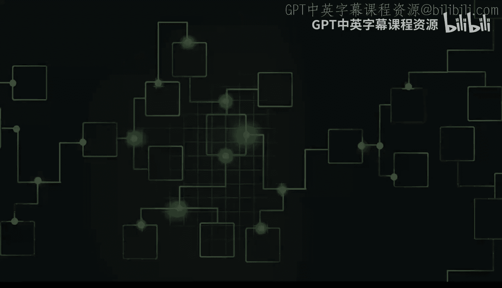
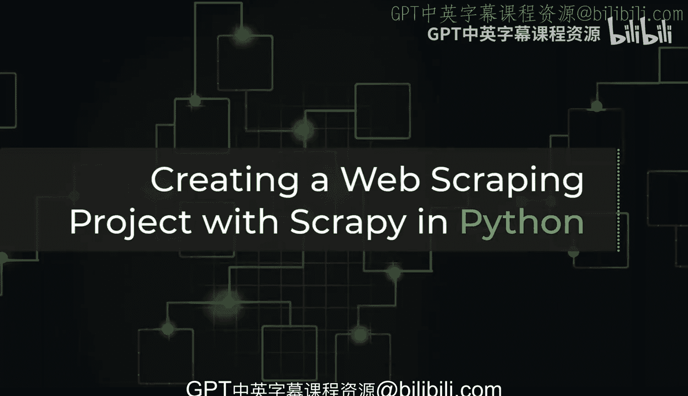
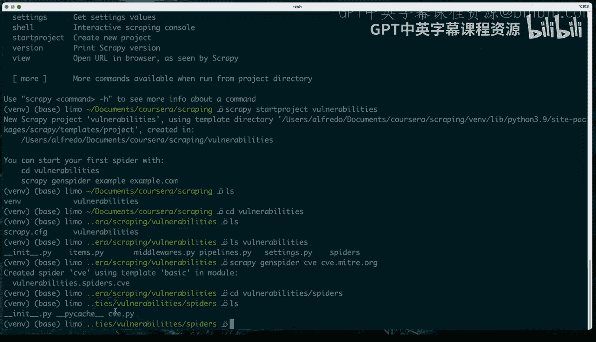
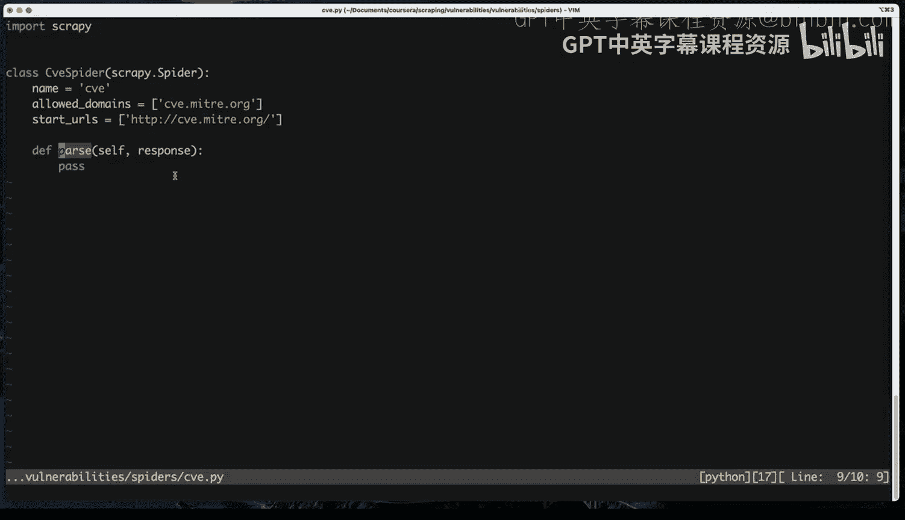
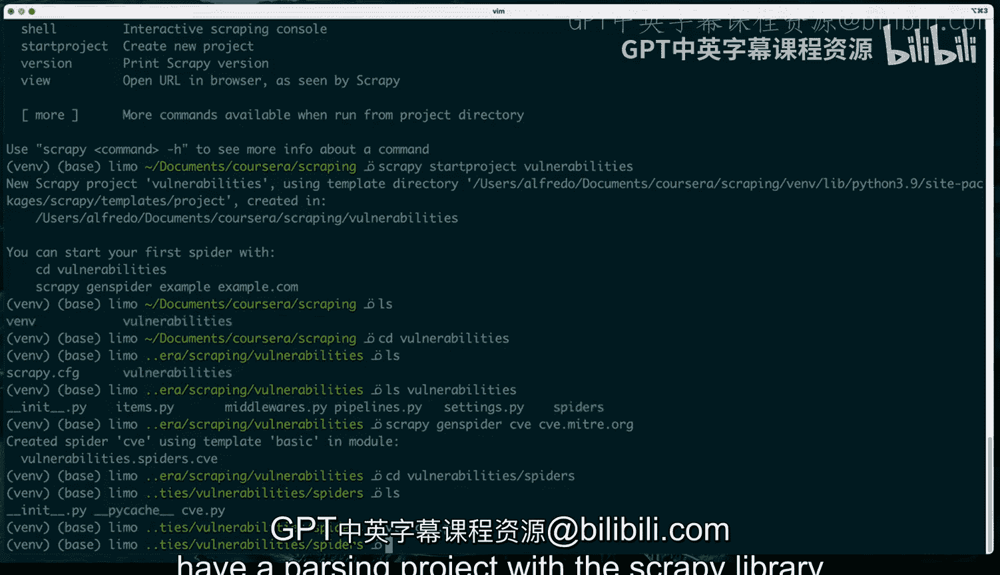

# 杜克大学｜Python、Bash和SQL数据工程基础2-4Python Bash and SQL Essentials for Data Engineering p108 41_03_03_使用Scrapy在Python中创建网络爬虫项目.zh_en -BV1XS421X7tw_p108-

There are a couple of components when trying to use scrappy when you want to actually start scraping a website to create a project。

 so I have my terminal open here and we're going to see what those steps to get started are so this is an empty directory in my documents directory。

 I have an empty nested directory here， and the first thing I'm going to do is I'm going to create a virtual environment。

 so I'm going to do Python 3 dash M。VM which is the virtual environment module and I'm going to create a virtual environment in the VM directory so this is going to create a directory called VM and next I'm going to activate that so it is source VM bin activate and then I'm going to do which PP because I want to make sure that PIP is coming from the virtual environment and indeed it is coming from the VM bin PP。

A pathath， so I'm going to use that to install scrappy so first thing install the scrappy project and I'm going to do that with Pip install scrappy and then we collect all of the necessary libraries and it will pull them up。

 install them in the virtual environment and that will allow me to have a separate isolated directory with everything that I need to run the scrappy project。

Now， scrappy has several different。Libras Inencies and you might be wondering why does it need all of those things so you can see things like LXML and then twisted over here。

And it does that because it's a fully fledged framework。

 unlike any of the other libraries that we've already seen like HTML parser that comes in the Python Standard Library。

 Scpy has multiple different features。Next up we're going to create a project。

 so by now if we do which scrappy， we should have an executable in our path called Scpy。

And doing scrappy dash dash help should produce a full flged help menu from the two。

 It has a few different subcoms that we can use and in this case we are going to start with start project So the start project is pretty pretty useful because you will it has the scaffolding that will allow us to create everything that we need to create a project。

 So let's just run that in the only one requirement。

Is that we need to pass in a name is the as the argument。 So let's do scrappy， start project。

 and then we'll pick a name。 In this case， I want to parse a website that has Is that are called CVs。

 So as a generic thing I'm going to call these。I'm going to call these well CVs are vulnerabilities。

 I'm going to call these vulnerabilities。So that's going to be my project and Scpy is going to create this directory for me as you can see in the output and now now it tells us like very useful it tells us like you can start your first spider with C vulnerabilities Scpy genpider example example do co So what is going on there what does this really mean well if I do a less you can see well I have my virtual environment on the left and then next to it is vulnerabilities So let me change directories to vulnerabilities。

And it's generated a scrappy C ofG， which is a configuration file and then a vulnerabilities directory a nested vulnerabilities directory that has a Python files and some other settings。

 What does the spider， What does the gen spider mean It means that we'll create something within the project that will help us do the scraping。

 So let's generate that and see what happens。 The one requirement is that we need to be within the project itself In this case the project is vulnerabilities。

 So I am going to do scrappy gen gen spider。And there's two arguments that we need to pass in first is the name of the spider in this case I'm going to call the spider CVE which which is the name for these vulnerabilities to identify the vulnerabilities and then what the domain name is in that case it's CVE that might thatorg this is not super relevant at the moment and you can change this setting later but what this does is restricts the request when you're setting a multiple requests what domains are or these requests are going to go through so what you need to do is run scrappy Gen spider the name of the spider and then the domain that it should go and then I're going to run that and it tells you that it has successfully created a spider CVE using template basic in module。

Vulnerability spiderid C。 So if I go into vulnerabilities and spiders。And I list the contents。

 you will see a CBE D Pi and that CVE Dpi will have a very basic class with a single method called PARS。

 that is everything that we need to get started with Scpy and that is how you set up the initial scaffolding to have a parsing project with the Scpy library。

