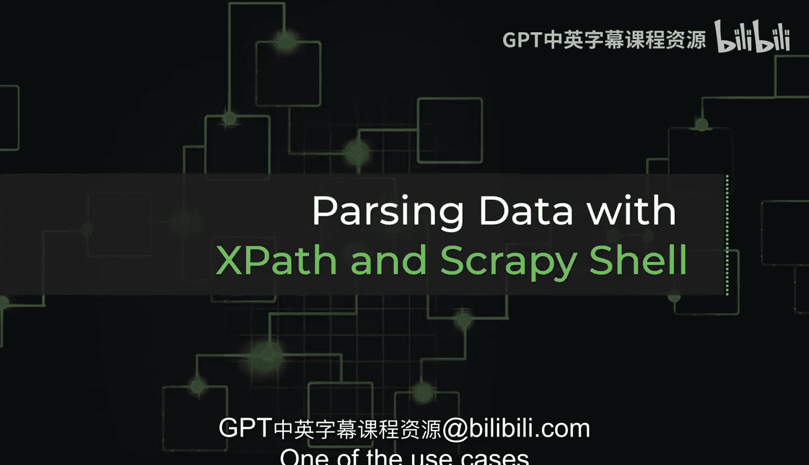
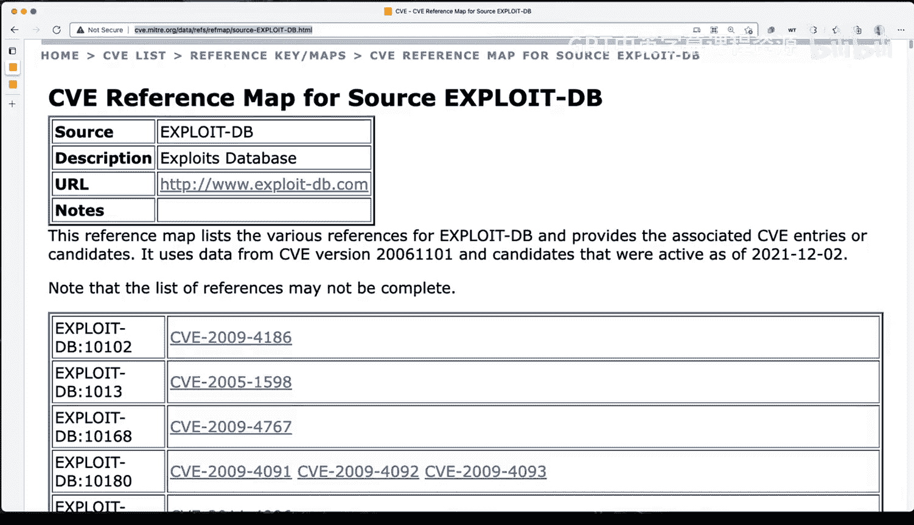
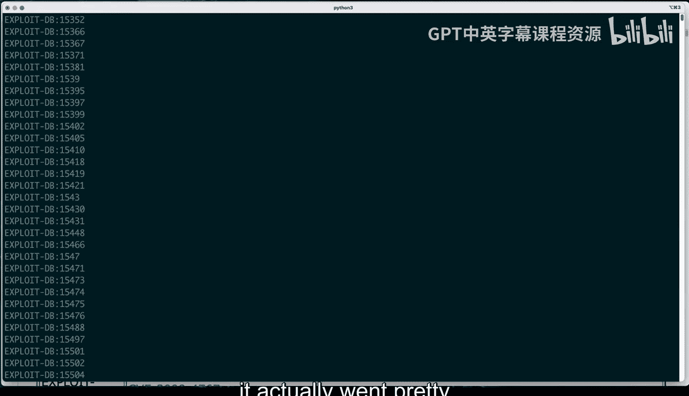

# 杜克大学｜Python、Bash和SQL数据工程基础2-4Python Bash and SQL Essentials for Data Engineering p109 42_03_04_使用XPath与Scrapy Shell解析数据.zh_en -BV1XS421X7tw_p109-

One of the use cases that is pretty common when parsing or scraping data from a website is that we don't have an API to retrieve information from this is a pretty common use case and in this case we have the CV miter。

org which is a government website that exposes common vulnerabilities that are being reported and what we can do here is that there is a reference map that means that every single CVE has in this website has an exploit DB ID associated with it so the business requirement what we want to try to do here to is to try to parse these data out。

 extract this data out so how we're going to do this what we've identify what's the target URL in this case is a single URL next we need to look at the source。

So the source is a highly unstructured HTML， this is very rough HTML。

That we have here and what we need to do is to identify where it's the data that we want。

 So if I scroll all the way up here that you can see that there's a lot of extra information that we we don't care about。

And things start getting interesting inside the tables。So in here we have a table。

 it doesn't have a class， it doesn't have an ID， so this will prove problematic later when we try to identify what's the table that we want to work with and what we want to do is go through every single row and start extracting the data that is between those rows in this case the exploit DVID and the CVE So that is going to allow us to have a rough idea of what's going on So now that we have that we're going to go back here。

 we're going to copy the URL and then we're going to go and open up the terminal once again and then we're going to use one of this features from Scpy which is called a scrappy shell Scpy shell is an interactive shell that will allow you to try and do several things interact track with a scraping a website。

So the one requirement is that we need to pass in the full URLs so in this case it' the URL that we wanted and we're going to hit return and now we get a lot of output and we have several things that are available we can have fetch and show the help and build the response so in this case if I type in response we'll see that we have an HTTP 200 and we are ready to start spell on inside that data object is basically a data object。

We're going to be using Xpath to try and see what's going on and here we're going to be able to access the X path properties by using strings passed into X path so we know we want to use a table so by using double slash table it means keep me every single table that you find in this document。

 so we see the response is that it gets it's a list with several different items let's check let's check the length of。

Of those elements that are being returned and we're getting five items。

 That means that we're getting five tables within the document and we need to extract the one table that has many different rows。

 How we're going to do that well。Theres several different ways。

 one approach is to go one by one and check if one of those has like several different items。So。

We can we can do something like these， which is the first item。No。

 that doesn't have that doesn't have length。 So what we can do here is， I think iss X path， T R。

And then allright， so that's the first， so that's the first item。

 And what we can do is you can see there that there's 10851 items there。

 but that's for every single table。 So what we can do here is we can loop。We can。

 we can try and do these。 we're going to retrieve the first item。

That's the that's the first that's the first table so we can do the second table and so on and so forth。

 So once we。Once we do that， we can say。X path and then。DR。And then we get a few items there。

 so we can check the length of the TR， which means table row。

And here for for the first for the first or the second item， that's index of1。

 we have three of index0， we have three of index2， we have four。And for index 3， we have 10839 items。

 So that tells us that these guy here， the response， that X path slash s table。

 meaning every single table， the third table in that response。

 that has all of the items that we want。 I know that that's the one that we need。 So I am going to。

Assign these to a variable。 So I don't need to type all of that。

 So I'm going to say table equals response that X path。Slash dash stable and the third item there。

And that's the table that we want to work with。 So if I do length of table that X path to ensure that I have really the right one。

 Yes， indeed， it's the 10839 item1。 So next， what we want to be doing is that we want to。

Loop over every single row in that table row。We have we have the table and there's a couple of things that we can do to extract what we want。

 but before we loop， we need to identify some of the items within this collection if I type in table we'll see that we'll just get us a lecture。

So let's do。Let's do table。And then X bath。And let's find every single table row。

And that's going to produce a lot of a lot of items。 but let's just find。

Let's just pick one at random let's say like the 110th item here and we're going to call these a child so a child item there now we can see that there's some exploit TV here and what I did was basically from all of those items that we just got up here I'm going to select just one of them and I'm going to assign that to a variable and then that variable I'm going to run another X path call here and we can do something like table data which is TV and I want to call the text the text function inside the X path and we can say。

We can do that and that basically brings up a list of items here that extracted all of the text。

So we can say give me the the first item there and then called extract which is a scrappy helper function here and if we do that we get the exploit DV10102 which is the ID of the exploit DV so that is pretty useful but we need to also find what's the CVveEI so let's try with the second item there that doesn't come up with anything how about the third item there and there we go we're getting now the CVE so if we were to loop over all of this items remember I just picked index of 10th so that's the 11th item we can do something like for we can create a loop effectively and this is still in the interactive shell4 row in table that X path。

Slash T R。 we can do。嗯。We can say。You can print。We can print。Re。That X path。

 we're going to call X path again， I we'm going to say table data and we're going to extract the text。

And。We are going to use the index of 0 and then extract。

 So we're going to try and do all of that and see what happens。 And I think I forgot to。Close one。

Band stare。We'm gonna see。There we go。 So you have to。

 this is one of the tricky things of the shell is that you， you must be aware that you have to。

Be able to close your parentss。Otherwise， you can get into a syntax hair。There we go。

 so now we're getting into a little bit of trouble because now we are getting with an index error list list index out of range。

 so in this case what we need to do is we need to do a try accept。

We're going to have four spaces here。So when I do try。And then we're going to try to print this out。

And we're going to say accept。Except。We can say， index here。And we're going to pass。

Because we're not interested in that and that basically populates all of the exploit DVs that we want。

 there's several thousand ones you can see here that this was pretty exhaustive。

 my terminal is full of them and it actually went pretty much over the limit of what we wanted to do。

