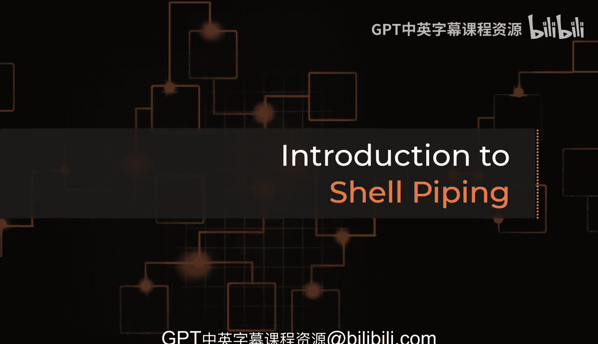
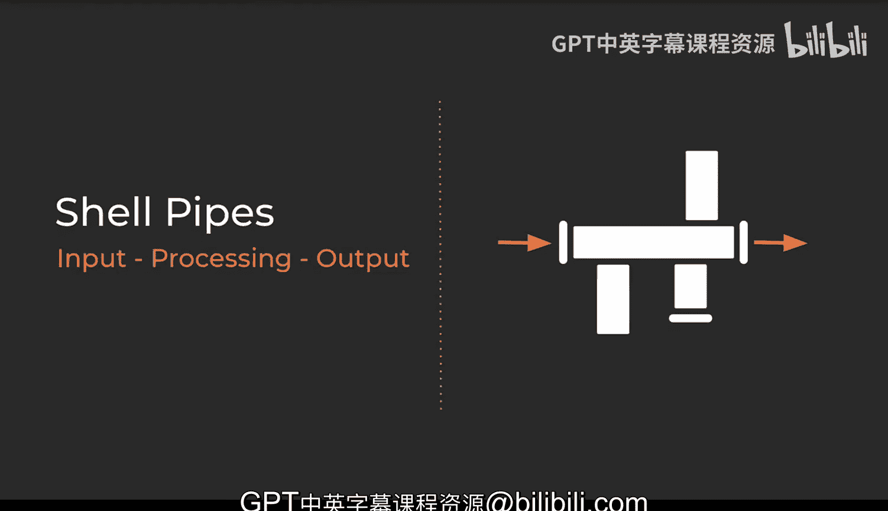

# 杜克大学｜Python、Bash和SQL数据工程基础2-4Python Bash and SQL Essentials for Data Engineering p11 11_01_02_Shell管道入门.zh_en -BV1XS421X7tw_p11-

How shell piping works， really it's a series of tubes where you have data that comes in。

 you process the data and you send it back out。So let's talk through the objective for this lesson。

First， what is shell piping？Again， as we talked about， it's a series of tubes。

 you're processing data， or you're accepting data。We'll also talk about the mechanics of how shell piping works in practice。

 so if you're going to look at a file and you're going to pull down some text from that file and count the number of lines。

 we'll walk through how to do that。Finally， when we go through the shell piping examples。

 we'll be able to see how you can actually format your code to work well with built-in Unix utilities and we'll have a series of examples that make you a master of shell piping in a nutshell shell pipes at the simplest level are about input processing and output there's a lot like the water in your house where youre actually accepting the water。

 putting it to the dishwasher， processing it and sending it back out to treatment so when we start this lesson with shell pipes remember this concept of a series of tubes。

