# 杜克大学｜Python、Bash和SQL数据工程基础2-4Python Bash and SQL Essentials for Data Engineering p110 43_03_05_使用Scrapy Spider进行网络爬虫.zh_en -BV1XS421X7tw_p110-

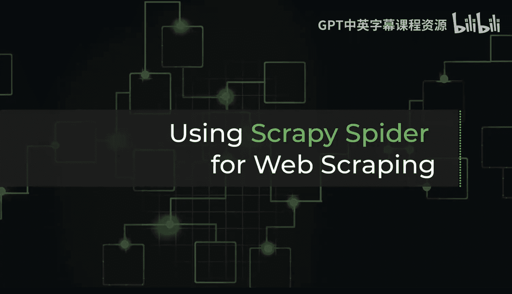

So why is this useful， well， it is useful because now what we can do is exit out of here。

And then go to the CVE。

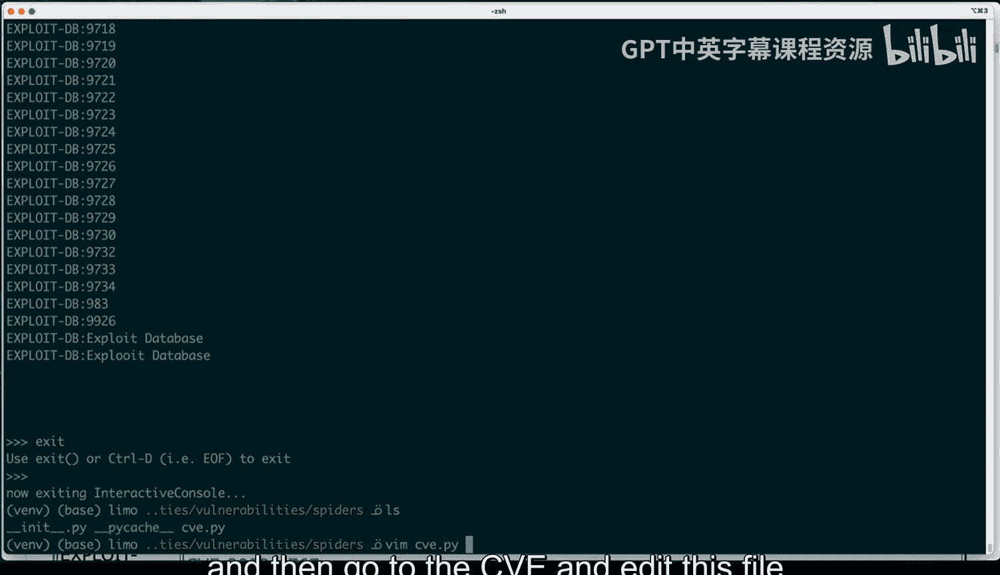

And edit， edit this file， which is the CVE spider， and then this response inside the parse method is effectively the same thing。

 So what we can do there is ty in the same the same answer that we had or the sync code that we had before so we can say。

That that we can say， for example， for child in response， that X path in slash s table。

And then Eve a land of child， that X bath。It's TR here。

It's larger than say 100 items then table equals child。

And then we can break out of that loop over there and now that we have a table。

 we can save for row in table X path again， we can look for every single table row。

And we can try to print the row that X path。And we're going to say TV， which is table data。

 the text function inside of X path， and then the first item。

 and then we're going to call extract and then we're going to lease and then accept。

Index error because we can get an index error if there's nothing there to extract we're going to pass and then we're going to remove that so that should give us something that we can we can actually we can actually use so now that these CVE spider is ready to go we can try and run it so we're going to rightqui that this is effectively what we used in the shell。

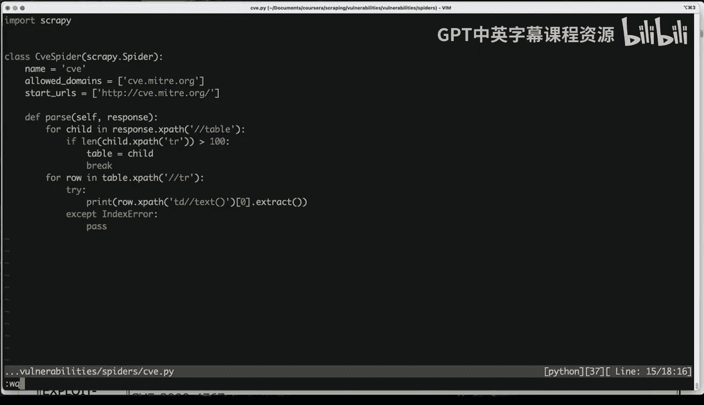

And。What we are going to be doing here is I'm going to go one directory up。

 and then we're going to call scrappy。嗯。Scrapy help and Scpy Help。

 the help menu will have more available commands when you are within a project。So in this case。

 we want to run a spider。And we're going to say。嗯。Actually。

 one thing that we we forgot to do is to specify the one URL。

 So you can see here that we have star URLs。

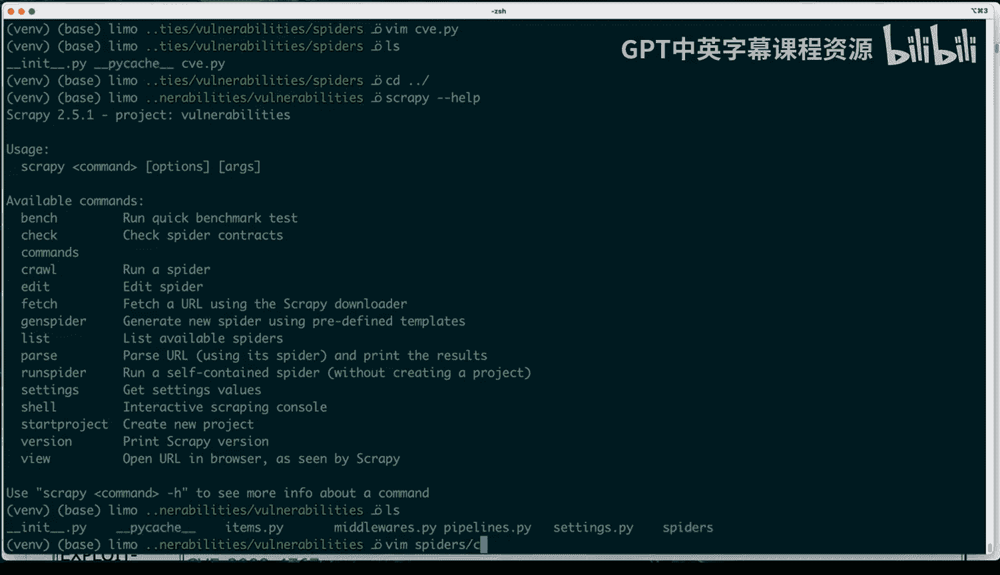

In line number seven， what we want is to actually have the full URL from our website。

 so we need to go here， grab these URL and then and then go back to the terminal and say actually the star URL。

 which is basically all of the URLls that we're going to be doing。

 we're going to be working with in this case it's just one so we're going to work with that so these are all of the available commands and now that we've edited the file with the URL that we want we want to run the spider so we have the spider we have a name the name is CVE so I'm going to clear out of here and I'm going to do a crawl so I'm going to say scrappy crawl CVE and that should be able to find there was a lot of output and it went really fast but I'm going to scroll。

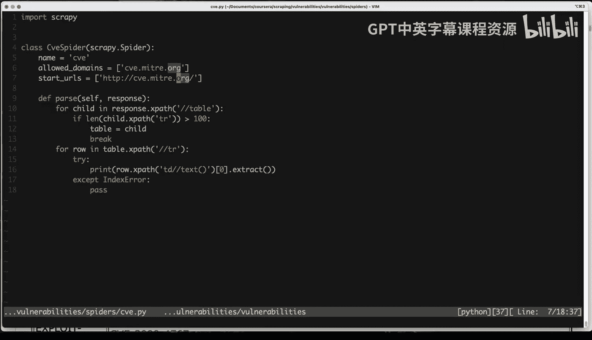

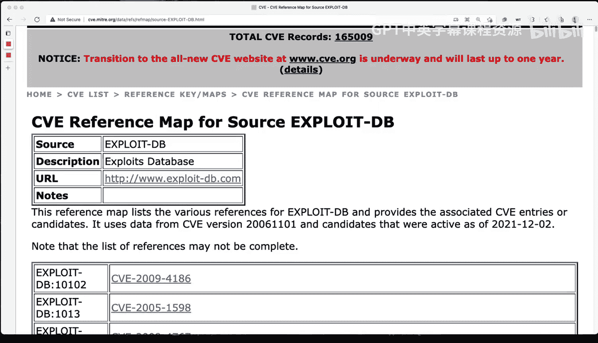

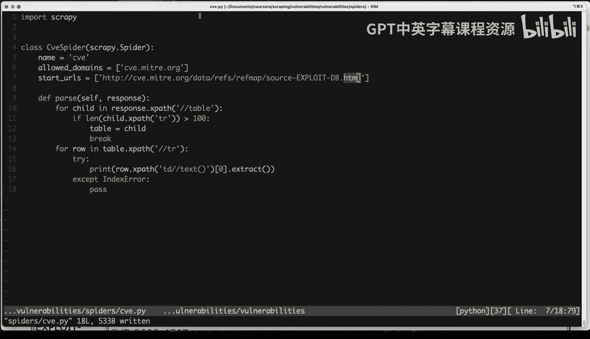

Back up so that you can see what's going on。 So you can see here my exploit D V I。

 which is what I'm printing。But it doesn't really show what I typed in the beginning。

 unfortunately this is scrolls all the way beyond the terminal scroll that I have， but what I did。

What I did was the scrappy crawl CVE that created that created a request that went all over to our website。

 which is the exploit dashB Hm on the CV thatmire。org and。

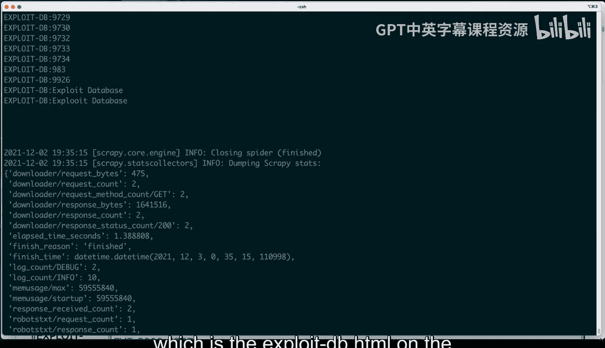

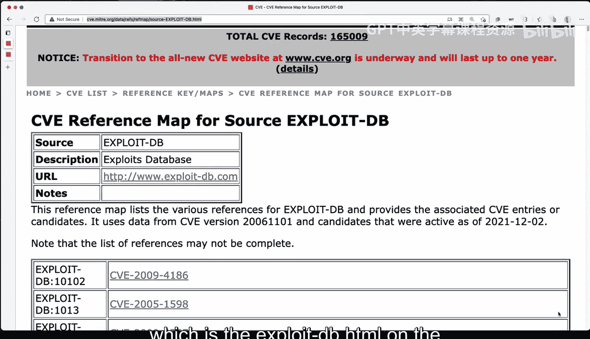

Once that data came in it parsed using our CVE spider now why CVE Because if you remember if I go to spiders and look at CVE that pi the name the name of the spider is called CVE。

 this is what we defined and why is it printing every single exploit DVID is because the parse method is being executed。

 now this is how you extract data， this is how you use a parsing using parsing method using X path。

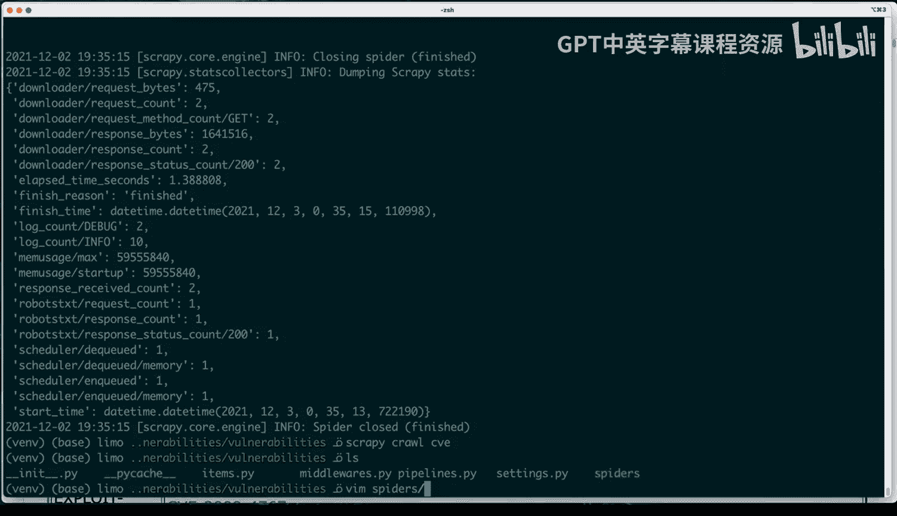

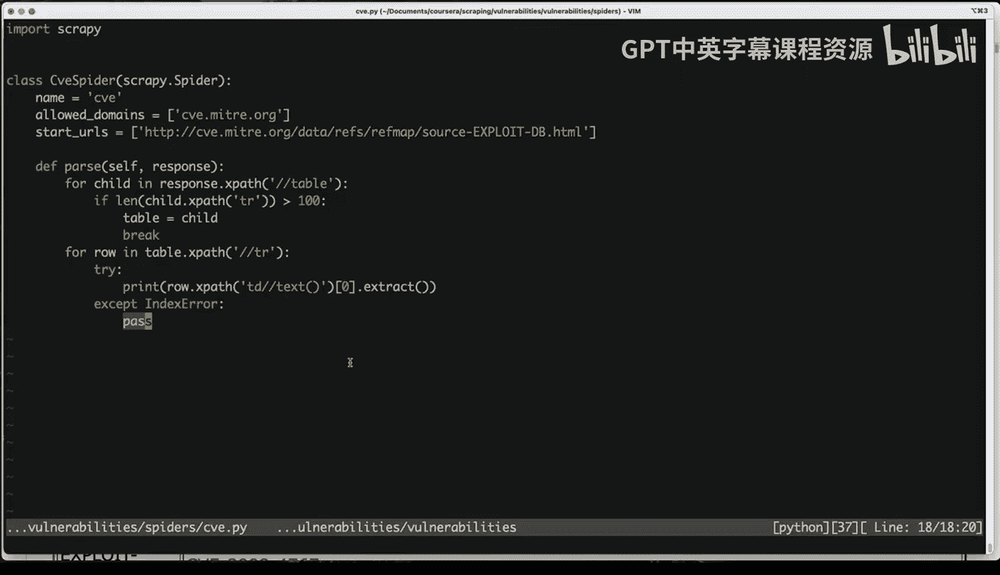