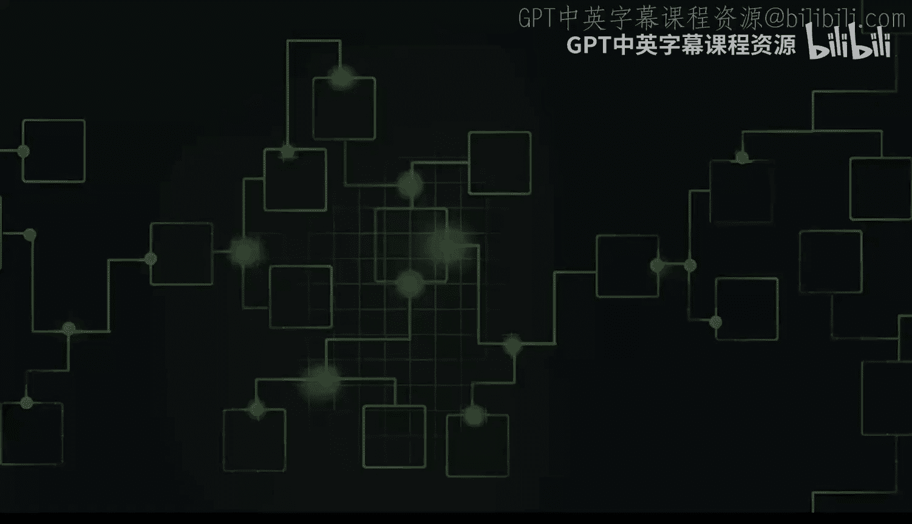
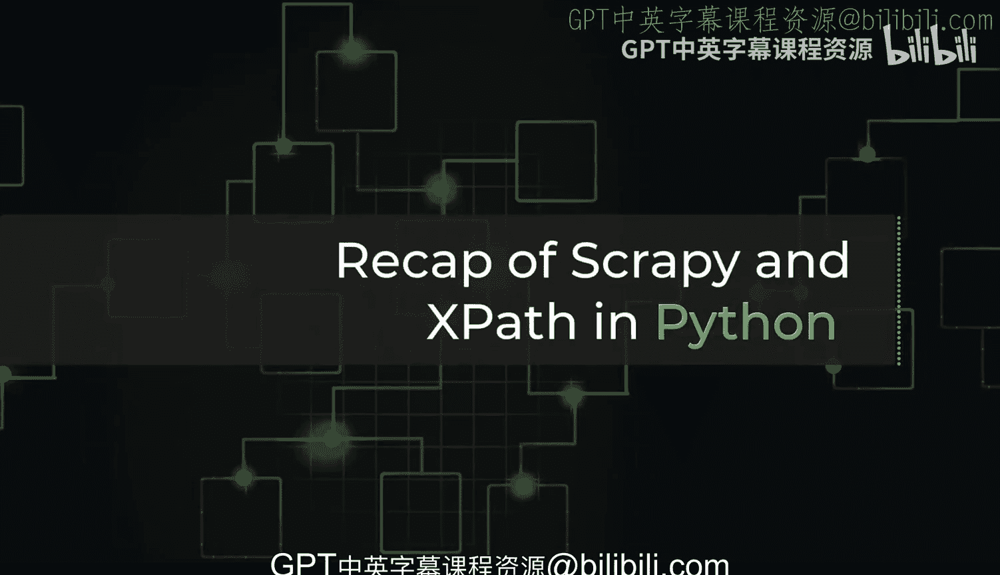

# 杜克大学｜Python、Bash和SQL数据工程基础2-4Python Bash and SQL Essentials for Data Engineering p111 44_03_07_Scrapy与XPath在Python中的回顾.zh_en -BV1XS421X7tw_p111-

In this lesson， we were able to create a project， installed Scpy。

 a powerful Python based library for scraping off data from websites and use some of the abilities of extracting data through XPAath。

To find data and extract that particular data。 So this should allow you to have a good idea on how to set up your environment。

To start scraping off data in particular， when data is not easily available through an API。

