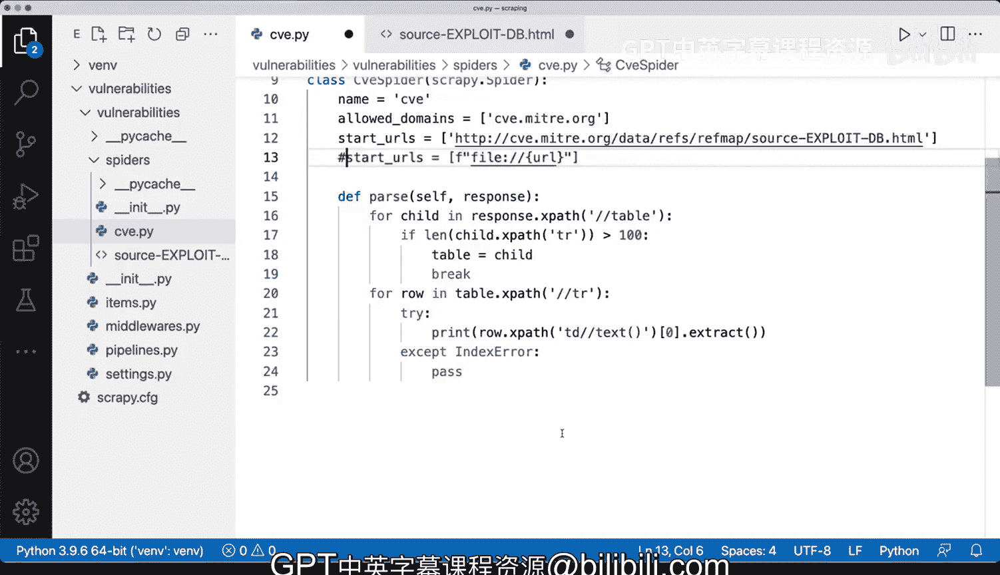

# 杜克大学｜Python、Bash和SQL数据工程基础2-4Python Bash and SQL Essentials for Data Engineering p113 46_03_03_本地爬取实践.zh_en -BV1XS421X7tw_p113-

Previously we've created this vulnerability scanningning project and we have the vulnerability scanning project right here with Scpy and we have our spider let's revisit our spider for crawling and retrieving these vulnerability information from this website that publishes the information that we need so that's right right here and you can see that the star URL is basically what defines where the spider is going to start doing its work online number seven it's a full fleshed out URL What does this mean it means that whenever this gets started it will go and reach out to this website Now that might not feel like a big deal if you're just reaching out to this website and retrieving information that's fine What if it was 1 thousand web。

What if you're trying to test out？Reaching out to several different websites and extracting hundreds of gigabytes in information。

 Well that starts becoming very process intensive。 One way to mitigate these is by pre downloadloading the HTMLm。

 this will allow you for several different things that are useful you can test it out。

 you can make changes and and you can be able to code more defensively here in the parsing method。

 you can see we're already getting some index errors but every time we run this again。

 we are hitting that live website we're proing information from the live website basically tasking the website server that is providing that。

 So being a good citizen while trying to scrape some data is basically downloading these so that we can parse these locally So we're going to do that right now I'm going to use the shell but you can you can use anything really to download。

This URL， I'm going to use the commandpa lead and I'm going to toggle the terminal。And then。

 in the terminal。I'm going to basically go。All the way to the vulnerabilities project and then and then the spiders。

And then that's where the CV that P file lives， which is this file over here。And I am going to。

 I'm going to copy this URL and。And I'm going to use the W get command line utility to download it。

 And then again， you can use anything you want。This is fine and then we're going to hit return so it downloads that you could see it download it it's almost like a 1。

56 megabytes。 So imagine if you multiply these by even several dozen websites that would be tremendously expensive time wise and just as a reference we we can run these we can run these spider。

By using。Scrapy， C， CVE， and we can time it， how will we time it？So that will run the project。

And it takes almost two seconds so let's see that this again goes fetches information from the exploit D V HTML website。

 retrieves the data， parsees it， the parsing is fairly quickly but it's just the fetching and the processing and loading in memory that takes it all so what happens here is that we are going to we basically downloaded the the HTML which is right here。

And this is a raw HTML and you can see has several hundred lines long， it's almost2 megabytes。

 but we're going to adapt the CB thatp Pi file so that it loads from that file instead of going to the website what we're going to do is we're going to use the OS module So we'm going make some changes here and then from OS that path we' I import your name。

And I'll tell you why in a second we're going to want to provide a full absolute path towards this exploit DBHtml file that we just downloaded and we' going to start by defining the current directory。

So the current directory in Python， we do it with O step path and your name。

And' going to say it is thicker in file。 So these will give us the current directory for the that is defining in this file。

 the file is C pi， So that will give us the spiders directory。Next。

We want to join and make a full path towards these HTML file and' I to call the HTML file URL and then when I say oh。

 is that path that join？And we're gonna join the current directory with。Source。exploitloed。

Dash DB dot HM L。And then。We are going to。Said the top directory for for what we want to。

Well we're not going to set the top directory， I think with the current directory in the URL is going to be fine。

 but we need to define like the absolute URL right And so instead of start URLs being this very long HTML file now is' going to be this full path to the current directory in the exploit D right here。

 So we'm going to say。Instead of star URLs being this long URL， I'm going to comment that out。

I'm going say star URL is going to be。And this is， again。

 a feature of scrappy that allows us to use a files。 I'm going to use file， colon slash/ URL。

And so that will allow us to。Use the URL that is coming from here。

 which is not a URL is really like a full， full absolute path or that source exploit that DB that HTML。

 So let's just run run this once again。And I'm going to use the terminal。

And let's see and let's time it out and see what happens。

So now you can see was less than one second before and this is just all processing。

 Now things are being processed in the mostly in memoryory versus what we were doing before and just so that we can try that again we can go back up and use the real HTML and run it again and see how much slower is that So you know a little bit slower not like we probably are hitting some cache but that is fine as well the point here is that you can be very。

 very effective by downloading the HTML and processing it locally this is why it's so useful next you can also go here to the HTML and say you want to program more defensively prevent some errors you can make some changes here let's look at some of some of these items and you can test it out。

For example， what happens if you have another table row here and you save that file and you want to prevent a problem like that well you could test it out like if you're going to the live website you wouldn't be able to do that so this is a good technique to keep in mind right now the example is very simple we're just using one single HTML file but if you were processing several files you could you could definitely code more efficiently and definitely get results much。

 much faster。

