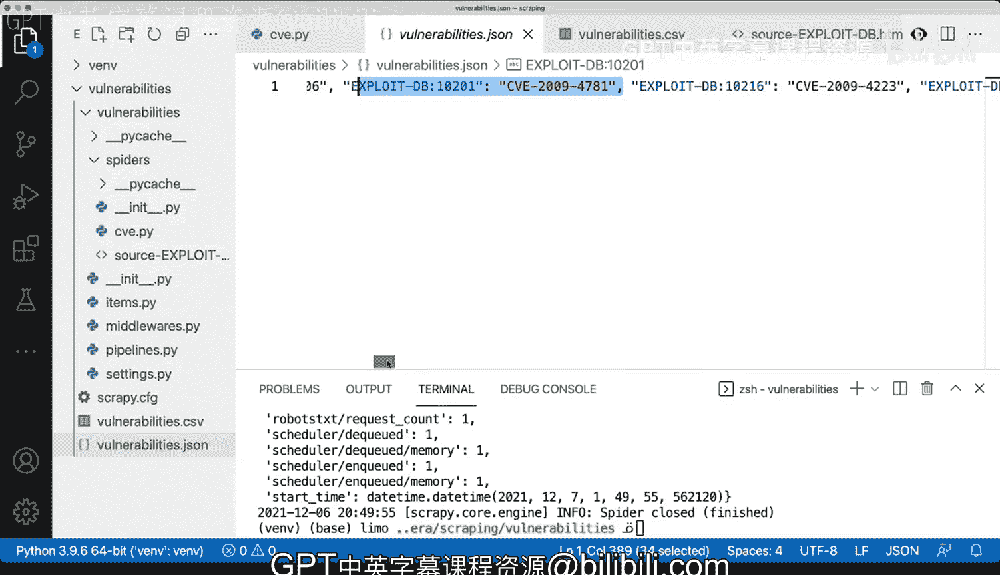

# 杜克大学｜Python、Bash和SQL数据工程基础2-4Python Bash and SQL Essentials for Data Engineering p114 47_03_04_数据持久化为CSV与JSON格式.zh_en -BV1XS421X7tw_p114-

There are a couple of ways that you can persist data once you have extracted that data from parsing or scraping from a website one of those ways which is a pretty popular format for data and data science in general is a CSB file。

 a comma separated value type of file， so back in our CE Py or Spyder here。

 we're going to be using the CB module from Python now you could do this with pandas。

 which is another popular library for interacting with CSB files as well as many other features。

 but for the sake of this example we're just going to use the Python standard library。

So let's import CSB here at the top and。To do these first we want to basically go here and find where in our code we're going to be opening a new CSB file and writing the information the part of the problem here is that we have a for loop。

And I've added a counter here on line 19 to not go overboard and we don't need to store thousands of entries right now for the example。

 so I'm going to break as soon as we hit 100 entries。

So if we were to open a file right here before the try block within the for loop。

 that would mean that the file would get overwritten every single iteration。

 so we want to be outside of the loop to open that file。Let's。

 let's define the CSB file over here on line 20。 and we're going to open。

A I'm going to call these vulnerabilities。嗯。It call these。Pities that CSB file。

 and we're going to use the the W， the W flag， which means we're going to open a file for writing。

Next， we're going to define a writer instance。 So a writer， it's a CSP writer， which will take in。

The C is B。File as an argument， So the open， the open file you can see here in the help menu。

 the file object Ar can be any object supports the file API。 In this case， that's the CSB file。

 which we've open already。Next， we want to write the the heaters。

 the like the main row for the heaters for each column In this case， we want to write two columns。

 One is going to be the exploit ID and the other one is the CV I and it's pretty straightforward to do that with the brighter module。

 It is right row。And then that right row is going to take an itable。 So we're going to use a list。

 and we're going to use exploit I D。And then， C， E， Ivy。

So that's the itable that's going to set set the CSB file for the writing。And。

Now we need to write every single row as we're processing。

 So we have here the exploit I D and the CB E I。 So right below it。We can。

Use our writer instance and use right row again。And we're going to use anitable in this case。

 when I say the exploit I， the bearable and the CV E I D。

And once once that is complete and once we're outside of that loop， we can close our open file。

 which was， you know， this is something that wouldn't happen if we were using a。

A context manager with Python， we're using the width open。File， then that would happen automatically。

 but since we're not using a context manager， we have to close it right here。

 So we're going to save that。And we're going to open a terminal。And in the terminalrill。

 I am just going to call scrappy crawl C， so I'm going to execute the spider and see what happens。

So I ran that and now we have a CSP file here。 Let me open that and see how that looks。 Well。

 it kind of looks like what I would expect except that we have several entries here that are full of empty space。

 but important options are important things to note here is that the first line is the exploit I and the CP I。

 So that's our header。And that's followed by several lines that do look correct。

 So there's some data sanitation that needs to be happening here。

 but for the most part we have which you have close to 100 entries that look correct。

 which will happen will have the exploit Db on the left followed by the CVE ID on the right。

 So that's one way to to do it， that's one way to persist to to cB file format。

Again useful because now you can tell that we have some problems here with our data that needs to be cleaned up on on the processing side。

 we need to do some checking， but next let's try and use Jason so we've used Jason in the past but not for persistent data and now we can do import Jason here at the very top so instead of using the CSB file we're going to start capturing the information as a dictionary。

So to do that， we are going to define an empty dictionary here， we're going to call it data。

And our data is going to be an empty dictionary。Instead of a CSB file。

 we are now going to have a JSO file， so let's just modify this line 22 here。

 we're no longer going to open a CSB vulnerabilities that CSB file。

 but a vulnerabilities is that JSON file。We're still going to use the W flag。

 which implies that we're going to be writing this file and is going to open open that file。

 a new file is just going to start writing data on it。

 we no longer need the writer instance or instantiation of that。

And then if we scroll here right here， what we want to do is we want to。Use our data variable。

 and I'm going to say。嗯。We're going to use our exploit ID as the key。

And then the value is going to be the CVE ID Now you can format or mangle the data in any way you want。

 I think this is pretty pretty good for the example that we're doing right here we no longer need to close the CSP file。

 we no longer have that， but we need to do something pretty important once the loop ends and the data is captured in line 21 we want to use the JON do dump method and when to dump the data and when I passing the JON file。

And once that completes， yes， we can tell the Json file to close and not leave an empty file or an open file descriptor here。

 So that would set us up for writing a vulnerabilities that JO file。 Let's see。

 let's see how that works once we run it here at the bottom running scrappy scroll CBE again。

 So we'm gonna to run that again and we we have now vulnerabilities that JO file。

 So let's just open that。 And again， we're seeing that well we're lucky to see now a new line character。

 That means that new line characters are being processed as data， which is not correct。

 But let me let me scroll here and see some CBE records and there you can see that these CB the exploit I and the CB。

ID are being respected as the key and the value respectively so that looks correct again。

 some data sanitation needs to happen， but this is effectively a fully functional JSON files So these are two ways that you can use to persist data while you are processing and you saw some of the problems that you may find and it is good so that you can be able to visualize some of the data you can extract extract it to CSB perhaps loaded in a Jupyter notebook and play around with the data and visualize it in similar with JON as well。

