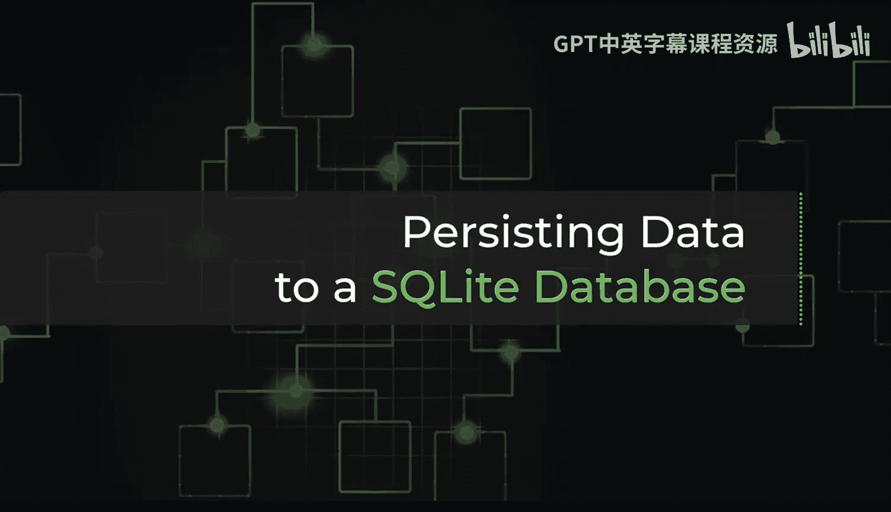
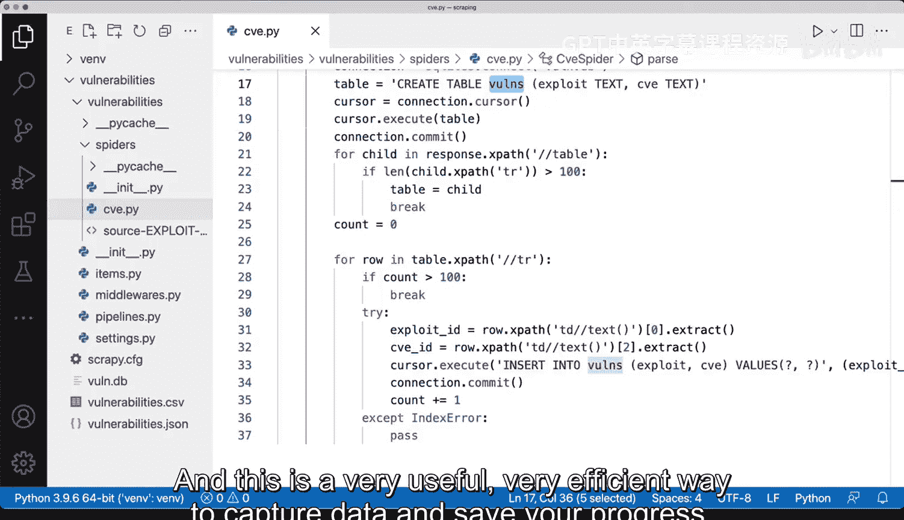

# 杜克大学｜Python、Bash和SQL数据工程基础2-4Python Bash and SQL Essentials for Data Engineering p115 48_03_05_数据持久化到SQLite数据库.zh_en -BV1XS421X7tw_p115-

Persisting data to a database is a really good and efficient way of saving your work as you make progress。

So one of the problems that we've seen with CSB and Jason is that you can't or you can。

 but it's really hard， really tricky， really difficult to keep up things and to keep making progress save your progress as youre work making producing information and gathering data so that is one of the things that persisting to a database solves so we're going to use SQL Li 3 instead of persisting to CSB and Jason just like we saw before and with SQL Li3 we're going to change some of the imports here one of the things that SQLI will give us is that will give us a fully fleshed out valid database to work with and we'll save it to a file although you can using memory we'll use a file in this case so normally you will have something that sets up that。

Database before your passing， but for sakes of。Getting this example fully flesheded out and working。

 we're just going to do it in the parts as a one off。So。

The first thing that we need to do is we need to create a connection。

So the connection is going to be using the SQL I3 module and when I do connect and use Bo that Db right there。

So that will create a file called Bo。 Db。Next， we need to create a table。

 so I'm going to write some SQL here。And again， this is something that perhaps you could do somewhere else。

 but for example is going to be good enough。 So create table booms and we' we're not going to define a primary primary ID for now。

 we're just going to define our exploit here， which is just going to be plain text and a CBE here with text as well。

Next， we're going to create our cursor， which comes from the connection that is going to allow us to execute some queries。

And the next thing we're going to do is execute。That table creation from the variable using using that line 17 variable called table。

So。Once this is executed， we're going to use the connection object to commit to commit that and。

This will create E created table for us in the database。

So once that's done we want to do some work that is going to start happening in the for loop here defining line 27 and what we want to do is start insert values into the database using the cursor and the connection to commit those insert statements as we're making progress so where are we going to be doing that。

 well just here once we defined that we have an exploit ID and a CVE ID。

 so in line 33 we are going to say。Cursor that execute any when I proceed to write an insert statement and insert sequel statement。

 So in a say， insert。Into bones。And we have exploit and CE。And then we're going to say values。

 And the way we do。The way we do this in SQL light。

 at least the API wants us to do these question marks。

That's like a safe way to do the value representation or interpolation once it's going to get replaced in there and we have to pass in here the actual variable。

 so it's going to be export ID and CVE underscore ID。And once that's done。

 we're going to say connection that commit。And I'm going to save that。

 So what is going to happen here is first on line 16。

 we're going to create a connection to the B Db that if the file exists it'll just open it。

 if it doesn't exist， it will create a new one。Next， we're defining the table SQL statement。

 will create a cursor and that will allow us to execute the table creation first。

 commit our SQL statement and then as we're making progress we are going to be able to insert the values that we're finding as exploit ID。

 and CE ID， so I'm going to save these， open the terminal。And run our scrappy Croll CBE command。

So we're going to run that and。We now see that we have a bone that Db filing here and we can actually use and you can see here's in the shell as well。

 we can use the sQL light3 tool to look into that file and see what we can find。

 So now we know that the table is called bones as defined here in line 17 so we can run a sQL statement and verify that our data is there so we can do select everything from。

Bs。And there we can see that we have our exploits and our exploit IDs and CBEIs basically very well persisted。

 so that is how you would roughly persist data as you're making progress and now you know why that might be a good idea。

 especially if you're processing several items and you want to keep track of what you're processing as you're making progress this is a very useful。

 very efficient way to capture data and save your progress。

