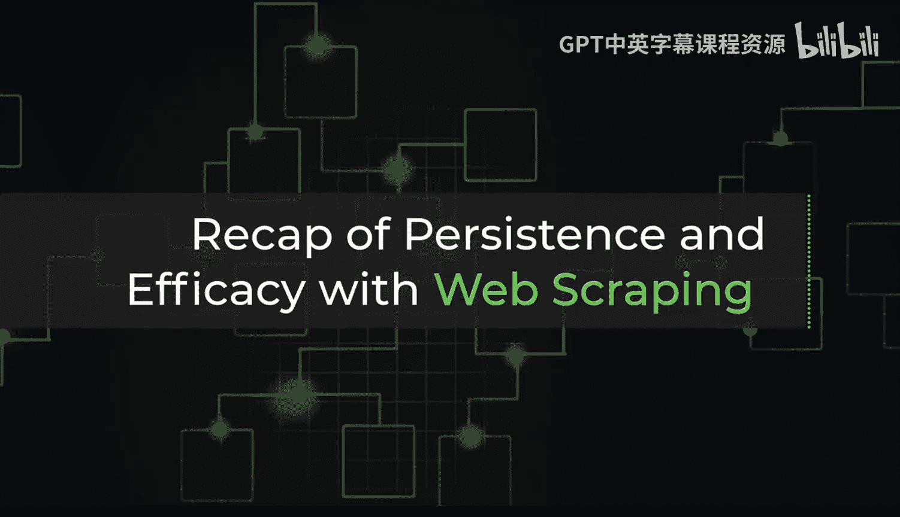

# 杜克大学｜Python、Bash和SQL数据工程基础2-4Python Bash and SQL Essentials for Data Engineering p116 49_03_07_网络爬虫持久化与效能回顾.zh_en -BV1XS421X7tw_p116-

In this lesson we've covered several techniques that you can use to identify some of the challenges when scraping data。

 some of those are how do you test or code defensively when things are changing in websites that you don't control。

 you can do that by persisting data into files locally so you can improve the speed and test stability of what you're parsing。

The other thing that you've learned in this lesson is persisting data。

 so as you're making progress as you're parsing websites， as you're extracting data。

 there are several different ways that you can persist that data either to a CB file to adjacent J file or even connecting to a database in this case we use SQLite but similar examples would work with other major databases this is very crucial because now you can be processing data。

 but also persist as you're making progress which is way more effective than waiting until the very end to save all of your progress at once。

