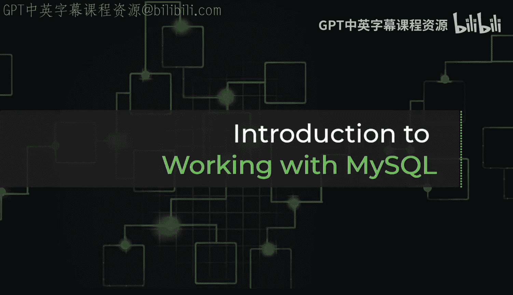

# 杜克大学｜Python、Bash和SQL数据工程基础2-4Python Bash and SQL Essentials for Data Engineering p117 50_04_02_MySQL数据库操作入门.zh_en -BV1XS421X7tw_p117-

This week， you will learn how to use VS code， a modern development environment。

I'll cover everything you need to know to connect to a MySQL database server from VS code。

 and you will be able to execute queries and perform database operations。Finally。

 I'll go through some strategies you can use to load。

 extract and migrate data from databases like MySQL。

