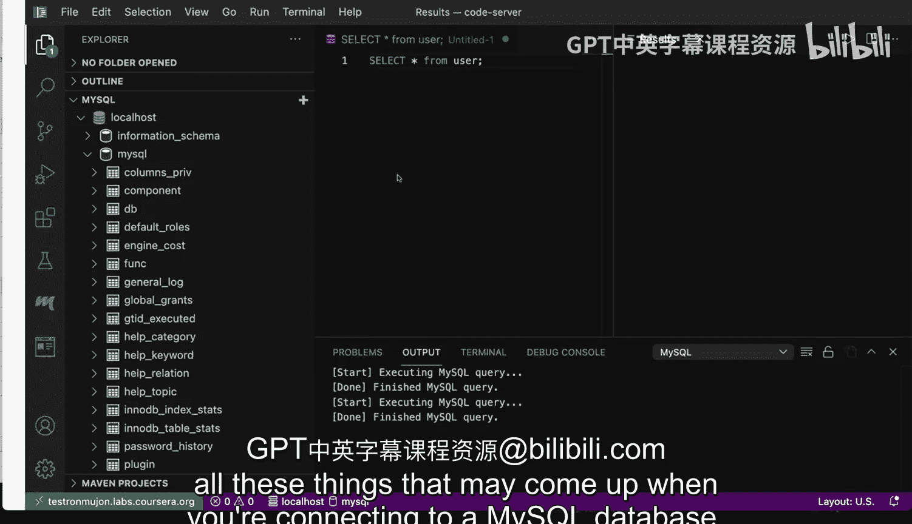

# 杜克大学｜Python、Bash和SQL数据工程基础2-4Python Bash and SQL Essentials for Data Engineering p119 52_04_04_连接MySQL服务器.zh_en -BV1XS421X7tw_p119-

So right here we have one of the labs running in Coursera and what we're going to do is use the VS code on the browser to kind of like work ourselves around this connection to MysQL what you will see is a fully flesheded out VS code text data but in reality this should work very similar if not identical as if you were running VS code locally on your computer。

 there will be some similarities and we'll see how that looks So once you open the lab。

 this is kind of like what you will see。And。This is fairly disruptive because it's like a new environment。

 there are things that are already set up for you， but it's not entirely clear what those are so a quick thing that we can do is check the extensions here on the left and let's look for MySQL。

So I'm going to start doinging my SQL， typing my SQL here。And what we have is this one right here。

 it's a management tool， you can install it as well if you have VS code locally。

And it allows us to do several different things we can list my SQL servers。

 databases tables columns and run queries， this is very powerful and it's already pre-installed here so if this wasn't installed you would be coming here and installing it right there from the extension tab。

Now we know it's install pit。 it's not， again， it's not very clear how to work with it。

 So let's go back here to the file Exper。And you will see that。

 although the open folder in the Cl repository。are kind of like the main the main things that you can see here。

 if we minimize these view by clicking here on the Carrot， you'll see that there's a MySQL option。

 let's close this extension MySQL here very quickly so that it's not distracting and we're going to click on MySQL and you'll see that there's nothing showing up well we need to connect to MySQL database and we're going to achieve that by clicking this a little plus button that effectively allows us to create a connection。

Now， there are a few things that you need to add a connection or to create a connection to a database and we will get some prompts。

The first thing is the host name of the database。 Now， in this case。

 the database is living in local hosts。 It's the same machine。

 but if you were connecting to a remote MysqL database。

 that could effectively be an IP or a FqDN a fully qualified domain name。

 So let's type in here local host。And then hitd return and then we'll get another prompt we need the Mysql user to authenticate in this case。

 we're going to authenticate as the root user。Ideally。

 you will have a particular user for a production database that has permissions restricted just to the things that you need to do。

 In this case， it's fine because we're just learning and we want to have all the permissions available。

 So we're going to use route right here and hit return。And again， ideally。

 you would have like a very secure password。But in this case。

 this is just a test database that does not have a password for the root user。

 This is fairly uncommon in a production environment and actually I would highly advise you always set a very strong password and allow connections just for certain in particular two particular destinations from particular sources so in this case this is just local host and is running in a lab so this is not really a matter of concern so I'm gonna hit return once again and it prepopulates a 3306 which is the default MysqL port and that means that we can connect we can use that port that default port to connect to the MysQL database this is again normal but if if it was something different then you have the option to change it here so we'm gonna hit return once more and finally we're gonna get a prompt for a certificate。

File path。 So this is optional。 Sometimes you have a connection to a Mysql database that is encrypted with SSL。

 And in that case， you will need to provide a particular certificate for the SSL connection。

 In this case， we're not using SSL。 Our connection is not encrypted。

 So we're going to leave these alone。So we click return there and now you can see that we have local host right here it appears sometimes if you have like a problem connecting once you click the carrot。

 you will see that there's an error string， let's see we get an error string or we get something else。

So no error string and we're getting four databases。

 these are the default databases that you will see once you connect to a brand new or empty。Database。

 My SQL database。Now。That is how you connect to a MySQL database。

 but other than that we can try really quickly and see if we can run some queries the first thing that you can you can do is select one of these databases on the left we can try MySQL you can see that once I click on the cart we' see all of the tables that are available but we can run a new que so I'm going to right click and this little menu will show up and a new query will effectively create a new file。

So here we want to do a select statement。Select everything from user。

And then you might you might feel tempted to use this little play button here。

 which is usually the thing that you would click to run some code。

 but you shouldn't do this because it doesn't do anything you will get an error。

 let's try that really quickly code language not supported or the fine。

 so unfortunately that's not a way how you run queries from VS code。

 you need to run something else to run the query， so what you need to do is you need to use the command pull that。

嗯。To use the command pullette， you can go to the view menu here and use command pullette in this case is shift command P for me since I'm on a Mac。

 but it might be something different for you。 So if I do that then this opens up so。

To run that query， I can just click on run My SQL query。And it will run。

 And you can see executing My SQL query， finish my SQL query。 And then you will get， you will get。

 you will get some results right here。 So that is， that is kind of like how you would。

You would you would run you would run some some query and and get get some some output in this case。

 the results are not very good， but if you wanted to look at the user table you can see some some of the things there that are available for us so this is very useful a few things that you have to keep in mind the username。

 the password， the ports， the connection stream， the connection type and you need to。嗯。

You need to be aware of all of these differences and all of these things that may come up when you're connecting to a MySQL database。

