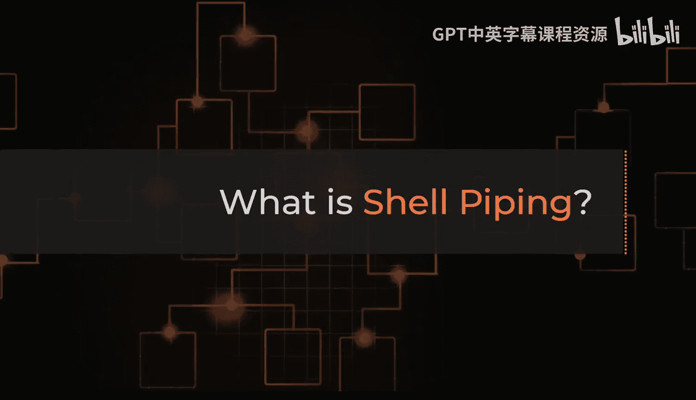
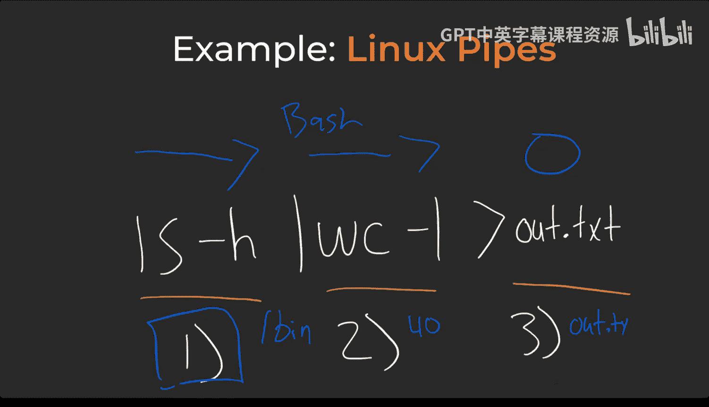

# 杜克大学｜Python、Bash和SQL数据工程基础2-4Python Bash and SQL Essentials for Data Engineering p12 12_01_03_什么是Shell管道.zh_en -BV1XS421X7tw_p12-

Let's talk through the concept of pipes。 This is really one of the foundational ways to understand bash piping is to think about other paradigms。

 A good example is your house。 And in this example here， you can see that the city water。

Is where people get things for drinking water， they get things for the appliances in their house。

 and if you think about this， it's not possible to do advanced things in your house like dishwasher or washing clothes taking a shower that's heated without this core input here of the city water。

 likewise when you're building a bass script， you need this input。

 this input is critical so that you're able to have something that you're going to do a transaction with。

Next up here， we have the processing phase。 So in this particular example。

 I'm looking at a dishwasher again， it could be anything from a shower to potentially washing clothes or a spa or a pool or whatever it is you're doing and this is the processing phase。

 And so what's important again with bash piping is that you'll usually put something into a process and manipulate it like you know translate something。

 reverse the characters， extract certain key phrases， Finally。We've got the sewer phase here。

 which is the output in this particular example after the dishes are cleaned。

 you want that water that's got food in it to go out to the sewage system so it can be treated and really this as a similar concept instead of the sewer system potentially you could write it out in the ba scenario to output。

 TxT or if we want to have a more closely line example， this could be something like dev Noll。

 which is very common。To pipe out something where you don't want to see the results of it， so very。

 very similar concepts to your house and bash biping。

Let's now follow that paradigm that we just talked about with the house and the pipes and look at this particular example here。

 which is a command LS H and notice that I list the contents of some files in a directory Now what I do is I pipe things into this next section so this is the start right here this is process one process two is I would then count the number of entries that appear in a directory so imagine that I'm in the bin directory for example and inside that bin directory there's potentially 40 different utilities if I pipe all of those entries into this command word count dash L。

It would actually return back 40 and so that result here would be a result that I could then process further and in the example here。

 we see that potentially it would be an outfil TxT and what's great about that in this particular example is that I could then give those results to somebody else。

 maybe I could email those results or process it somehow via maybe a text message or whatever it is I'm going to do this pipeing concept in bash is really very very similar again to the water that comes into your house you put it into the dishwasher。

 it clean some things and it puts it out somewhere else so once you understand this concept really it's easy to build sophisticated tools with bash pipelines。

