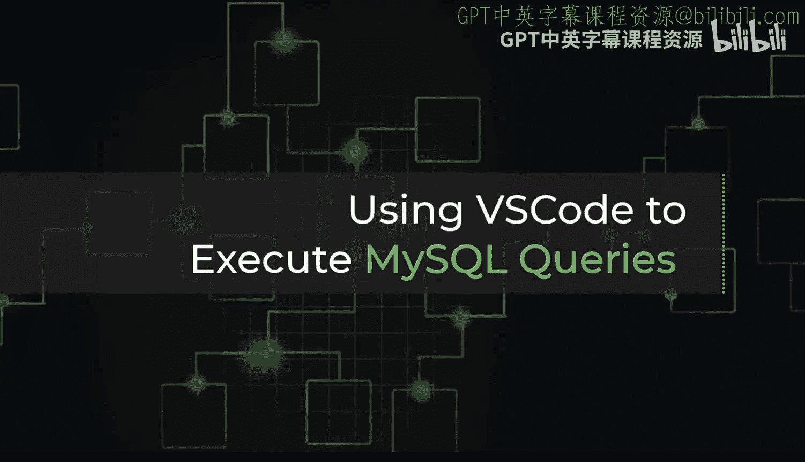
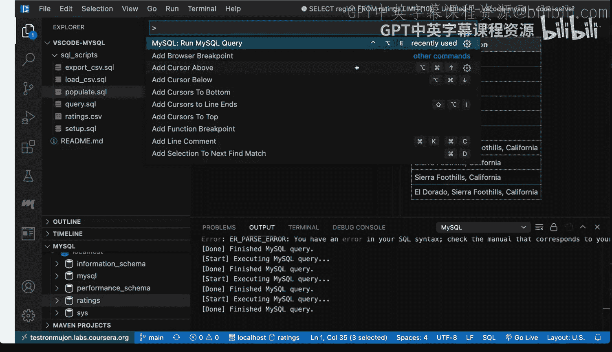
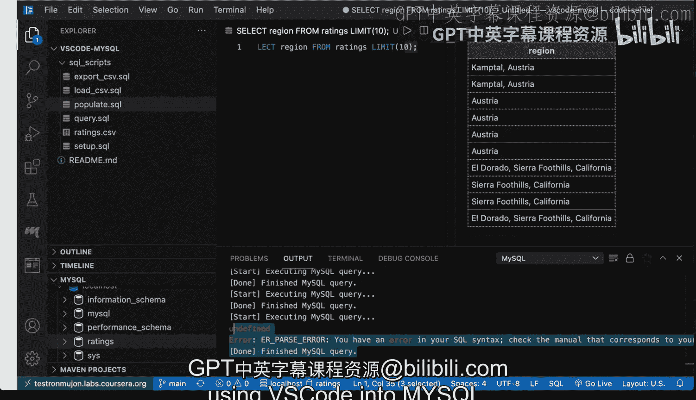

# 杜克大学｜Python、Bash和SQL数据工程基础2-4Python Bash and SQL Essentials for Data Engineering p122 55_04_03_使用VSCode执行MySQL查询.zh_en -BV1XS421X7tw_p122-

So now that we know how to connect to a remote MySql database。

 lets let's try to to interact a little bit more with it here we're back in Coursera。

 we're back with VS code and we have。Connected to the local host MySQL database。

And you can see here we have four databases again， these are the internal databases from My SQL and I want to run some some queries first。

 I want to create a new database， which is going to be called a ratings database I have some ratings from from some wine ratings a data that I have already and I want to create that。

 So how would I I would do that well here I have my SQL on the left on the bottom left。

And what I need to do is like well here in the Explorer I have a project checked out where I have some SQL scripts so in the scripts I'm click here and I'm going to open setup so setup is going to create the database if it doesn't exist in this case is's going to be the ratings database then it's going to use the ratings database I'm going to create a single table for that database with which consists of three different things name rating and region。

All of these three three settings are or three items are text and just preventing here to 556 characters。

 120 and 256 there so how would I do that well I have selected local host as my my SQL database I've opened the setup SQL and then i'm going to run the query so again I go open the commpa it and select run my SQL query so I run these。

And immediately， youll get well， the output here and on the right。

You can see that I have some results right field can affected rows。

 insert ID server status and whatnot this is not very useful at the moment I'm going to click also here to close the output and close the results。

And here you might be surprised to not see anything on the local host on the bottom left。

 This looks like it hasn't reloaded。 Well， the only thing you need to do is right click and and do and select refresh and once you do refresh you will see ratings is now here So that's perfect Now we have ratings and keep keep drilling down and then you can see that ratings have that name。

 the rating， the region and everything explaining the database。

 this is super useful because if you want to know more about the database。

 well now you know you can drill down to the settings。

So that's not the only thing that we can do here， we can start populating the ratings and so we've selected ratings here and let's open a new SQL file so let's use this one。

Note that the first line is use ratings， basically selecting the ratings database。

 and then it has several thousand lines of of information that he wants to use。

 So what we what we do here is once again is run as SQL query。And this is going to take a second。

Actually， it ran pretty fast the reium populationulate there。

 but now ratings should be pretty well populated。So I'm going to right click here on ratings and select a new query and。

That's going to open up again the text editor and we'm going to run a query again to double check that everything is all good and populated inside the ratings database。

 So I'm going to run the query here and the query is going to be a select。

Select everything from the ratings table and I'm going to limit the result to just 100 items and I'm going to use the commandpolet to execute this query and I'm going to use run my SQL query and there you go we now have several different results coming in so we are able to verify that everythings all well and ready to go here you you can see that we have name rating and region if we want it to be more specific and say for example we wanted to limit these to 10 and just we want to select only regions。

We can say region and then run my SQL query in the commoette and you could see that we only have or the regions there coming up and all throughout the output tells us like what's going on if you ever get into a problem where you have an error or SQL syntax that will help identify that you don't have something correctly done So actually and we have also tabs here。

 so you want to go to the previous results which is pretty useful and then compared to what you now have you can compare that as well。

 but like if we want to have like a syntax error So say for example limit with parents that some other SQL engines like say SQL like by one parenthsesis here this wouldn't work and we will get into trouble。

 So if I run that My SQL query you can see that I'm going to get into an error so that is how you。

executeecute queries， that's how you would populate this database and interact with a database in a more specific way using VS code into MysQL。

