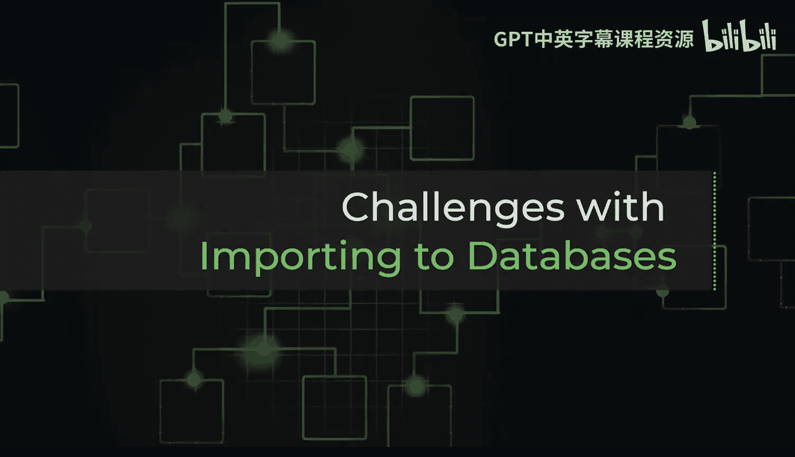

# 杜克大学｜Python、Bash和SQL数据工程基础2-4Python Bash and SQL Essentials for Data Engineering p124 57_04_02_数据库导入的挑战.zh_en -BV1XS421X7tw_p124-

There are some challenges when working with databases。

 especially if you're migrating from one place to the other。

 you might be working locally with a local database and you feel confident enough that what you have is already good and you're ready to start kind of like defining how your production environment will be in that case。

 what's needed is to take a database or the definition or the description of a database on how it's set up and how it's configured and take that definition and take it to a production environment。

 even if you're not talking about production environment or if you're not migrating from a local to a production environment。

 it is really tricky to kind of like find a way where you can take the contents of one database and put them to a second database this is essential。

Because it's the foundation you will need in order to have high availability or to be able to repurpose data and to work with many databases。

 this is fairly common when working with databases and you will no doubt will be migrating one database to another fairly often。

 so it is essential to know how to do this and how to do this effectively， not only with SQL。

 which you might already know， but also with other data formats like CSB and Jason。

