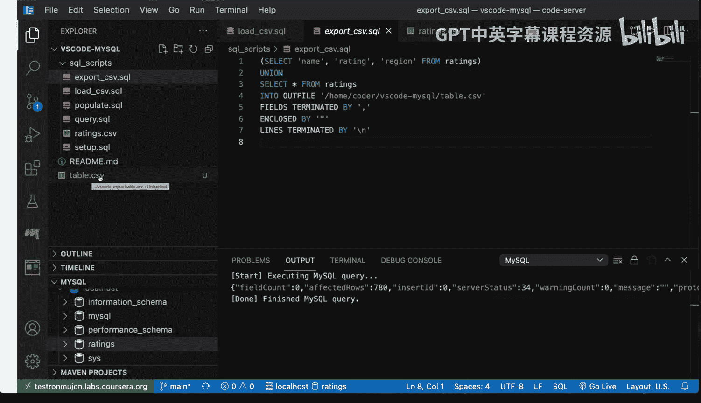

# 杜克大学｜Python、Bash和SQL数据工程基础2-4Python Bash and SQL Essentials for Data Engineering p125 58_04_03_将CSV数据导入MySQL.zh_en -BV1XS421X7tw_p125-

Importing data into MySQqL is mostly done through SQL files。

 and faster we'll see later on that are coming out from exporting。

Data from a MysQqL database as a SQL file， and we've already seen a little bit of that。

 but it is entirely possible to use some other formats to try and import that data over into MysQL In this case。

 we're going to see。How we can have a CSB loaded into My SQL。

And this involves several different things which might be kind of tricky in this case。

 we have this load underscore CSB SQL file and in on line  one。

 it starts by saying load data local in fileile ratings that CSP into table ratings。

So this means that it will read the ratings that CsB file。And it will load that。

 It will use the table ratings for these。 Now you can define it how the fields are terminated。

 In this case， it's a CSB file， So the fields are terminated by a comma。 Actually。

 if we head over to the CSB file over here。 So I'm going gonna to double click there and double click on ratings。

 you can see that。The the the data is separated by by comments like you can have a different delimiter。

 So you have the option to select there what you want。 So back to the SQL file。

 we're saying that every single line is terminated by a new line character。And then what we're doing。

 it's fairly interesting。 What we're doing is we're naming each field each each portion of data。

 and we're setting up a variable。 So these， these things here that have like an m percent in within parentheses are defining。

A capturing the variable names and then on the right over here we're saying we're naming those variables and setting them over to what they would map to so we have name rating and region and we're using the variables here it's not necessarily like a straightforward syntax but this would be essentially how you would do that now in this case if I run these I'm going to get into trouble so let's run these query again with a commandpaette run MysQL query and if I run these I'm getting into trouble because the system doesn't allow me it like is fairly restrictive so it doesn't allow me to load local data so you can see the error says loading local data is disabled this must be enabled both the client and server sites and finish。

The MysqL query This means that the client and the server both have to be able to allow loading from a local file so that that this actually works Now in the case that you have that enable。

 this is how you would do it。But the other thing that is interesting is that you can also export a database in this case we already have several hundred lines of ratings that we want to export so if you wanted to export to CSB you could certainly do that and we're going to look at at the export CSP SQL file over here。

So， in this case。What we're doing is， and I'm going to clear the output over here。

 What what you're doing is your're。Doing a select you're creating a you're creating a starting a query basically and you're selecting name rating and region from the rating table and you're going use union here and then you're going to select everything from ratings and then the output is going to go to this path so you need to pass in an absolute path in this case。

 this is a path within the curcera lab environment and this is going to create a table that CSB file at the top of that directory we'll see that in a second how that looks again you can you can define how the fields are terminated In this case I want to create a CSB file so fields will be terminated with using a comma and the values are going to be enclosed by a double quote can this gives you flexibility because you can enclosed by any other character if instead of like。

If you have several different types of data that have double quotes you could select something that is different so that you avoidscaping that and finally you are defining or describing how the lines are going to be terminated in this case by a new line character so if you have something different like a character turn well in this case you could define that as well so once again we're going to run and execute the query and we're going to say run My SQL query and this is going to run and you can see here on the left that table that CSB appeared so it has effectively exported everything that was within the database in the ratings database in the ratings table。

And has exported here so we can click here， I'm gonna exit here and you can see that this is effectively all the stuff that we were able to have in the database so this is a pretty good way of exporting data from MySQL pretty nifty way of exporting from MySQL very useful and you can use these to load these CSB into Python。

 if you want to do some data processing as well， and it's a pretty effective way to start dealing with data in a way that is more suitable if you want to do things with say pandas which is a library that can handle CSB file。

 So it is just a different way of exporting and importing data into MySQL。

 although what you will most commonly see is importing as SQL and exporting asSQL as well。

