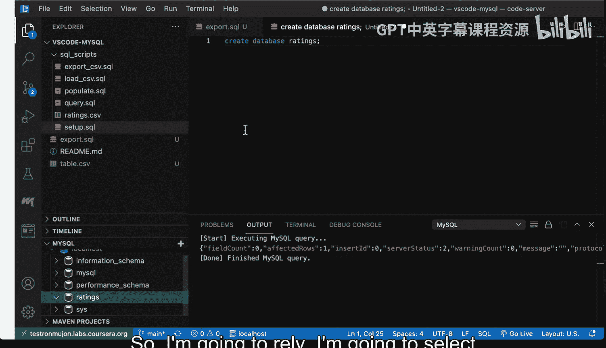
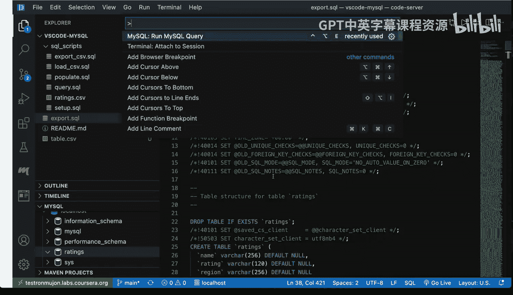
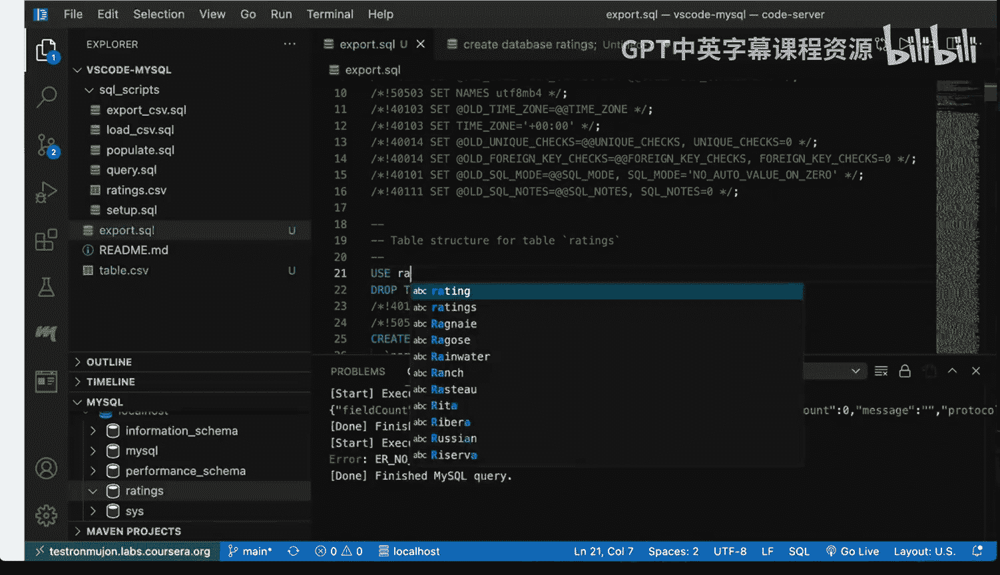
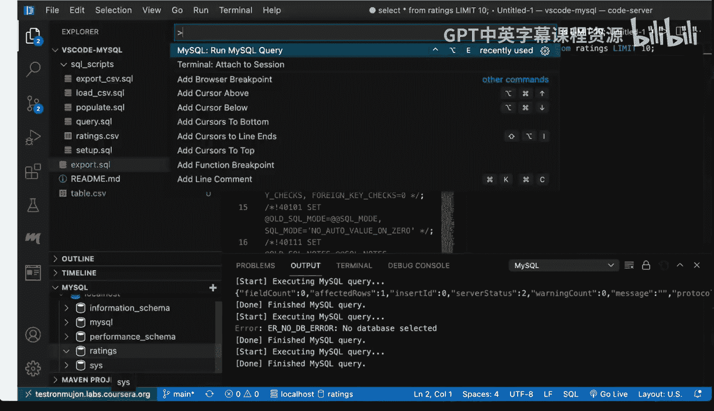

# 杜克大学｜Python、Bash和SQL数据工程基础2-4Python Bash and SQL Essentials for Data Engineering p126 59_04_04_从MySQL导出数据.zh_en -BV1XS421X7tw_p126-

So we've already seen how to import data into MySQL。

 but exporting data is also pretty useful and the full way is to do it with the MySQl dump command line tool so let's open up a new terminal over here and we have we still have our ratings database over here and we see we'll see how that works。

 let's open up a new terminal， we'll use the terminal over here。AndFirst。

 you need to ensure that you have the Mysql dump utility in Linux。

 you can do that with the which command， and that will tell you， yes。

 the Mysql dump is available and it will give you the path。

What we want to do here is use My SQqL dump and then when I pass dash U to specify that the user is rude。

 then when I say dash P for the passport will get prompted because we're not going to pass it in we're going to say that the ratings database is what we want to export。

And let's call this export file， the SQL file。Export that SQL and we are using the little katang here to signal that we're going to redirect the output into this file。

 so we're going to do that it's going to prompt us for a password I'm going to just hit return because in this case the root user doesn't have a password and this is going to appear so the export that SQL file will be here and you can see that there's a lot of information it captures well basically if you run this it will drop the table and recreated itself so it's creating the table again and it's selecting the right engine and the character set and then it's basically prepopulating all of the data that we already had。

 you can see here that it will alter the table and。Insert everything in one go。 Actually。

 instead of having several separate insert statements， it has one giant want as a single insert。

 and it will do that in one go。 So let's try and see if we can。

If we can get rid of the ratings database and see if we can run this once again in pre populated using it using the same SQL file。

 So I'm going to run。I'm going to run a new query and I'm going to say。Drop database ratings。

And then。I am going to， I'm going to execute the query。

It's going to affect several rows and then if I click here refresh， it's no longer there。Right。

 so now what we want is to well， want we want to create the database ratings and it doesn't exist because if we go back to our export SQL file。

 you can see it doesn't it doesn't create the database。

 This is just populating or using a database to to prepopulated。 So what we want to do is create。

Create the database。 I mean， this is a fairly nuclear way of getting rid of a database。

So we create the database ratings again into the local host of MySQL database。

 and you can see that this is executed correctly， so now if we go back to local host and we hit refresh ratings will be there。

So we've created a database， we haven't created any tables for anything， so we're going to rely。

 so we're going to select ratings over here， we're going to rely on or export that SQL found I'm going to click here to close it up。

 we're going to use that to create the contents of our database so if we use the command pullette and we say run my SQL query。

Well， we didn't select a database right so we will want to let's click here on the results and we can use can we can make changes。

 we can modify our export SQL and say use use ratings， which is the database that we want。

 and then we can run it once again。

And then executes the My SQL query。And you can see here that we get several。

 we have 780 entries there， so we've basically prepopulated our database that was blown away so if we want to if we want to see what we're going to get。

 we can say select everything from ratings limit 10 and we run these query again。

We'll get some results basically everything that we had in the beginning。

 so this is a very effective way of moving databases。

 I mean we did it in one in a single database by dropping the database and getting rid of it and then reconstructing it back again and populating with the with the data that we had exported previously everything with SQL and MySQL took care of all of these specifics of the server and the configuration needed for to recreate everything and have it done seamlessly。

 so this is a very good， very straightforward way of using My SQL dump and SQL statements to reconstruct the database once it's blown away。

