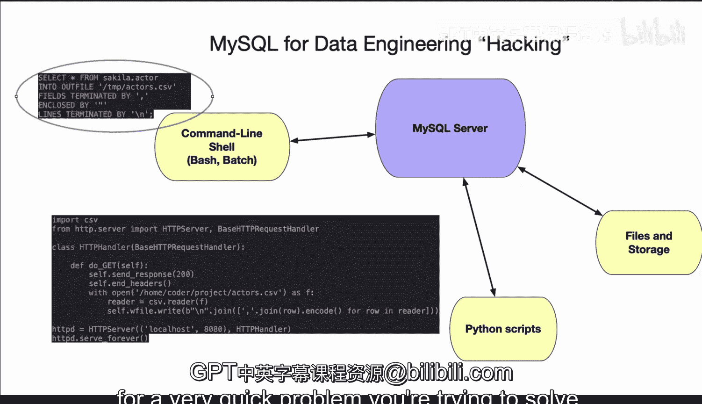

# 杜克大学｜Python、Bash和SQL数据工程基础2-4Python Bash and SQL Essentials for Data Engineering p128 61_04_06_MySQL高级操作概览.zh_en -BV1XS421X7tw_p128-

Here's a diagram that shows some hacking type ways to interact with MysqL。 So instead of only using。

 let's say， a MysqL SDK or going into MysqL inside of a nice gui etc。

 there is more of like a traditional Linux hacker kind of style that you can do for data sharing。

 because in some cases you may need to do something very quickly。

 let's say you only have MysqL installed python and bash which which is pretty common for let's say some virtual machine and you have access to or a container and how do you build something without getting into of package management hell and installing things left and right and uninstalling them seeing what works。

 Well fortunately， with MySQql， you can move very， very quickly。

 So one of the things you can do is you can dump files out to disk。

 So let's say you do a specific query inside your database。

 So in this case I'm doing a query of some。I dump those out to a file。 and once it's in a CSV file。

 then we can use our traditional tools like Linux or Python， etc。

 And another thing to point out is that the Python standard library itself is just truly an amazing collection of different features and you don't have to have third-party libraries to use Python in fact it's one of the advantages of it it's got everything built in so the standard library has in fact a web service so let's say you needed to really quickly build out a web service that is able to process some of the data from a database well you do this query。

 dump it out disk then build this a very simple bit of Python code to run a web service and then read in that CSV file and then you curl it to actually get the results and this could be something that was let's say a hackathon or you're working with some scientists in a lab and you want to build something very quickly。

 This is a pretty good solution。Additionally， you could build more and more of these kinds of solutions using the standard library Now another thing to mention with let the kind of hacker way for MySQL is that you can also dump the entire database and this is also kind of an exciting way to work is that you could say MySQL dump get a bunch of SQL then go through use some Linux utilities to parse some of that data and then do another manipulation with standard tools like Gr and sort and things like that So there's lots of ways to think about kind of hacking when you're working with data engineering in a traditional database by using just the tools that are available a lot of times we can get caught up into wanting to install all these libraries and do all these things but there are some traditional tools that can be very valuable to start with and see how far you get before you get into really industrial strength tools that may or may not be the best solution for a very quick problem you're trying to solve。

