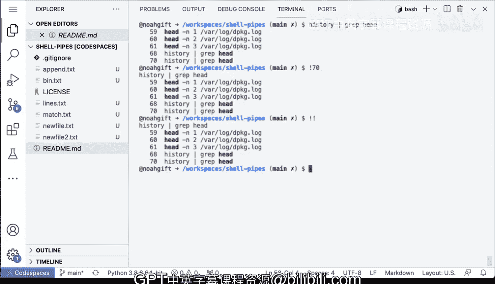

# 杜克大学｜Python、Bash和SQL数据工程基础2-4Python Bash and SQL Essentials for Data Engineering p13 13_01_05_Shell管道实例演练.zh_en -BV1XS421X7tw_p13-

Let's start off here and explore pipelines， one of the best examples of a pipeline would be to do the LS command here。

And let's look inside of user bin。And this is a directory that has lots of files or so many files we can't even count them。

 so what I could do is I could pipe this and this is where the power of piping comes in is if I pipe this I can tell that there's 1。

059 entries so instead of meaning into count all of those entries manually or scroll through them I can pipe that output into word countL now similarly I can go even a step further and if I use the up arrow。

I can retrieve the history of that command and I can actually pipe that out to a file。

 and so we could call this bin。txt。And what's nice about this is that it also is able to capture the output。

 and then if I look at the output of this file， you can see that that same entry is inside of there。

 So I could do all kinds of things with these kind of utilities where step1 again is list the number of files pipe that into word count and then retrieve the results into a file。

 so use this greater than operator to redirect the output very， very common。

 Now let's move on here to another operation which is conditional and this actually happens a lot in the real world with Docker files。

 let's go ahead and type in， for example， something that won't work right So if I type in this there's no directory here。

 it shows me that there's an error and so likewise if I use this conditional operator that said touch new file Txt if I do an LS。

You can see it didn't create that file。 So if I go in， I fix this， though。

 where I actually do have a directory that I can do an LS on。What is nice about this？

And we'll just do， for example， the Read me file right here in our current working directory。

Is that it was actually able to find that readme file and then because that was successful this is what this conditional operator says。

 I was able to create a new file and that's how that works so similarly if I do this again I say uparrow I say new file do2 it'll create a second file but again if and we'll do an LS here notice that it was because this first command was successful so this is a great way to chain together things that really require everything to work together and if one step fails then you fail the whole script you see this a lot and make files and you see this a lot in Docker files this concept of the double ampersand Now let's again just kind of do a refresh here and see if I put in the wrong path and I say new file do3 it won't work right so it didn't create that file so it's a very powerful concept this conditional concept Now let's move on to using a more comp。

P example， which is processing lines with pipeline。

 So here's a variable you can see here I've created this STR and I put a dollar sign and I have these single quotes here and I have a new line character right here。

 So it's going to create this variable。 And if I go ahead and I type in echo。

And I put this into quotes and I put in dollar sign STR。It'll actually make three different lines。

 There we go。 This is line， this is a line， this is a line。

 Great so now that I've got those set together， what I could do is I could actually output this into a file called lines Txt we've already explain how that works。

 And so now that I've got this what I could do as well is sort this by piping it into another utility So I'm gonna type in cat which will print it out if we do this and then if I go through and I type in sort dash R this will reverse the order。

 notice how this started with a one and if I do a dash R it reverses the order because it's able to pick that up and now if I go through and I pipe this into less if this was a very large file it would allow me to navigate up and down by just using the up arrow and that's one of the great things about the less command and so again this you know command here where I'm able to you look at the output of the file by doing cat sorting it。

So that I do some kind of a reverse and then potentially moving it back into the less command so I can kind of go back and forth very。

 very common Now a similar thing that that happens a lot is I could use this cat again to just print it out and just grab for a certain pattern in this case what if I just want to look for the number three here we go look it was able to highlight that that's the actual line that I want and then again I could go through here and if I wanted to I could say like match for example do TxD and if we cat that right we were able to extract just one line out of it so really shell pipeing with files is a very common thing you would do as a bash developer。

So let's move on here to another thing that I'm going to play around with。

 which is that I'm going to append something to a file。If I type in， you know， you know something。

 for example， like this， and I want to append it to a file and I guess we could go through here and put this into aend。

Txc like this， if I cat this。let's go ahead and do a cat thatta pen file。

 you can see that it was able to put this into the file。

 but what if I wanted to instead up overwriting it because if I overwrite it？This would be overwrite。

Overrights right and if I cat it again right it just replaces it。

 I want to go through here and I want to append to it。 so in order to do that pretty simple。

 all I have to do is just say something else or let's just say another thing。Here we go。

And what this will do if I put two of these greater than symbols。

 it will append to the end and so now if I type in cat。Aend。There we go。

 We've got actually two things inside of that file， so this also is very。

 very handy if you're going to be running commands together and you want to let's say。

 get a list of error messages or some kind of thing where you need to append it instead of overwrite it。

 you can use this double grid then。Now another thing to be aware of is this concept of throwing away error so a lot of times you may want to try out some path。

 for example， in this case， let's try this out this wrong path oh you know maybe this was part of a script。

 we don't want the script to print out a bunch of noise what we could do is we can actually tell the error messages by using two greater than to go away and this is essentially the trash we could say go to devnool and now notice how it just goes away so this is a very good pattern as well is if you know you want to throw away the standard error you use two greater than devnool。

So another thing to point out here to maybe wrap things up is that it's very common in data engineering to need to look at different file outputs of servers and look at the logs and so what we can do here is we can look at this we can go to var log tab complete this by pressing tab and it it'll pick whatever is the closest match here。

 notice how I do tab there it's a great way to get the right path what this tail command does is it actually will keep that file open and every time I make a change to it it'll keep giving me a new and new output so this is a really cool command to be aware of and you use this a lot if you're looking at a server that's not the only way you can look at it though you also could do tail dash in so just show me the last two lines and go through log depackage like this Here we go we can see。

That these two lines here are actually in input。Inside of here， if I want to look at three lines。

 we can go through here and I've got actually three lines。 so tail。

 if you use the dash in will let you explicitly look at the end of the file now you can do the opposite by doing the head file and if you do in and I look at just one we can again look at just the very first part of this file here if I want to look at2 I can just go through here and and I can look at two So one thing to point out as well when you're doing a lot of shell commands like this if you use control a that gets you to the beginning of the line you control E it gets to the end if you're doing a lot of changing of things like the head file the head command for example。

 this is a great tool to be aware of because it lets you easily tweak things without having to rewrite the whole command So similarly if I do a control L this will clear the screen here let's take a look at something called history and if I type in history。

 you'll notice here there's so many command。As in history， it's overwhelming。

Here's where our pipe commands come in handy。 So if I go through here and I say history and I say less。

 this lets me scroll through right and if I do the down arrow， I can scroll up。

And down and kind of look through the whole file。 and this is really one of the most powerful things about less if I do escape。

 I'm sorry if I do。Q here it gets me out of it right so history goes up and down if I pop into the less Q just gets me out now if I want to look at the very。

 very end of this， what I could do is I could do history。

And I can do Gr tail and I can look for some command that I entered and this is very common as well。

 like if you're doing some kind of programming task。

 a lot of times you know what it is you're looking for in your history and and look here we go。

 we can see for example， look at this command that I potentially want to run again now there's actually a shortcut that many people don't know about is if you do Gr and you find the thing inside。

 you don't have to type the whole thing again， all you need to do is this if you type in the exclamation point you can type in whatever line of history you want to run and it will actually execute that same line again So that's a really awesome feature to be aware of and there's actually one more trick to be aware of if I type in。

 for example， PS EF or some command。And I wanted to run it again， how would I do that？

You can run exclamation point twice so this is really a nice takeaway as well as that history is one of those commands that is very suited to you know gripppping things for example。

 or piping it until less so you can take a look at it and you also can go through and you can run different parts of history by using this exclamation point here for example。

 exclamation 70 if you want to run the last command of history you can just do the pound pound so I'm sorry exclamation exclamation so there's a lot of great use cases in the real world for doing shell pipelining and it's a great place for you to follow this repo next and play around with these same commands。

