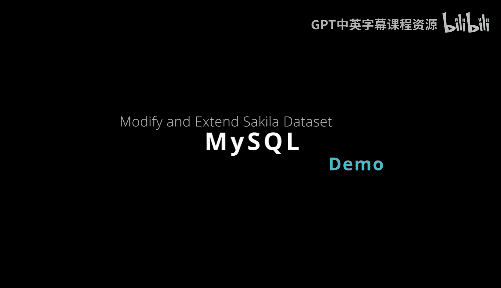
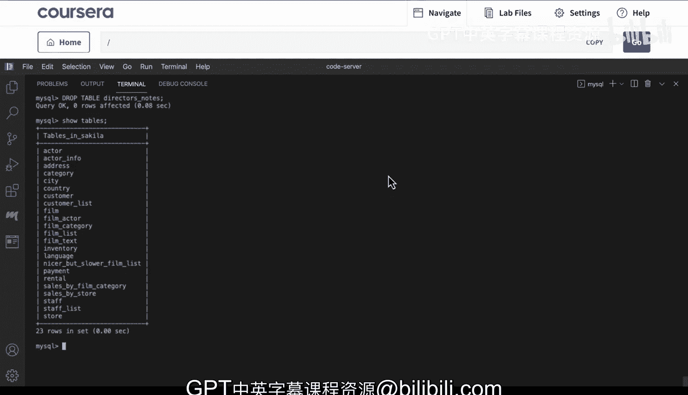

# 杜克大学｜Python、Bash和SQL数据工程基础2-4Python Bash and SQL Essentials for Data Engineering p132 65_04_10_修改sakila数据库.zh_en -BV1XS421X7tw_p132-

Here we have a default database that comes with My SQL here that covers the film industry and has actors and films。

 et ceter。 What I'm going to do is take this database and extend it。 So in order to do that， first。

 we'll go ahead and log in here with My SQL dash user root dash P。

And let's go ahead and type in this password。And then once I'm inside of here。

 let's go ahead and say show databases to see that there is， in fact， the S database in this system。

 So we'll go ahead and say use。And then from here， we can actually say show tables。

 This is typically a good place to start。 Hey， what do I got inside of this database。

 You can see actor category， film list， etc cetera。 Now the next thing， though。

 that we need to do is is actually extend this a little bit because what I want to do is pretend that I'm a director and I want to enhance this particular set of records because let's say that these are all my films。

 let's just kind of pretend that for a second， And I have notes that they're in the final stages of editing maybe postproduction And I want to put some notes inside of there。

 So how would I do this， Well， first up， we need to create a table。 So in order to do that。

 I'm going to take some。Create table statements that I've already created here。

 and I'm going to paste them in and we'll look at what this does。

 So first we say create table director's notes。 Now， notice that I say I want to have a note ID。

 which is auto incrementing I。 So it shows that you know if I put in record one。

 and the next one will be two etc cetera。 the film I as well as an integer。

 and then we have the director note， which would be a text block。

 which allows me to put some notes that are kind of free form in there。

 And then we also potentially could have a date here。

 which would be you know let's say the editing date。 So if I go ahead and I do this。

 we can see that that table has been created now。In order to do something useful with it。

 we need to do an insert statement。 and so this will be the next thing that I do is actually we'll paste inside of here。

A another statement and we can see what it does。 So insert into this new table that I created。

 let's go ahead and add some notes like fix the sound in minute 20 and then maybe another one would be you know shortened a battle scene。

 And these are kind of typical things that a director really would do in a movie and there we go。

 we can actually see that now。In order to look at exactly what's happening inside of this table。

 we would need to actually move everything around， maybe join it with a film table and get something useful。

 let's say that we're going to create some application that the director would then see later so in order to do that。

 we also can just paste inside of here。Right here and say select the film title。

 the also the notes and then the edit date。 and let's join it together to create a more uniform view of everything that's happening。

 So we can see here that oh， look， we have all these different films here。

 And then at this point we see at only these two at the very top。

 The Academy dinosaur and the a gold fingerger actually have notes。

 So this also could be a view that would be really useful。

 Maybe the director has to actually go through。 maybe they're restoring a bunch of films。

 and they need to actually go through。 and。Make a note for each and every title that's in the library。

 Well we could see here that there's only two right so you could at this point。

 you know build further and further automation around this。

 So now that we've actually got this thing finished。

 let's say that that was an initial experiment on a copy of the data。

 One of the things that we might want to do is just drop it because it was it was an experiment。

 So in order to do that， we can just say drop here， we'll just say drop table。

And then we can type in directors。Notes。There we go， and you can see that that has been cleaned up。

 and we can say show tables。There we go， and we can see that the director's notes has actually been removed。

All right， so that's it for this demo， go ahead and try something like this out on your own。

 it's a great way to get a few for a sample database。

