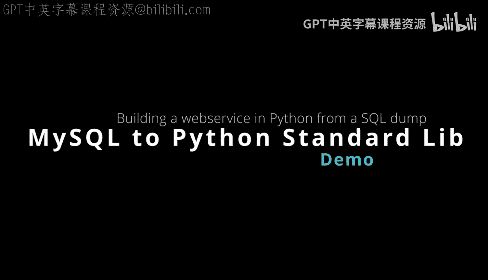
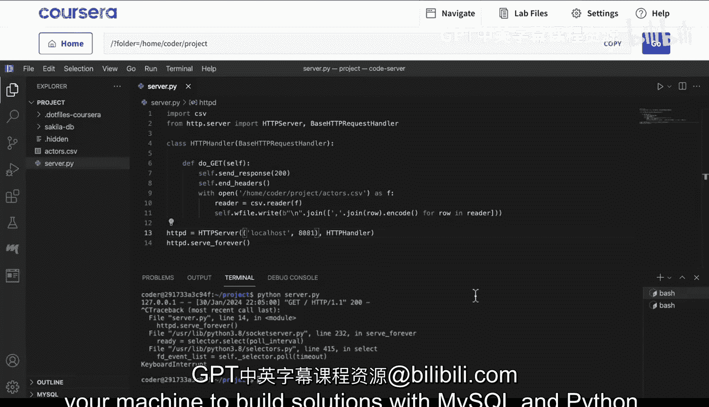
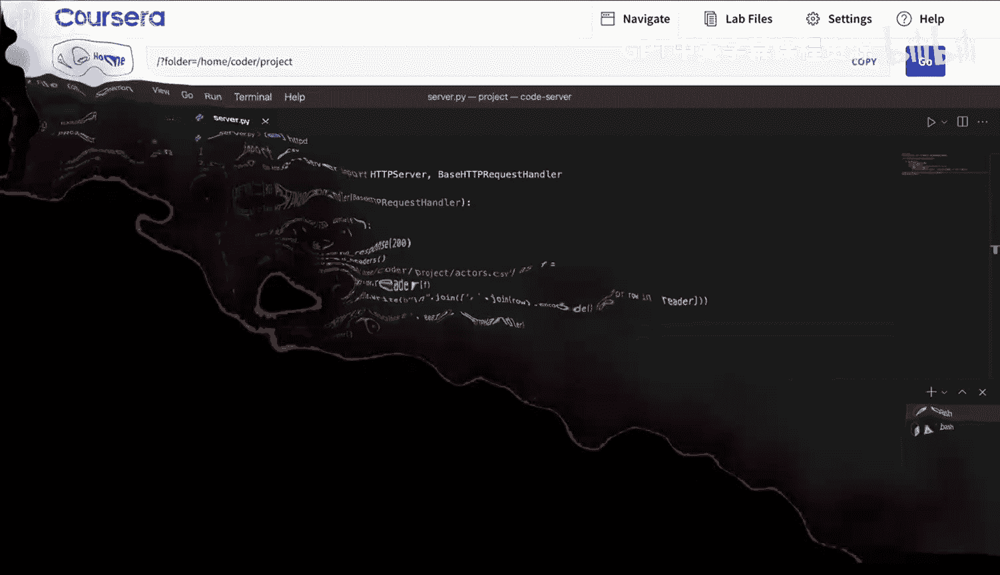

# 杜克大学｜Python、Bash和SQL数据工程基础2-4Python Bash and SQL Essentials for Data Engineering p134 67_04_12_通过Python标准库Web服务器连接MySQL.zh_en -BV1XS421X7tw_p134-

Yeah。

All right， here we have a terminal where what I'm going to do is talk to my SQL。

Get some data out of it， dump it into a file， and then use Python to create a simple web service that I can curl all using the standard library。

 So let's go ahead and first dive into My SQL here。 We'll type in MySQL dash U root dash P。

Now we'll go ahead and say show databases。There we go。

 So we see that there's actually this Sequila database here， which has this film data inside of it。

 I'm going to go ahead and say use it。And then next up。

 what I want to do is say show tables right So what have we got。 Okay， great。

 we have all these tables inside of here。 Now in order to do something pretty cool。

 what I'm going to do is just paste in some SQL I verticalti got prepared。😊。

And what we can do is see what it does。 So it'll say select everything from the actor table and then dump it into an actors do CSv。

 But see， we're doing some data cleansing here to make sure this in the right format。 perfect。

 Now let's go ahead and exit out。And get into Python。 Now。

 what we can do here is see that that does in fact， exist。 We can do a head。Perfect。

 now in order to take this CSV file and create it into a web service。

 what we'll need to do here is actually open up the editor to get a little bit more power。

And so I can move this down right here。And what we can do as well。

Is basically create a file called server dotpyY， and then I can actually say a file。Open folder。

 There we go。Perfect， we can have the terminal open as well。 So now that we've got this thing open。

 we can see the the file here that we're going to manipulate。

 So I'm going to go ahead and just paste in some code I've already written here and let's go ahead and walk through it。

And what this is going to do is it's going to say import the CSV file so we can process the CSV。

 we're also going to start a built in web service and then notice what it says here as it says。

 let's go ahead and read that file in and then we'll run it forever to get these queries so let's go ahead and run it so we can just say Python server。

And notice it says it's already in use on the port 8080。

 so pretty simple to fix all we have to do is just say port 8081。And then we can save that。

 run it again， and there we go now in order to use it。

 what we can do is actually just do a curl command and say curl local hosts。And we can say。8081。

There we go。So I think this shows how powerful it is， and we can see of course， the web result。

 how powerful the standard library itself is in Python a lot of times we get really obsessed with all these fancy third party libraries。

 but if you're building you very quick and dirty and fast solutions，You can use just bash。

 you can use just SQL， you can use just the core standard library of Python to develop truly incredible things very quickly。

 So I hope this shows the power of using what's already on your machine to build solutions with MySQL and Python。

