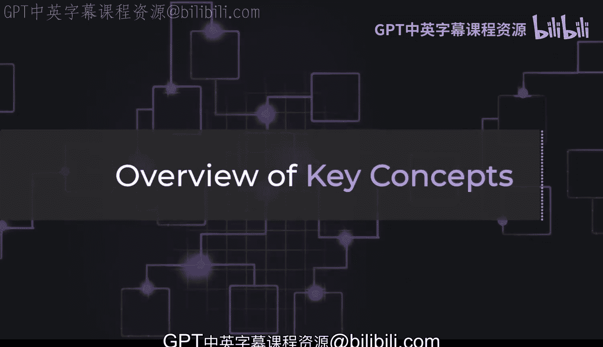
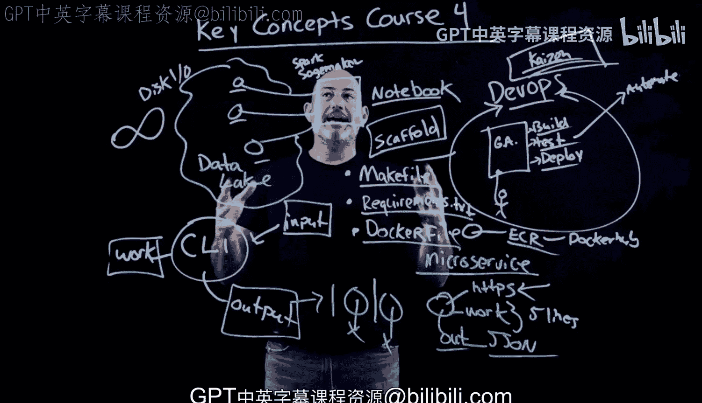

# 杜克大学｜Python、Bash和SQL数据工程基础2-4Python Bash and SQL Essentials for Data Engineering p136 02_01_05_核心概念概览.zh_en -BV1XS421X7tw_p136-

Welcome to the key concepts in course4 these are really important as we're starting to wrap up the whole specialization and let's start off with notebook So why is notebook so important and why do we want to talk about it in detail。

 Well I think a good way to think about a notebook is it's really the tip of the iceberg。

 It's the execution of your code but behind the scenes。 There's a bunch of stuff happening。

 Let's take an environment like sageMaker What's doing is it's using this data lake which has the ability to do infinite disko and infinite disk compute and actually move this data over and over again inside of some machine learning project or data engineering project the same goes for things like Spark or again sageMaker they're all orchestrated by notebooks but behind the scenes。

 there's these big data operations there could be compute nodes being spun up that are training machine learning jobs or doing inference machine learning prediction。

 So really a。The book is important to know both from the top of it。

 but also to know what's happening underneath。The other thing that we're going to talk about is the command line tool interface and it really is the most important thing to be aware of for prototyping for data and engineering it's because you can take an input you can apply a unit of work so it could be as simple as a Python function and then take that result and then make output and then send that output through a pipe operation to some other unit of work and then again that could be a command line tool which could pipe it again and that could do a unit of work so really the command line interface here is critical to building very quick efficient single purposepose tools the other thing that is really critical that is often not talked about is this concept of DevOs you may have heard the term before let's go ahead and define what DevOs is really DevOs is about continuous improvement ortyzen and the idea behind continuous improvement is that your' constantly making things better by applying automation to your。

and so what this means is let's say we're using you know we'll call this Github actions。

 which is a common build system， you would build your code。

 you would test your code and then you would deploy your code into production and it would be continually getting better and this is a very efficient and fully automated process so one way to you know do a litmus test for DevOs is if your code is not fully automated in terms of being able to push it into production you're not doing Devops you're doing something else DevOs is about full automation of high quality code and continually making it better again。

 this is the concept of Kazen。Now how would you do this some of the details of this are what I call a scaffold so if you go to a beach community you'll see a lot there's houses that have the pylons they' build on top so that if they're floodwater。

 they're protected same thing with the Python project you have to build this structure out and what I would say are the three most important things where a Python project would be the make fileile the make fileile allows you to have a series of recipes inside that abstract out really complex sequences of code so these save you time they don't cost you time they save you time in the lifecycle of a project I would recommend all Python developers use a make fileile to make things simpler then later when you go into the deployment process you just type in make install make test。

 make L likewise a requirements file is critical because it keeps track of not only the packages but the specific version of the packages。

It's very easy to have a problem where it dynamically pulls in the latest version of a package and breaks your your project this has happened many。

 many times in real- world scenarios but you can pin those version numbers by using a requirements file Likewise a Docker file is pretty fascinating because what it does is that finds the runtime for your project so that you can containerize your project and you can push that container to something like a container registry in the case of Amazon。

 they have a container registry called ECR there's also container registries like Docker hub that are public ones but the idea here is that you package both your code and the container together by using this Docker file so I would say most Python projects especially in the context of data engineering machine learning engineering should have a make file requirements file and a Docker file Finally we're going to get into microservices which are critical to master for a data engineering and the reason why is that it allows you to use the web。

As the input， this would be the HDPS endpoint you go to a website you do some work and the work could be as small as let's say five lines of Python it doesn't matter you know how large the file is it's really matters about what it solves what the problem is that it's going to do and then you put the output back out most of the time as this JSN data data structure so you can send this out to other people so we're going to get into the microservices we'll talk about flask we'll talk about fast API we'll also talk about data visualization services that you can build so these are really critical final steps to master inside of course for。

