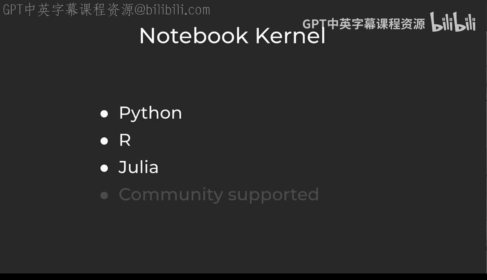
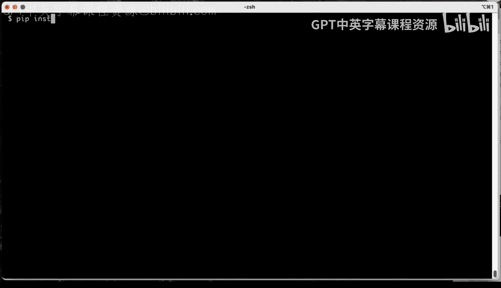
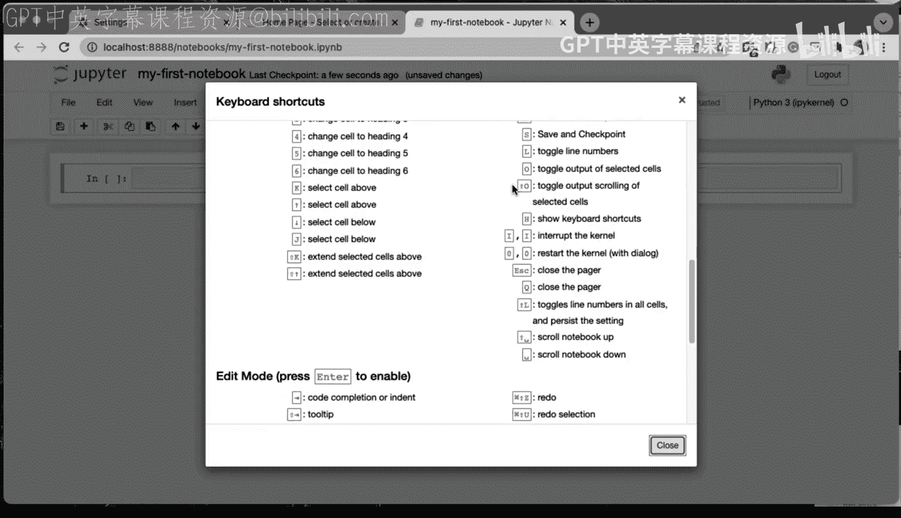
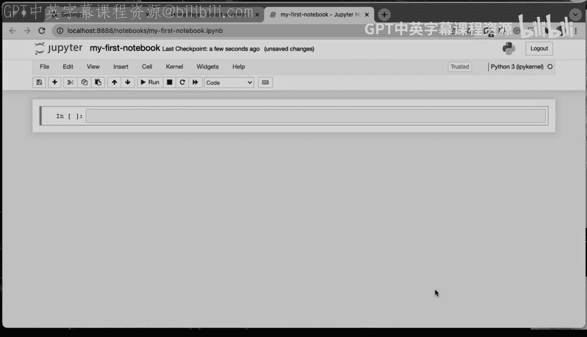

# 杜克大学｜Python、Bash和SQL数据工程基础2-4Python Bash and SQL Essentials for Data Engineering p138 04_01_03_Jupyter入门指南.zh_en -BV1XS421X7tw_p138-

In this lesson， we'll look at Jupiter notebook code cells。Text cells。The use of magics。

And the Jupiter lab interface。Project Jupiter sprung from the I Python Project， which began in 2006。

I Python is an extended interactive Python shell。The Jupiter Project。

 which was separated from the I Python Project in 2014。

 is the language agnostic part of that project。Jupyter notebooks are an executable document。

They contain cells。And these cells contain code， text， or images。The code cells run in a kernel。

Colonels are supplied for Python， R and Julia。 Other kernels are maintained by the greater community。

We could install Jupiter， using Pip。

This will take a couple moments to install。Once it's installed， we can start Jupiter。

With the command， Jupiter。Notebook。This should automatically。Open a notebook window in your browser。

If it doesn't open a window in your browser， you can look at the output in your shell。

And you can see here that it gives you a URL。 you can paste into your browser to open a notebook。

So here we have the notebook interface， but we don't have any notebooks yet。

We can open a new notebook。By choosing to kernelel。This is the interface for a notebook。

This is the name of the notebook。And that'll actually set the file name of the notebook when it's saved。

Jupiter automatically saves your notebook at regular intervals。

You can see that there's controls up here。They're doing various things。

You can also press escapescape。An H。To bring up a list of keyboard shortcuts。

