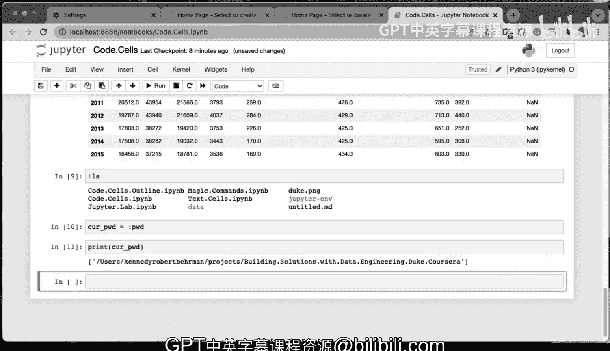

# 杜克大学｜Python、Bash和SQL数据工程基础2-4Python Bash and SQL Essentials for Data Engineering p139 05_01_04_Jupyter中的代码单元格.zh_en -BV1XS421X7tw_p139-

Let's look at some code cells。 When you first open a note or create a new notebook。

The default cell that is created is a code cell。So we can write code in a code cell。

Notice that the code has syntax highlighting。We can then run the code。By using the run button。

Notice that the button opens a new cell below if there's an existing cell below。

 it'll select that cell。We can also use the keyboard shortcut Shi Enter to do the same thing。

If we do a dot。And then press Tab。We get code completion。

And start typing you can see it's showing us which。Functions are available on this module。

If we press a question mark after a function。And then， press shift enter。

It opens up the documentation for that function。Now， the results。

For a function or method that we call。Are displayed in an output section right below the cell。

You should note two。IfWe create state if we define a variable in one cell。That variable will persist。

In consequencesequent cells。Now， the output。Can be numerical or can be text。

But can also be more complex。For example。If we import pandas。And' open a CSV file。

The output for the data frame we just loaded is actually an HTML。

 and you can see that it's interactive。And richer in contact than simple text。

We can run shell commands from inside a notebook by prepending them， with the bang symbol。

So here we've run the list command on the current directory that we're running this notebook from。

 and we can see all the files that are in that directory。

 We can also capture the output from a shell command。By assigning it to a variable。

And we can see that we have that variable now as a Python object and we can use it with normal Python code。

