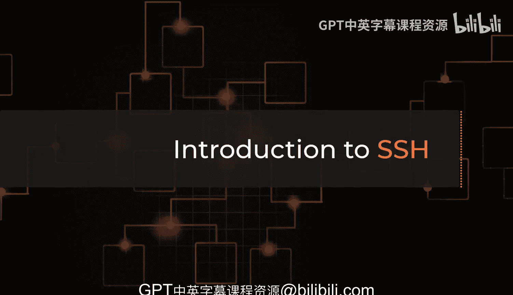
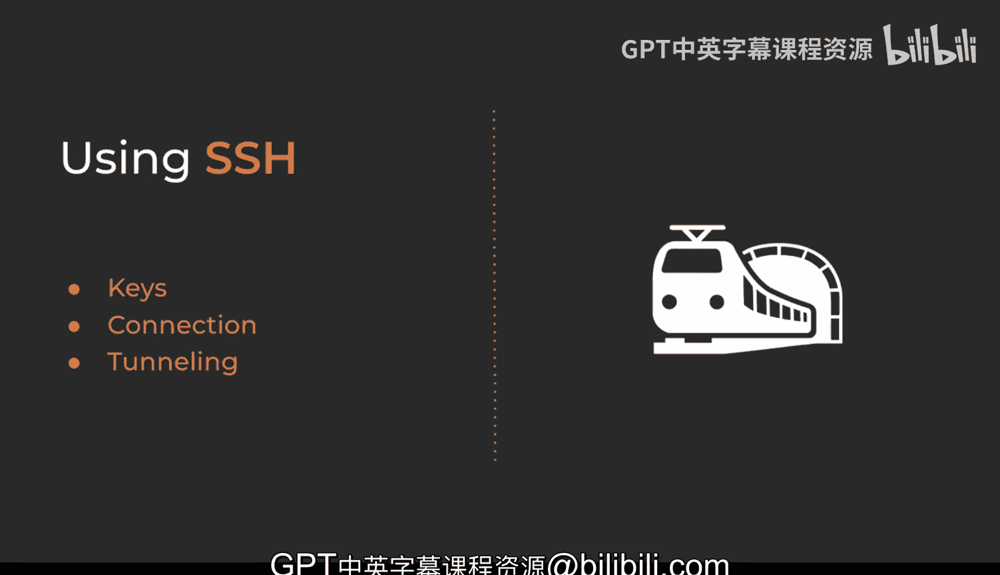

# 杜克大学｜Python、Bash和SQL数据工程基础2-4Python Bash and SQL Essentials for Data Engineering p14 14_01_02_SSH入门.zh_en -BV1XS421X7tw_p14-

Let's talk through this lesson which is using SSH， one of the key characteristics of SSH is this encrypted and secure tunnel。

The objectives are first we're going to talk about SSH itself， what is it， how do you use it。

 and what are some of the best practices behind the SSH protocol。

Next we'll talk about how to create SSH keys this is very popular in communicating with things like Gitlab or GitHub also in talking to remote servers you need to know how to create a public and private key pair and then put that information into a location so that you can communicate with a remote server We'll also talk about how to connect to these servers how to use port forwarding to for example。

 talk to a remote website or remote WordPress site you're developing before you want to make it go live how would you forward that to your local machine we're going to do this step by step in a nutshell what we're going to do by diving into this lesson is cover these three main areas keys connection and tunneling。

All of them have in common though is you're creating this tunnel that has your code in the middle of the pathway。

 it's a lot like this train， you have everything on board， your packages， your passengers。

 everything's inside and you need to actually get it from one location to another securely without other people intercepting it really that's what SSH is it's a toolbox for connecting to servers for tunneling and also for remotely talking to your source code。

