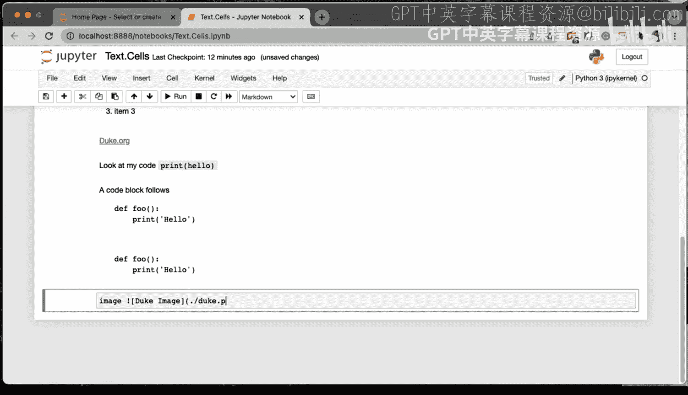

# 杜克大学｜Python、Bash和SQL数据工程基础2-4Python Bash and SQL Essentials for Data Engineering p140 06_01_05_Jupyter中的文本单元格.zh_en -BV1XS421X7tw_p140-

Let's create some textiles using markdown language。We can convert a cell to a text cell。

Using this menu。Choosing Markdown。To create a heading new text cell。

Use a hash sh to go your next level heading， use two hash shys。And so forth。

 to create each level of indentation， we can create a block quote。

By putting rightward arrows at the beginning。Of course， first turning the cell to markdown。

We can add emphasis to a word。Right。Incloing it in a star， which will。Put it in italics。

We could enclose it in two stars。Which would cause it to be bold。Or。We can cross it out。

There are two types of lists we can make。One with dashes。This will appear as an unnumbered list。

We create a numbered list。It doesn't really matter what numbers we use。

The numbering will be automatic。We can add our URL。I put in the URL text。And square brackets。

And the URL address in parentheses。you can click on this URL to get to the website to follow the link。

If we want to embed code in text。We can just put back ticks around it。

Or if we want to do a code block。We can either and wrap it in。Cipple tick marks。

Or even just indented。If we want to add an image。He put her knee。

A text that would replace the image in square brackets prepened by an explanation point。

And then a path to the image in parentheses。

And you can see。 the image appears。