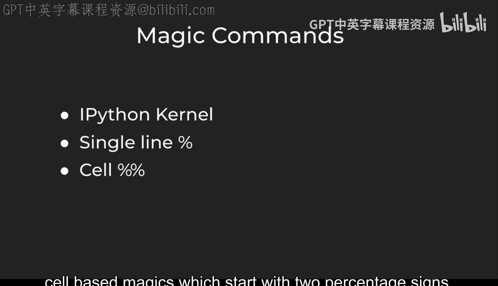
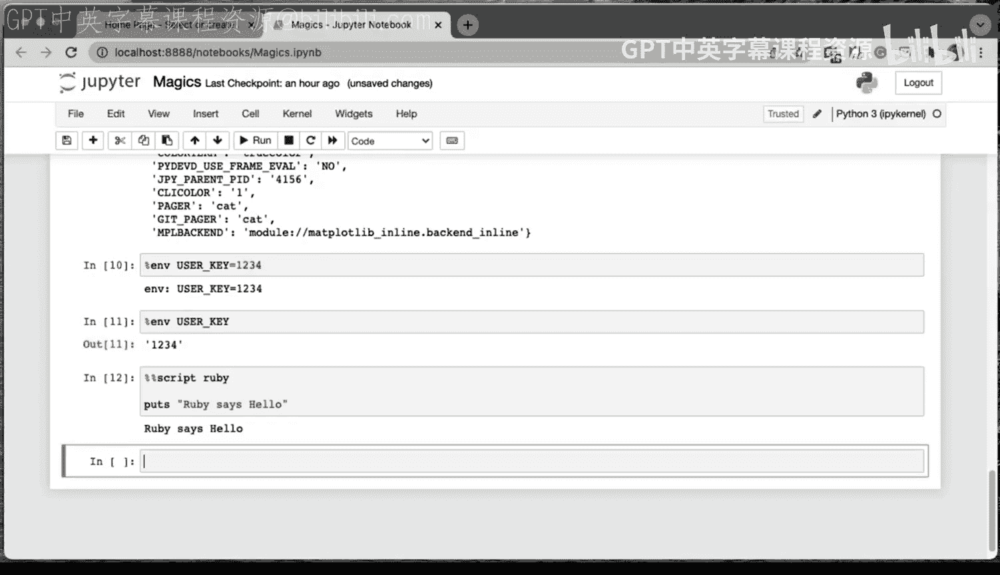

# 杜克大学｜Python、Bash和SQL数据工程基础2-4Python Bash and SQL Essentials for Data Engineering p141 07_01_06_Jupyter中的魔法命令.zh_en -BV1XS421X7tw_p141-

Let's talk about Jupiter Mags。Magics are a type of special command。

The Jupiter gets from the i Python kernel。Our single line magics， which start with a percentage sign。

And cell based magics， which start with two percentage on。 Let's look at some examples of magics。

The first magic we'll look at。Is the line magic。Ell S， magic。

This magic lists all the available magics， both line magics。And cell magics。And with Mags。

Similar to other functions。We can get their help documentation by putting in a question mark after them。

So here we see the help for the magic alias， one of the most popular magics is the time at magic。

Which is used to time how long a statement takes to run the single line timeic magic。

Times whatever statement is put after it。On the same line。So time it did seven runs in each run。

Louped the statement 10000 times， it returns the best average of the seven runs。

The cell based time it。Well， time， whatever code is in the rest of the cell。In this case。

 it once again did seven runs， but this time only a thousand loops per run。

Another cell magic is the right file， magic， This lets us write a file to disk from inside of our cell。

So here we've got a little function called say hello。We're actually going to call that function。Here。

But this is all argument to the right file， which will read to the file， Ho dot P Y。

So you can see it's writing the file，Ho。pyy。You can then use the。

Run line magicic command to run the file or any file it's on disk。

So here we're going to run the file from within Jupiter。

And you can see we get the output from the file， which is pretty hello。

Another useful magic when dealing with files is the load command。For this command。

 we can load the contents of file on disk。So let's load the file， hello do Pi。

Now the code that's in that file is loaded in our environment。So， we can call the。Say hello。

Function that we defined in that file。And it will run locally。

You can also see what environment variables are defined in our environment。We're using the end。

Bine command。We can also use this command to set new environment variables。

 Let's say we want to set a variable named user key。We'd type percentage M。

 and then we'd type user key equals in whatever value we want to give it the same way we would on the command line。

Now we can check the value of an environment variable using M as well。

And we can see that it's set to the value that we。Gave it in line 10。

Another sometimes useful thing to do is to be able to run a cell in a different language。

We can use this with the。Script magic。So let's say we want to print something using Ruy syntax。

We do script， give it the language Ruby in this case。And then whatever ruby syntax we want to。

Evaluate。And you see that it's。Run the ruby。Code using a Ruby interpreter and put the output in the output area after the cell。

