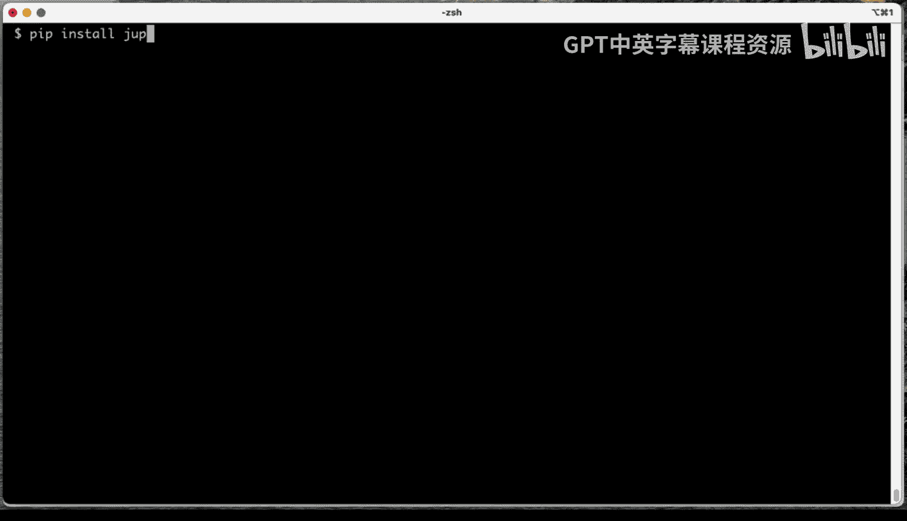
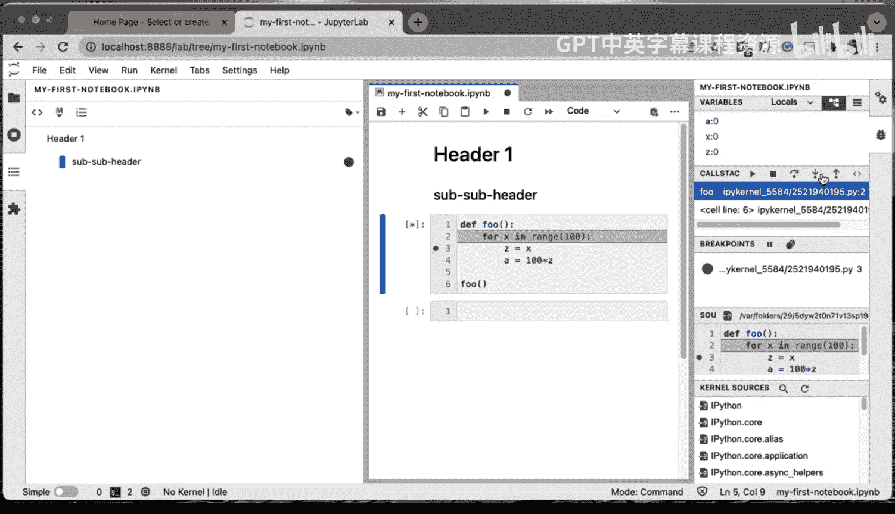
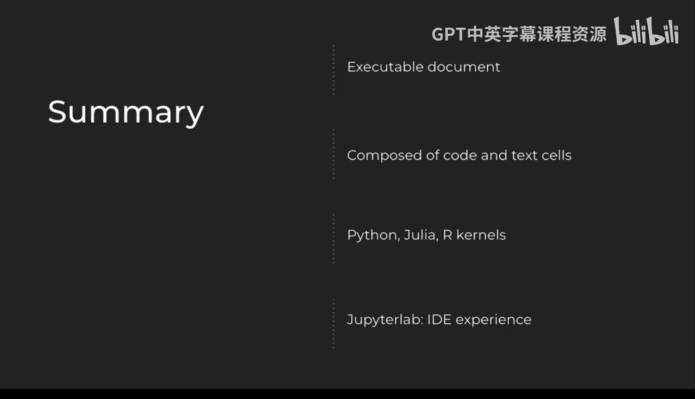

# 杜克大学｜Python、Bash和SQL数据工程基础2-4Python Bash and SQL Essentials for Data Engineering p142 08_01_07_Jupyter Lab概览.zh_en -BV1XS421X7tw_p142-

Let's take a look at Jupiter Lab。

We can piip install Jupiter Lab。

And then start it with Jupiter。Using the lab command。And here we see the Jupiter lab。Interface。

You can see that here there's a launcher。With the opportunity to make a new notebook。

An interactive Python。Session。Open a terminal session， text file， a markdown file。

A Python file or show contextual help。So here's the contextual help on the side if we。

Open a Python file。You can see that we get the documentation。For the functions that we're using。

As we type them。You can also see on the left hand side， we have an left hand navigation。

Including a file browser which shows us the files in the local network。We can right click。

And rename our notebook。And we can see that it's also renamed in the file browser。

We can also see over here any running kernels。Were terminals。

And this shows various extensions and plugins that have been plugged into。

Our Jupiter lab is a whole ecosystem， both for Jupiter notebookbooks and Jupiter La， in particular。

Of these extensions。So let's open another notebook。And we have two notebooks。

 you can actually drag and drop them too。Lay them out any way you'd like。Now if in our notebook。

 we start to put in some text cells。You can see over here this gives an outline。That we can navigate。

 can select and go to the cells as they're here。 If you have a big， complex document。

 this makes it really easy to get around。We right click on a cell， you can see we get。

All the commands that we can run on this cell。 Jupiter Lab also has a built and debugger。

So let's put some code in。So here we have a simple function。

Which loops through a range of numbers and set some variables。So we can turn the bugger on here。

And then plus a break point。we can see we have the debugger information over here。

Quiing the ability to step through our code。See local variable values。

And step in and out of functions。

So in summary， we've learned that Jupiter Notes are an executable document composed of code and text cells。

The code cells are run by kernels， and these kernels can either be Python， Julia or R。

And also that for a more IDE like experience， we can use Jupiter Lab。

