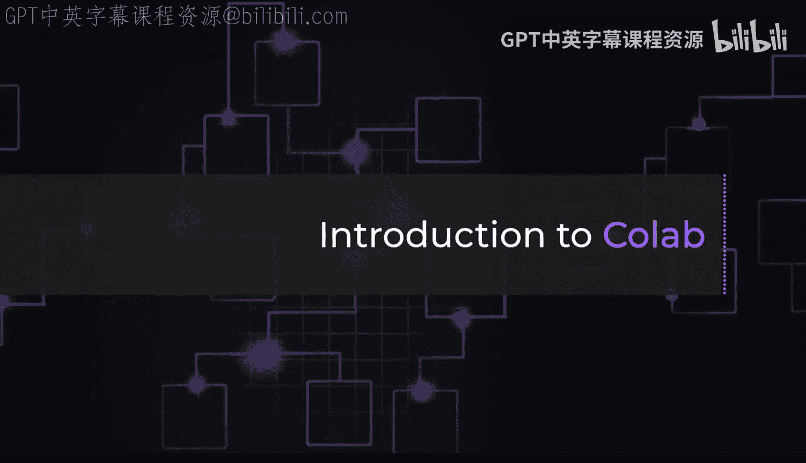
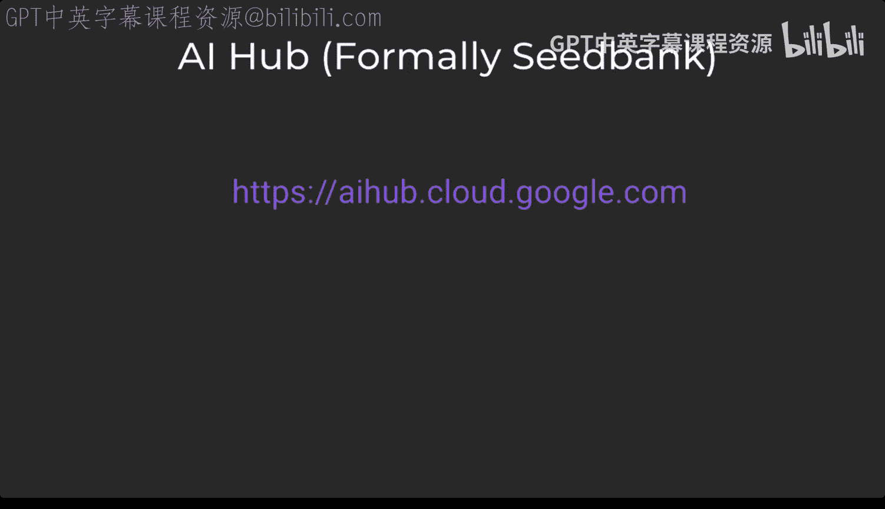
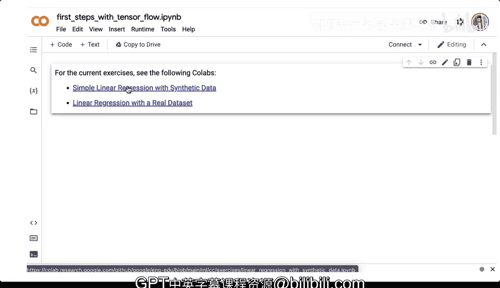

# 杜克大学｜Python、Bash和SQL数据工程基础2-4Python Bash and SQL Essentials for Data Engineering p143 09_02_02_Colab导论.zh_en -BV1XS421X7tw_p143-

In this lesson， we'll look at Google Coab。 We'll discuss managed notebook environments。

Look at text cell previews。Learn how to mount Google Drive in a collab notebook。

And how to manage coab notebooks。Google Coab is a managed environment。It is hosted in the cloud。

 It's a Jupiter notebook， with extra features。It has pre installed data science packages。

So for much of what you'll do， you won't have to worry about the environment or any type of setup。

A Google Coab。Is Python only， unlike the normal Jupiter Notes。It's free to use。

With the Google account。And because it's in the cloud， the documents are by their nature， shareable。

Much as you share other types of Google documents。And it has a wide ecosystem of shared collections。

 One such shared ecosystem is Google's AI H， former known as seed bank。

Let's take a look at Sed Bank， also known as AI Hub。And seem back。

 there are a bunch of example notebooks。Where you can learn about different subjects related to machine learning and data science。

If we select a notebook， we can see。I can read through it here。

Or we can open the notebook and Google Collab ourselves。

This gives us a copy of the notebook that we can then modify。As we wish。

