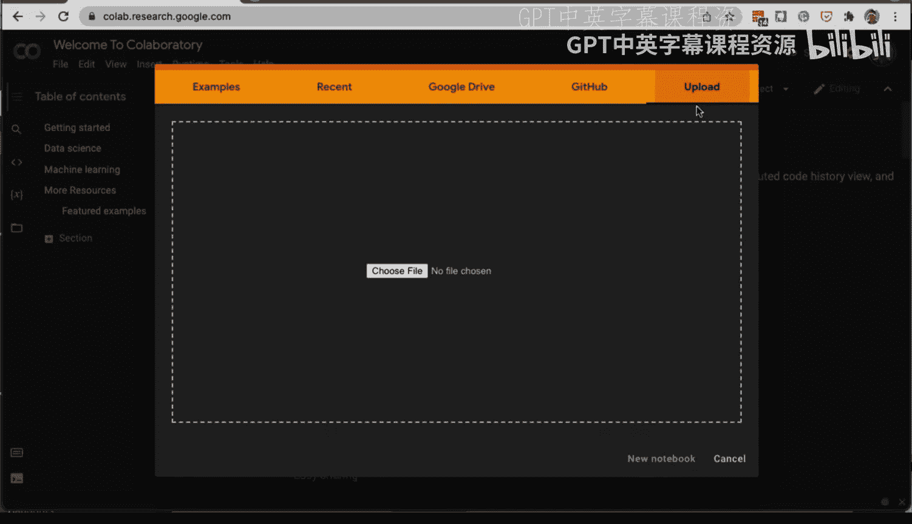
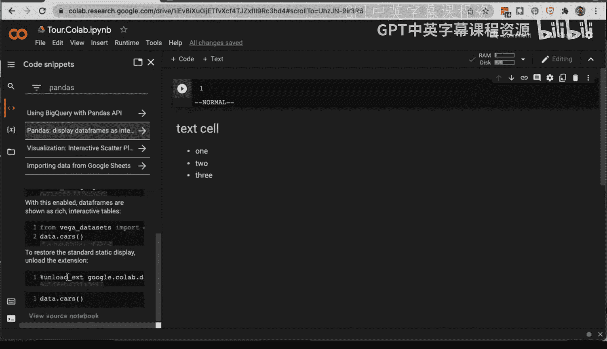
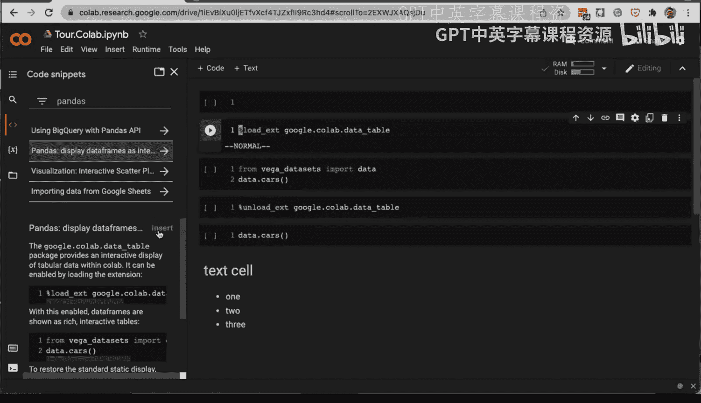
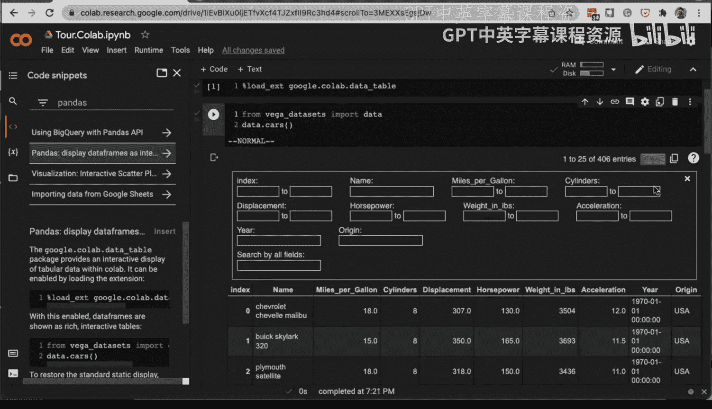

# 杜克大学｜Python、Bash和SQL数据工程基础2-4Python Bash and SQL Essentials for Data Engineering p144 10_02_03_Colab功能导览.zh_en -BV1XS421X7tw_p144-

Let's take a tour of Coab。To access Google Coolab。Go to Collab。research。google。com。

The first one you'll see。Let you open up recent notebooks if you have any。Example notebooks。

Notebooks you have stored on Google Drive。Or GitHub， the option to upload a Jupiter notebook。

From your computer。

With the option to create a new coab notebook。Since coabb notebooks are only Python based kernels。

 it doesn't give you an option to choose a different kernel。

 you can see that the layout is similar to Jupiter Lab。There's a menu on the left。Acroross the top。

Licked。Change the name of the notebook here。And that will change the file name when it's saved。

 just as in Jupiter， the notebooks are automatically saved at a regular interval。On the left。

 we have a table of contents， where if we have。Headters in such sections， they'll show up。

We have the ability to find and replace through a notebook。Some code snippets。

Which we'll talk about in a moment。The ability to。Track the values of variables。

And a place for files and data， which we'll look at later。We can also， when we add cells。

 we can add a text cell directly instead of having to convert it to a text cell afterwards。

So here we can see a preview of what's happening in our text cell even before we've finished。

Writinginess。So we don't have to run the textile to see a preview of the markdown。

Let's look at some of the other options。These code sppets are example pieces of code。

So we can see there's all sorts of different things we can do。They're useful little examples。

And we can search through them。Choose a snippet down here。

 It'll show some information about the snippet。 It'll explain it。 Show some of the code。

And then we can insert it into our notebook。Once it's inserted into our notebook， we can run it。

And you can see it'。Loaded a table。In this particular snippet。

L a function that shows this table in a way that you can interact with it。

So you can actually filter the table。Using this interface。

Much as you would with a spreadsheet。