# 杜克大学｜Python、Bash和SQL数据工程基础2-4Python Bash and SQL Essentials for Data Engineering p145 11_02_04_Colab中的数据与文档.zh_en -BV1XS421X7tw_p145-

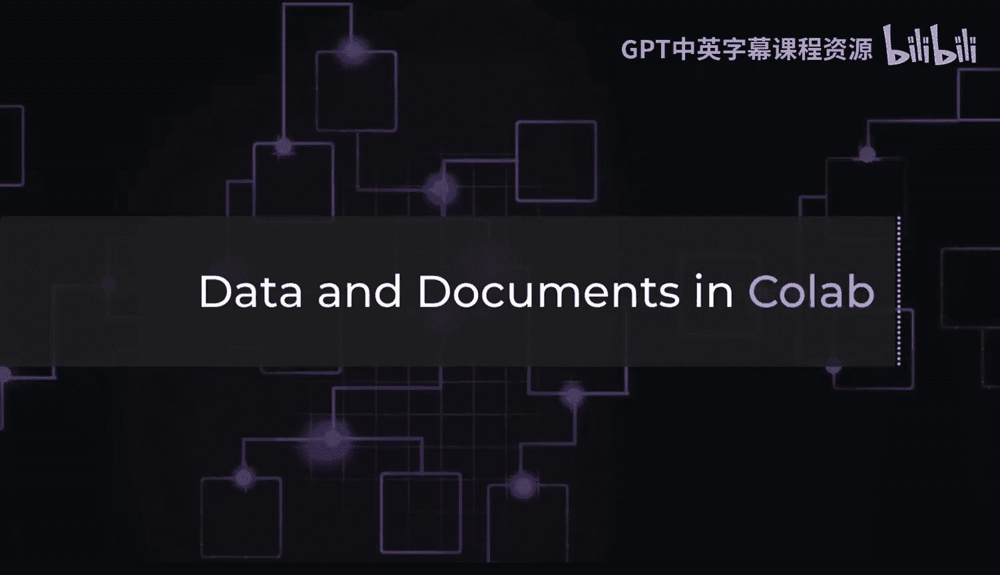

So let's look at how we handle documents and files。 Weve already seen in this left tab。

 There's a file section。 This section actually comes preloaded with some sample data that Google supplies for you to play around with。

 So read me file。 If you double click on anything in here。This pane opens up。

 which reads you or gives you a preview of the file。 So this allows us to read the Read me file。

 which describes the sample data。 we open one of the sample files。

 it too is previewed here on the right。 So as well as the supplied data。

 we have other ways to bring data into our documents。 This Mount Drive button。

 will actually connect us to our Google Drive。

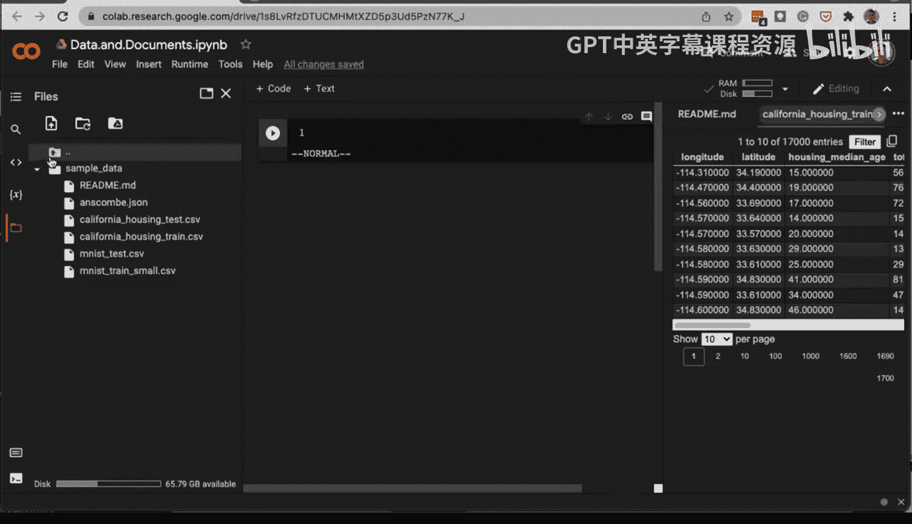

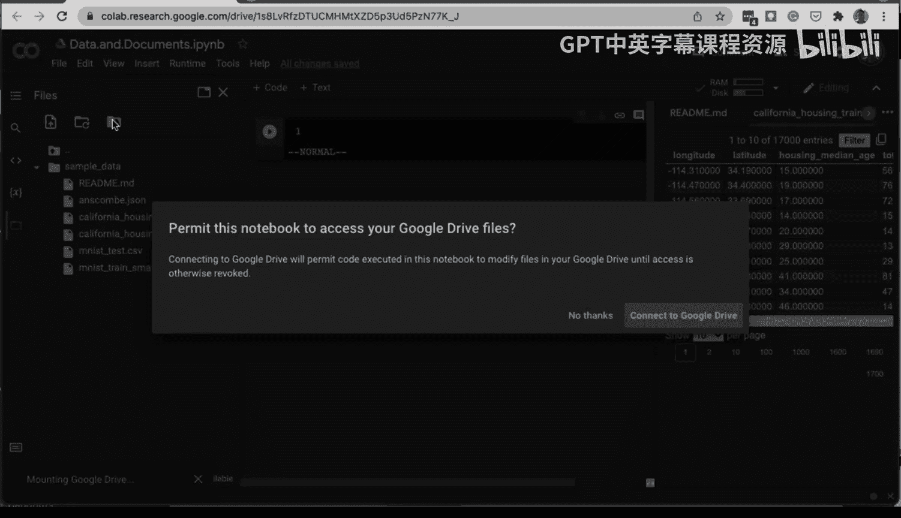

Which takes a few moments。Now， we can see here our drive is mounted。

 This give you access to all the files you have in your drive and also the ability to write files into the drive。

 If you have outputs， you want to keep in addition to Google Drive and the sample data that comes along。

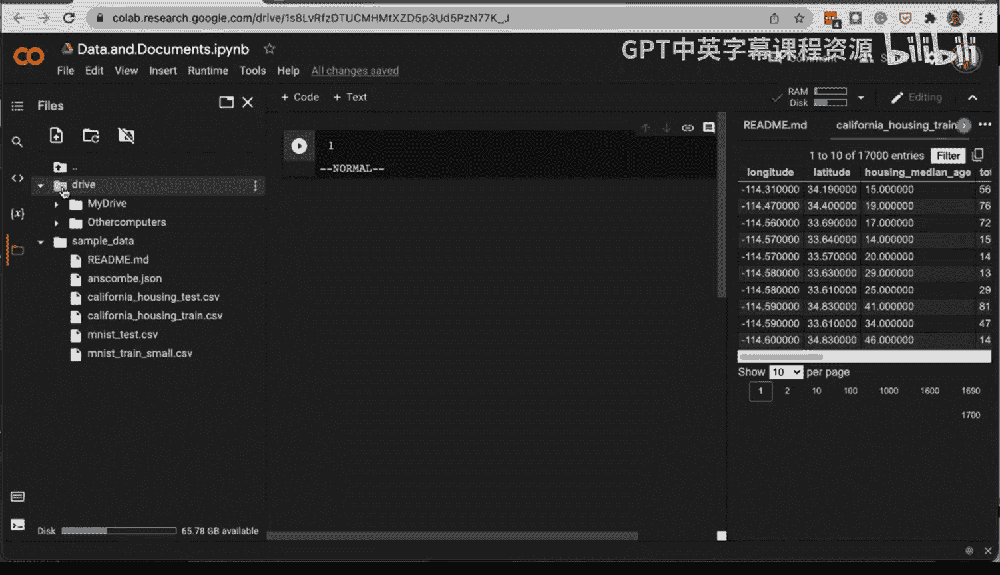

You can upload individual files。

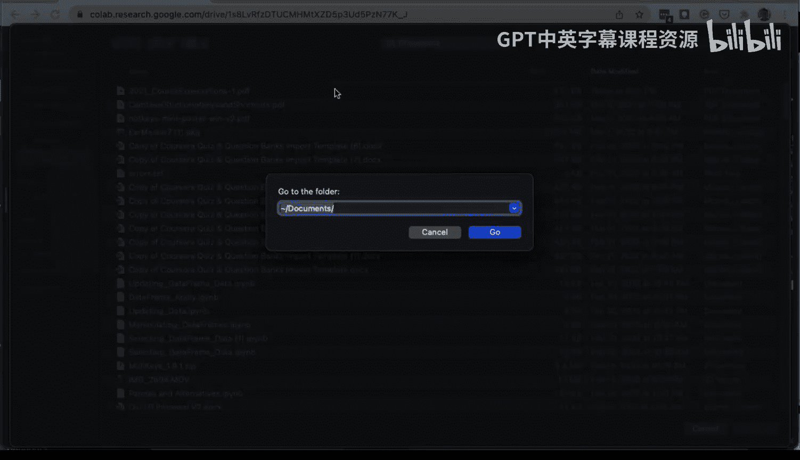

From your hard drive。So here we will upload a CSV file。

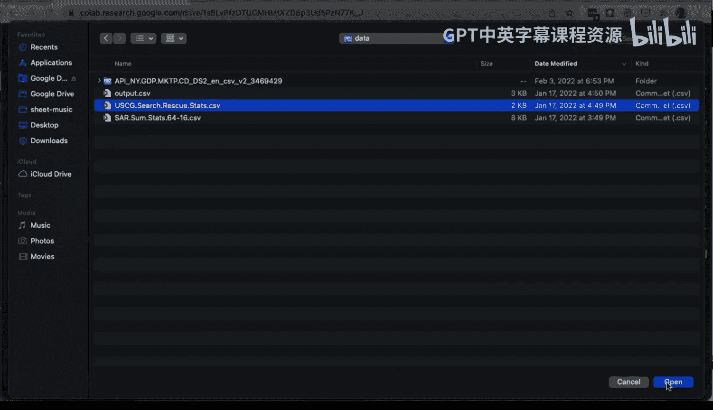

And it now appears in our files， which allows us to access it from the code。

 do note that in between sessions， uploaded files are not preserved。

 so you'll have to re uploadload them if you want to use them again。By default。

 Google ColLD documents are saved in Google Drive。

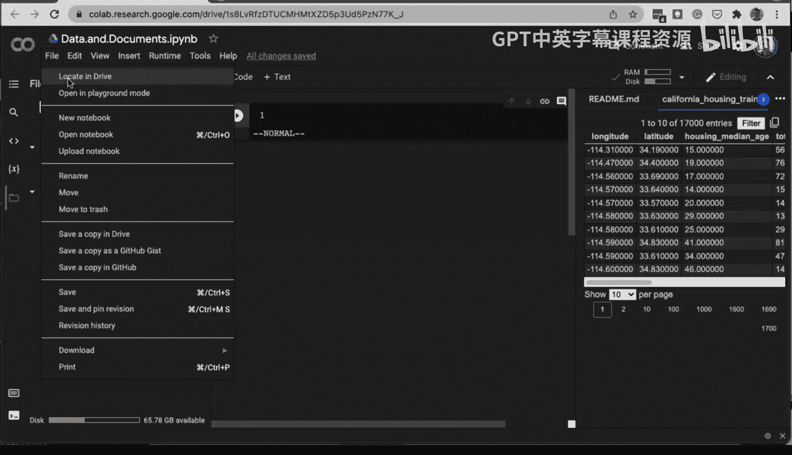

So we can see in my drive， there's a coab notebooks directory that's created by Google CoAab automatically。

And this document is here。

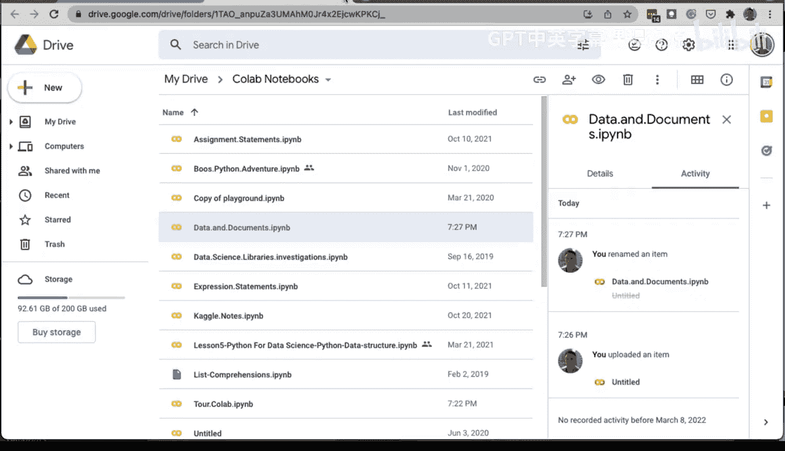

In addition to saving them in Google Drive， we have the option to save a copy into Gitthub。

Either as a file and revision control。Where is a Github G？We can also download a copy of the file。

Either as a Jupiter notebook。Or is a Python file ready to be executed on the command line？

The files are automatically saved， but we can explicitly save them at any time。And save them。

Ptting a revision。I can then view a revision history。

And see what changes there were between various provisions。

It's also possible to upload a Jupiter notebook from disk。

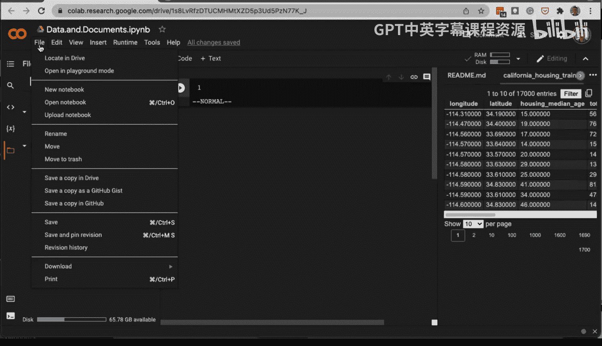

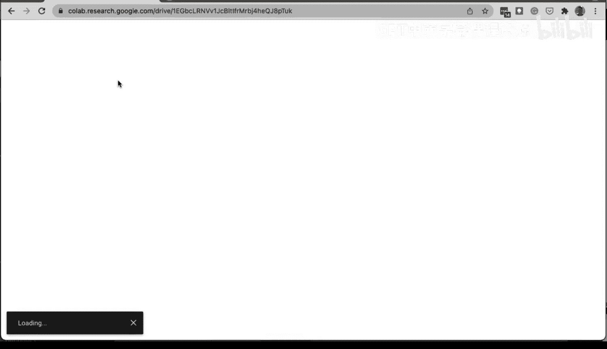

Here we've uploaded a notebook we created in vanilla Jupiter。H our laptop。And brought it。

Into Google Collab's cloud。 So in summary， in this lesson， we've learned about Google Collab。

 which is a form of managed cloud based notebooks。Google Coab Notes have extended Jupiter notebook functionality。

There's an ecosystem of notebooks containing information about data science。

 which you can learn to research particular topics。

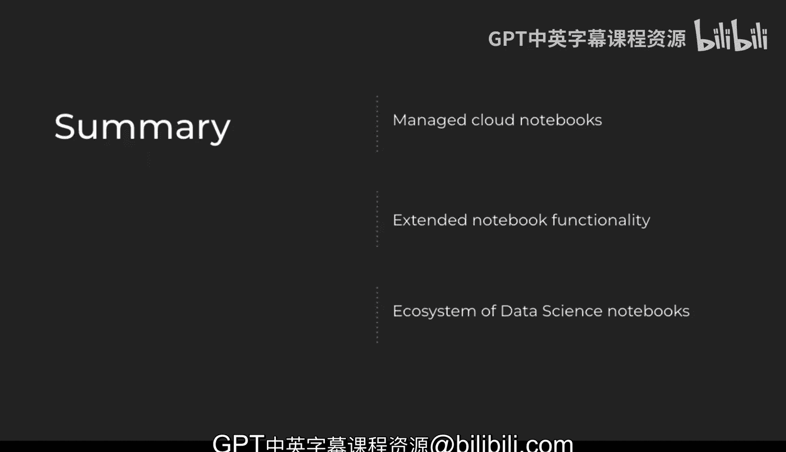