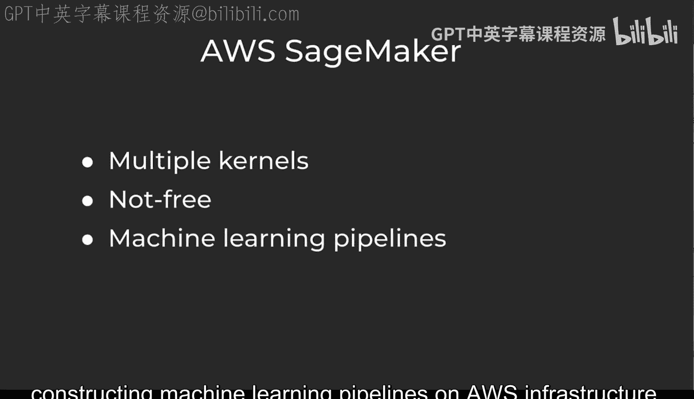
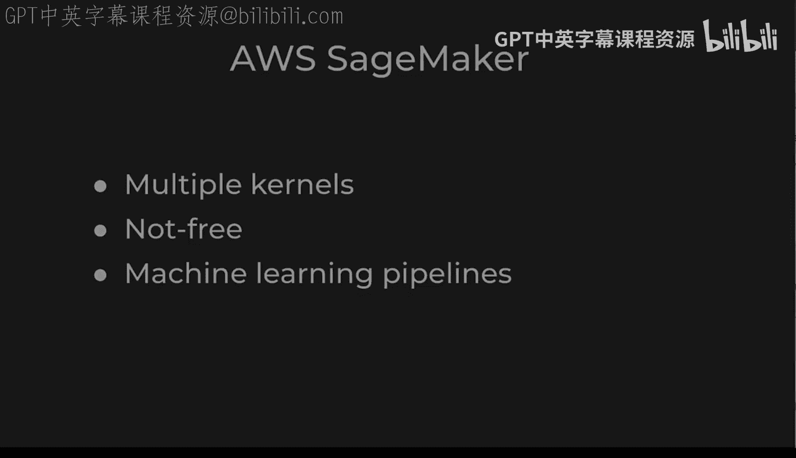
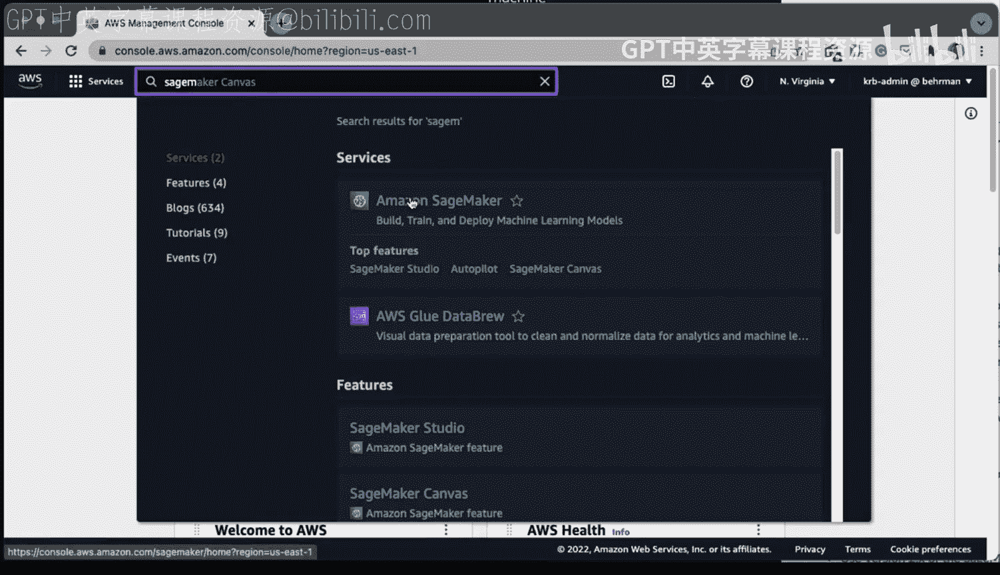
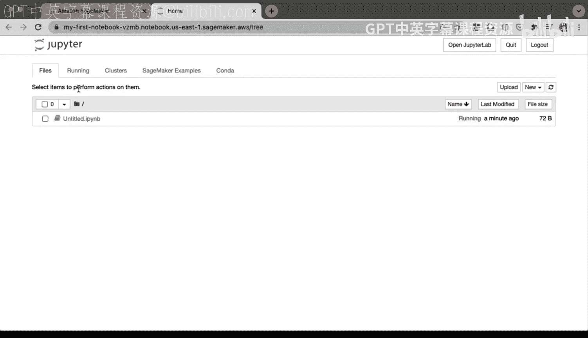

# 杜克大学｜Python、Bash和SQL数据工程基础2-4Python Bash and SQL Essentials for Data Engineering p146 12_02_02_SageMaker导论.zh_en -BV1XS421X7tw_p146-

In this lesson on AWS Sagemaker。Will'll create a sagemaker notebook。Take a tour of Sagemakerr Studio。

And learn about data and feature creation， using pipelines。

Aware's Sagemaker is AWS's hosted notebook En。Unlike Google Coab。

 there are multiple available kernels for your notebooks。Also， unlike Coab， it is not free。

Is designed for constructing machine learning pipelines on AWS's infrastructure。

Once you've logged into the AWS Council。can find sagemakerr by searching for it。Here。

The first thing you'll need to do to use SageMaker is set up a sageMaker domain。

You can see the status that this domain has being created。This takes a few moments。

 so we'll pause the video。Now that our domain is ready。We can create a notebook。

By selecting the notebook。Interface here， you can search for existing notebooks。Or create a new one。

Give their a notebook a name。And here we choose the instance type we want our notebook to run on。

Should be careful。To not choose one bigger or more powerful than what you need。

 because you will be paying for it。You scroll down， you can see the T's， the M's。

The compute optimized。Accelelerated computing。Had memory optimized。You have other options。

But for the sake of this example， we're just going to create an notebook with the defaults。

I can see here that the status is pending。It'll take a few moments for the notebook to be created。

Now that our notebook is created， we can open it。To open it in。The single notebook， Jupiter style。

Hes open Jupiter here。And you can see that we have the normal， Jupiter interface。

Amazon does offer quite a few kernels。Both for R and Python。And here we have a Jupyter notebook。

That's being served in AWS's environment。Generally。

 these notebooks work just as you'd expect a normal Jupyter notebook to run。

 One thing Amazon does offer is a special SDK。It's 60 K。Gives you access。To。

A whole world of tools for use in machine learning， including tools for training and building models。

 tools for accessing resources in AWS。And doing lots of other things。For example。

 we want to find the environment we're running our notebook in。

We can get it by calling the Boho region name。And you can see I'm running in US East1。

 When we're done with our notebook， and close it。And be sure to。Stop it as well。

