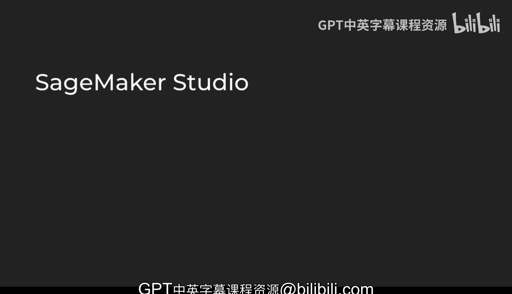
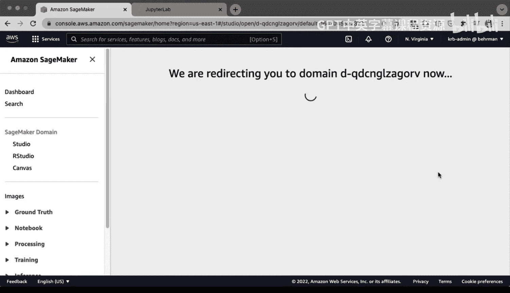
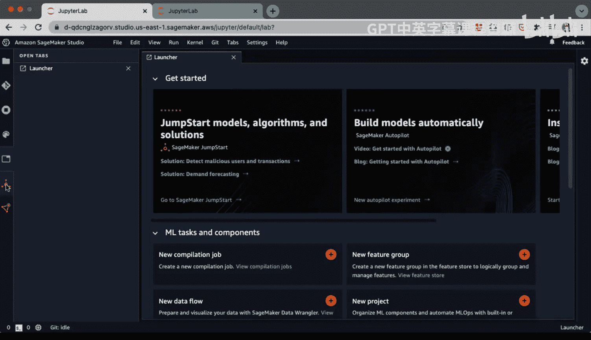
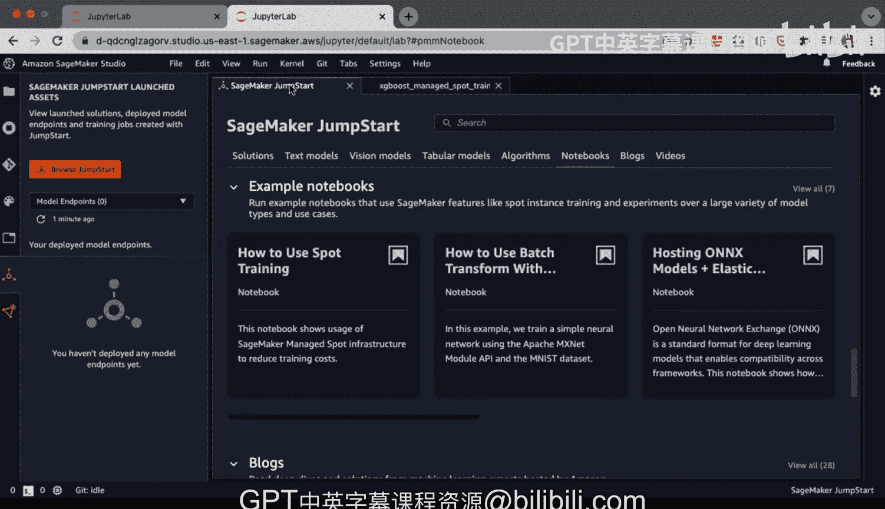

# 杜克大学｜Python、Bash和SQL数据工程基础2-4Python Bash and SQL Essentials for Data Engineering p147 13_02_03_SageMaker Studio导览.zh_en -BV1XS421X7tw_p147-

Let's take a look at Sagemakerker's studio。

To launch Sagemaker studio， we go back to our Sagemaker domain。En large studio。

Once your Amazon Sagemaker studio instance is created， you should see a view similar to this。

This should look familiar。 It's very much like。Jupiter La。In fact。

 it is Jupiter La with some extensions to add new functions and capability。 If we looked on the left。

 we see some familiar controls that we've seen before in Jupiter La， such as a file browser。

If we've connected our。Domain to a git repository， we can interact with the git repository here。

You can see any running。Applications， instances， and kernel sessions here。We can have multiple。

Notebooks running multiple kernels at the same time。In Sagemakerr studio。

Here we have a useful interface for finding commands that work in SageMaker studio。

A lot of these are the same commands we've seen before。

 this makes it an easy way to find them though。This is the launcher。

 which is what we're currently viewing。

This is an interface to SageMake jumpstar。And these are other sage major resources。

Let's take a look at Sage Winker jumpstar。Jumpstart has a collection of example models。

And notebooks as well as videos and blogs。That allow you to。Get started quickly。

So here we can look at some of these models。And we can grab one。Let's see we can deploy the model。

And talk about how to train it。It's also a description so we can understand what the model does。

This is a handy feature for getting started quickly。Here， we can。Open a notebook。You can see。

If we want to use the notebook， we can import it。So that we can change it。

This notebook will teach us how to use X boost， which is a。Model used in machine learning。

So other than these additions。You really should think of sagemaker's studio as being。Basically。

 Jupiter Lab。But served in the AWS hosted Cloudout。

