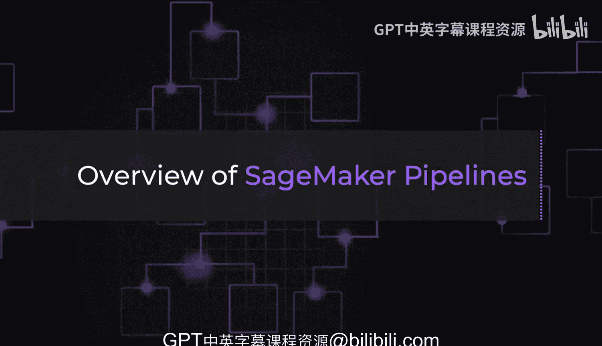
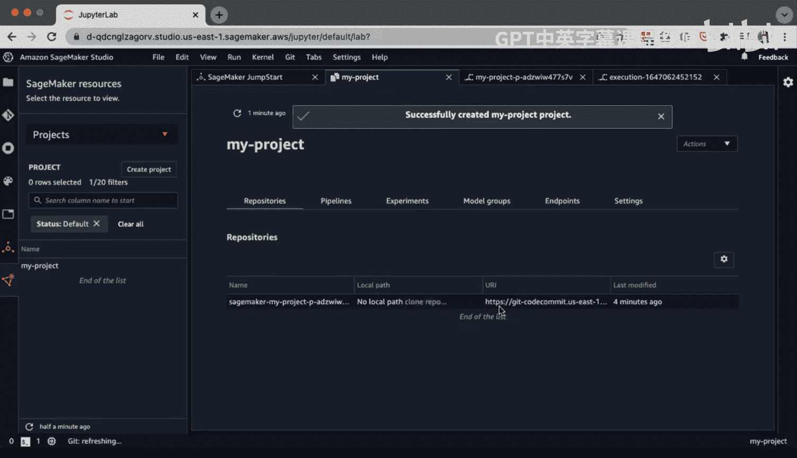
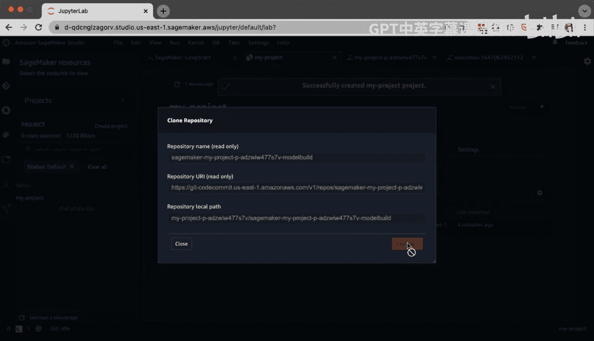
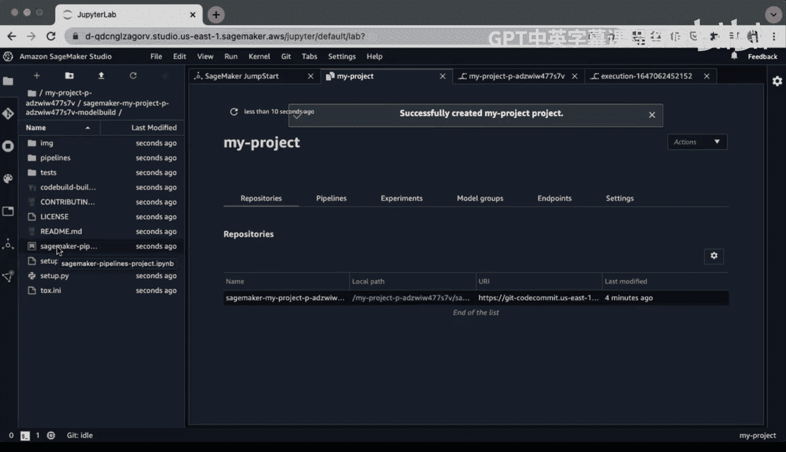
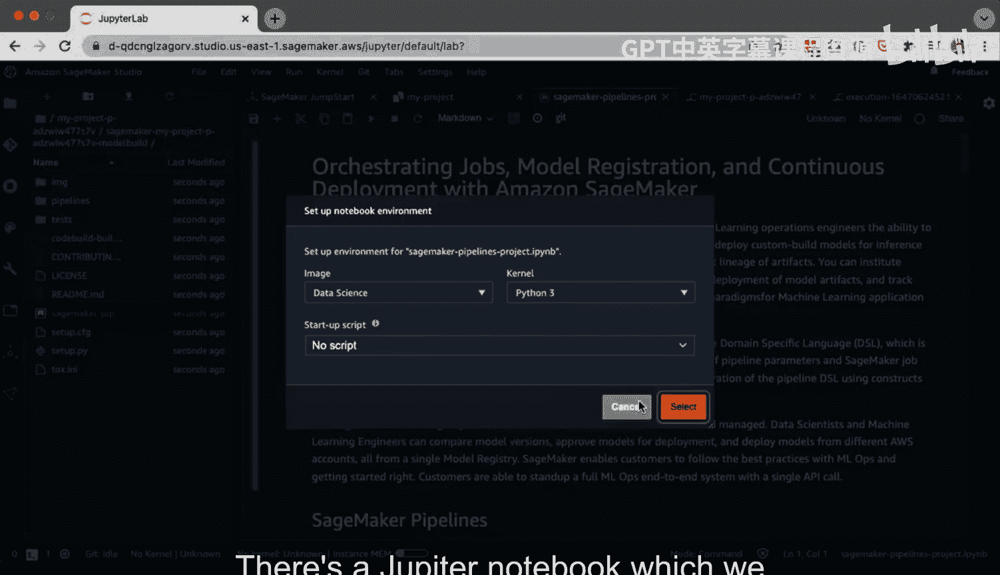
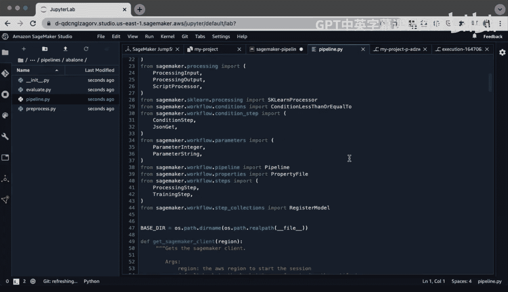
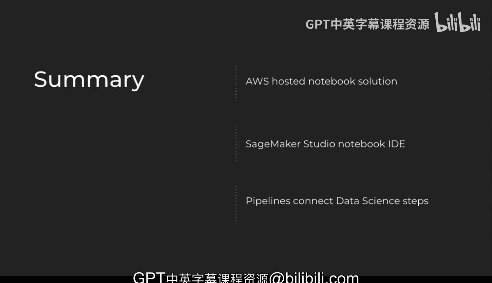

# 杜克大学｜Python、Bash和SQL数据工程基础2-4Python Bash and SQL Essentials for Data Engineering p148 14_02_04_SageMaker Pipelines概览.zh_en -BV1XS421X7tw_p148-

Now， let's look at sageMake Pis。 Here we are back in Sagemaker Studio。To use pipelines。

 we need to create a project。SageMaker Studio provides template projects that we can use as a basis for many common situations。

We'll choose a project that's for building and training a machine learning module。

Give the project a name。Yeah。And then it'll take a few minutes for the project to create。Now。

 our project has been created。Here's the pipeline for our project。

And see if the pipeline is executing， this is done automatically when you create a new pipeline。

And we can see here a graph of the pipeline with all the steps that are outlined in our pipeline。

As nodes in our graph， and we can click on a node。Get information about what that note is。

Input that was sent to the node， any output that the node has and logs if the node has logs。

If we go back， we can。See here， this is the。Get repository where the code defining this project lives。

We can make a copy of this code so that we can take a look and modify it for our own project。

So we see here。This is the。Code and and files in this project。

There's a Jupyter notebook， which we can open up and it has an explanation of what the project does and information about SageMake pipelines。

If we go in this pipelines directory。The pipeline itself is defined in this file。

 you see it's defined using Python。And each step has its own class and is defined here。

So this is how sage me pipelines。Give you a way to。H。Wrap up data science operations。

In a deployable manner that's repeatable and worthy of production code。So， in summary。In this lesson。

 we've learned about sageMake notebooks。Which are AWS's hosted Notebook solutionl。

We've seen StageMake Studio， which is really an IDE for notebook creation and management。

And we've introduced the idea of sagemaker pipelines， which connect different steps。

Taken in data science solutions。