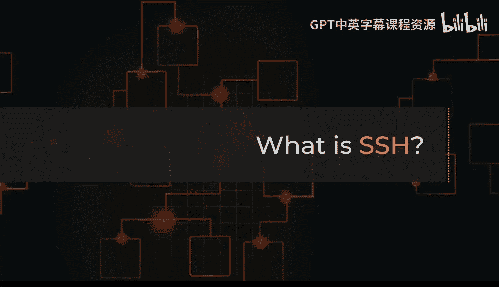
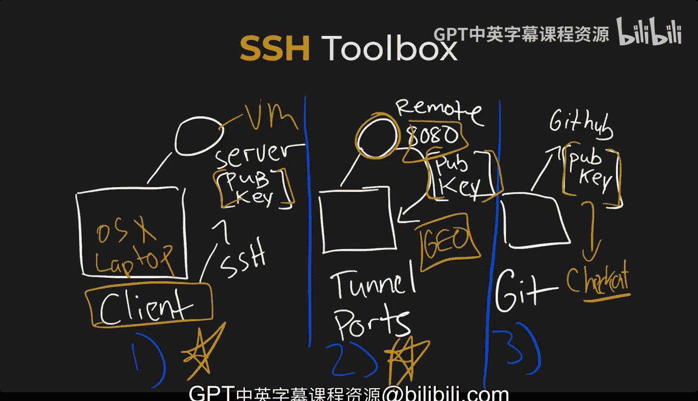

# 杜克大学｜Python、Bash和SQL数据工程基础2-4Python Bash and SQL Essentials for Data Engineering p15 15_01_03_什么是SSH.zh_en -BV1XS421X7tw_p15-

Let's talk through SSH in a way it's kind of surprising。 what does this have to do with bash。

 but SSH is actually one of the most useful utilities in doing bash operations Why well first you can actually shell into a server and run commands either on the server itself through SSH or you can actually remotely invoke a command and this is one of the most powerful ways to use SSH in fact。

 if you wanted to do a distributed computing job and data engineering， maybe talk to a cluster。

 you can actually invoke some command across all the machines in the cluster Another common technique is to use SSH keys in communicating with GitthHub so this happens quite a bit if you're going to let's say check out a repository you'll take your public key and you'll give this to a location that you can communicate with and then you can pull your code from that location。

This is in fact how GiHub works。 A third method is actually being able to use the SSH protocol to tunnel into a server and forward the traffic to your server is really common if you have let's say a server inside of the AWS cloud or the Google Cloud or Azure cloud and you wanted to run some code inside of that environment and then expose。

 let's say a local host 8080 server that's using flask or fast API or some microservice and then actually develop it on your local desktop without needing to open up a port。

 This is what SSH does allows you to forward these ports to different locations。

 This is very common for a data engineer and we're going walk through each of these different techniques so that you can be an expert in SSH tools。

嗯。Let's talk through SSSH SSSH is really a toolbox。

 It allows you to do many different kinds of things for data engineering。

 software development let's start with option one here。

 you can see in this example that I have a client machine and this is often let's say a laptop like an OS10 laptop and I want to talk to a cloud server well how would I do this I would just spin up this virtual machine over here and I would put the SSH key the public key。

Onto that server and then I can actually make connections to that remote machine and run commands on it。

 Now the difference here is that I can actually treat that remote machine like it's my local machine because I can execute any bash command that I want So this is a great way to switch to a different operating system and run it in the environment where you actually are going to a later host your code So this is very friendly to developers Now an option here this is a really common scenario as well if you're needing to talk to let's say a very secure location maybe you're in defense or you're in healthcare or you're working with some kind of advanced networking。

 What you can do is you can actually tunnel and forward a remote servers ports to your port again it works the same way you would actually take a public key and you put it onto that remote server and then when you make an SS connection you can basically say that certain ports like in this example maybe you have a flask gap that's running a port 8080 it can actually。

Run locally on your machine， so you don't even need to know。

Really anything about that remote server once you've got that setup。

 you can just turn on port forwarding and then you can actually start to execute and run remote commands on this remote server people often do this as well to get around geographic restrictions to a certain website you could actually forward your traffic to a remote location and then it appears that you're in that remote location。

In a third method and this is again very common， you would take your public key here with。

 let's say GitHub and you would use that so that you could do a checkout of your source control without needing to type in a password and this is really handy because of the fact that you have an encrypted end-to end connection and then you don't have to constantly be typing in your password back and forth so really from a bash-based developer workflow SSH is one of the most useful tools that you can come across and we're going to show examples in screencast on how to do all three of these methods。

