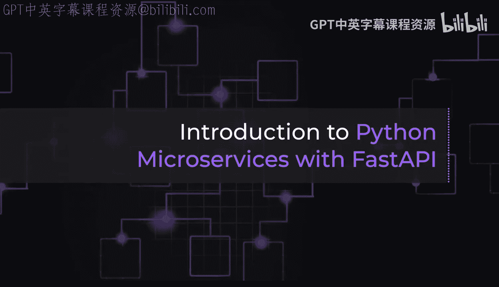

# 杜克大学｜Python、Bash和SQL数据工程基础2-4Python Bash and SQL Essentials for Data Engineering p153 19_03_02_FastAPI Python微服务导论.zh_en -BV1XS421X7tw_p153-

Welcome to the next lesson on Python microservices。 In this lesson。

 we're going to cover some of the best practices for building Python microservices and also why Python is such a great language to quickly prototype of function。

 map it to a service like Fast API or flask and then put that into production。

 We'll also touch on some new frameworks like AWs Lambda， which allows you to build some logic。

 put it inside of a AWS Lambda ecosystem and then respond to events。

 So this event drivenven programming paradigm is a great way to do microservices in Python。 Okay。

 let's go ahead and get started。😊。

