# 杜克大学｜Python、Bash和SQL数据工程基础2-4Python Bash and SQL Essentials for Data Engineering p155 21_03_04_部署Python Lambda微服务.zh_en -BV1XS421X7tw_p155-

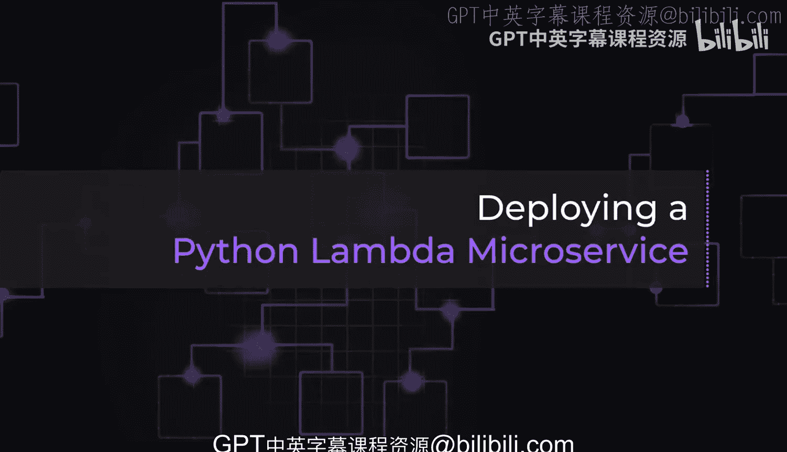

This is the repo that has this high level architecture here inside of it。

 and in particular this high level architecture， you can see that this is what we did we went to Cagle。

We created a file system。 We did Auto。 We registered the best model。 We also click the serve。

 but I'm gonna I'm going actually interact now in a cloud based development environment。

 in this case， I think to start with。I could I could probably play around with it in initially in GiHub code spaces that'd probably be a good environment to play around with it in and then later we'll push this out via a containerized microservice so we can kind of almost pretend that Databricks doesn't exist now if we want to right we can just download the model and just start playing around with it so let's go ahead and experiment with how to do that So first up I'm going to click on this button up here called code。

And I'm going to actually go to a code space， I'm going to take this existing code space that I had set up a while back。

And I'm going to open this up。 and this is similar to。

AWS cloud 9 in that allows me to like test that ideas and play around with the code inside of this code space。

And let me show you a couple things that we can do。Thing that we can do。Is that。

We can actually list all of the models that are available in this tracking system。

 and this is actually very interesting is that in a traditional standalone psyit learn type environment。

 actually let me change the background to make this a little bit easier on the eyes。

I'm going to change the color to。

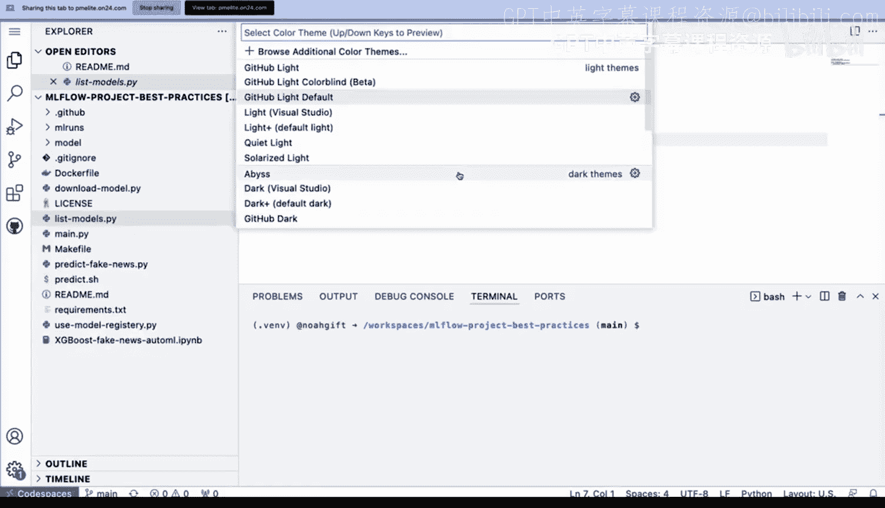

Visual Studio dark， there we go， that's a little bit easier for me。

What's nice here though about this is notice that this particular piece of code will go into the Databrick system and it will then say look。

 show me all of the different models that are registered， so let's try it out。

 go ahead and say Python list models。And then notice that it will make an API call because I created a Databricks token earlier。

 so this is an environmental variable that now I have a hook into the Databricks file system and look。

We should be， I could even grab。That model， I could just say fake something like this or grip。

 I need to grip。Like this。Here we go。 Look， see that that's the model I just created text only fake news。

 so pretty pretty neat actually that I've registered the model and now I can just pretend essentially Databricks doesn't exist。

 I can now start to treat this like like its own project。And then the other thing that we could do。

Is that I can also download the model。 So check this out。 So if I go here。

Notice that this is the model， a different kind of model that I downloaded。

But I can actually create another version of this script or make a chameleion tool or something like that and put this model somewhere different。

 So what I'm going to do。Is I think I'll just swap this out like this。With the new token。

Or the new I for the different model， the fake news one， right， which is。

 I think if I look inside of here。It's this， it's 68 AFF， it's this。

 it's basically this this payload， so I'm going to go ahead and swap this out。And see what happens。

 so let's go ahead and do that。Let's save this。we'll say， first of all。

 let's look at what version of Python we're using。 Yeah， Python 38， I think that's good。

I think that this should probably work。And because the models have to be serialized in a certain。

V of Python， I think there can sometimes be problems between Python 38 and 37 things like that。

 but for now I think that this will work， I'm going to go ahead and say a Python download model。

There we go and we're able to actually。Download this model and look。

 it put the model inside of this directory right here and we could look at it。 We could do this。

 We could do LS D L。And not that I want to look at the model location。

And we'll go through here and we'll run this。Aha， so we see that it has。A requirements file。

 it has the model right here， so really these are the two pieces of code that I really care about。

And now what I could do is notice I have a model directory here， which is my other。

Model that I had previously， I could just overwrite this， which I think is a good idea。

 so I'm going to go ahead and do that。I'm going to。I'm going to actually Cp this data。Hereear。

Inside of this directory。And I'm going to overwrite my existing model。

 let's go ahead and try that out and see what happens。We'll do this asterisk。

 and we'll do model here。There we go and so if I say get status。

 it should be a different model right because I change the download model， I changed this。

And I change input example。Because the input example is now going to be different because it should be really simple。

 look very easy， it's just one column which is kind of neat because I don't have to do anything。

At all to it now。And so from here， I could just say get status right， I'll say， I'll commit this。

Dear command。And then say， adding。New model。There we go。Get and we'll push this。

Let's do a poll first。There we go， merge。Yeah， and then we'll do gi push。So I got this working。

 so how would I build out a？A script here or something that can actually interact with it。

 so before I had to do this really large example， I can actually get rid of all this in fact。

And I'm going to change this code because all I need to do is create a payload。That has text in it。

 that's it。And so I'm going to create a data frame here。

That just puts something that looks fake inside。 In fact， I could refer to the input example here。

That look at it looks like the data。In fact， I could just literally copy this payload to start with。

I believe I could just import this into pandas let's go ahead and try this because that's what's nice is it gives us this structure。

And。Let's type in I Python here。And we can say import pandas。As PDd。And then I could say PD。

 data frame。And I thought you can just throw that。No， that's that's just too big of a。Oh。

 this is a big piece of text here。Maybe I don't want to do that one。嗯。Text here。Let's let's try that。

 let's just try this piece of text。Aens are coming， I'm going to make a data frame out of it。

 and then I can just really riff off of that code。Which I did earlier。And。

We could could either we could either invoke。The one externally， or we should be able to。

To run the prediction here locally， as well。Which I think。Would work so we could either， yeah。

 we can basically either load this thing up locally。Or we we can make， we can make a smaller one。

 which let me just look at this thing， which would be using this。

 I think this is actually what we want to do is we want to actually。

I think it's at this point I could just build a flask gap actually that would be easier。

 let's go ahead and try this onem i'm changing the wrong one so let's change this one， which is。

The text here。We'll put this， we'll keep the text。We'll keep this going here like that。

So we have a very simple data frame。Right here that's going to be created。And notice that that's it。

 that's the only piece that I need to do as I say。Load this model from disk right here。

 load this model from disk that I just downloaded and then this is the piece of code that will do the predict which will take the loaded model and then I create an endpoint in this case in flask that will go through here and it will use this text based input to make a prediction and then I basically convert it to J and return back adjacent response so let's go ahead and run this that would be a good one to run so let's go ahead and do this I'll type in Python mean。

Dot pY， and this should work。I guess we're about to find out。Okay， looks like it's running。

 that's good。In this case。We could do this， which I think I'll just need to。

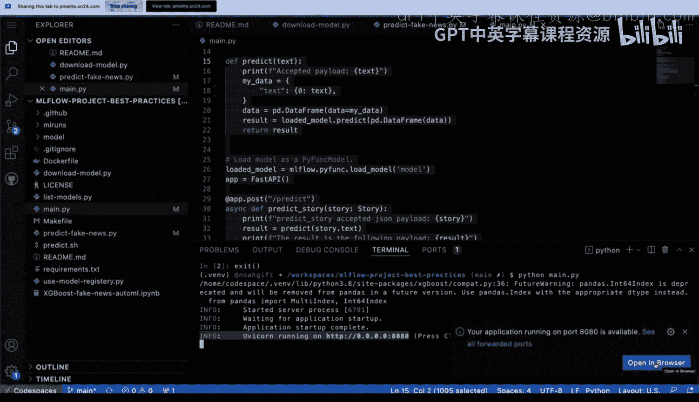

To open this browser window here。And paste this back into our window。So we can toggle back and forth。

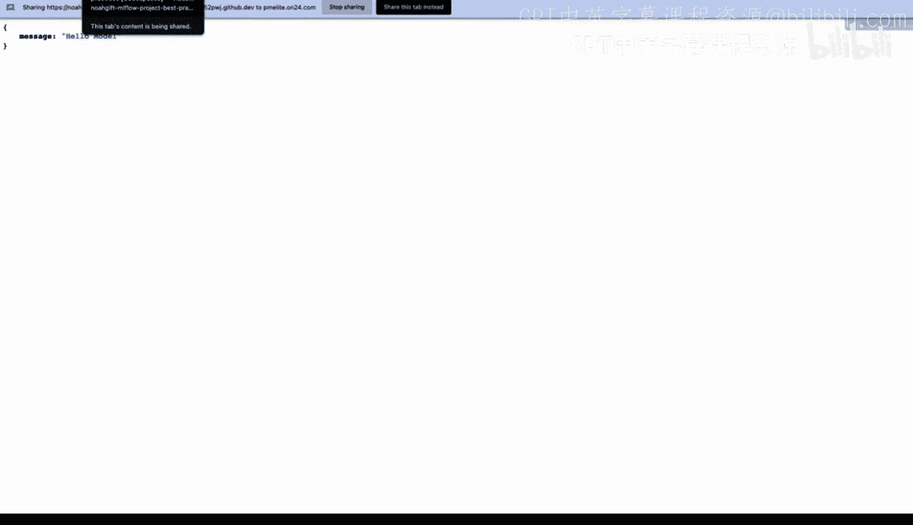

Which does make things a little bit more complex， but let's try it out so I can see this and now in order to interact with this model。

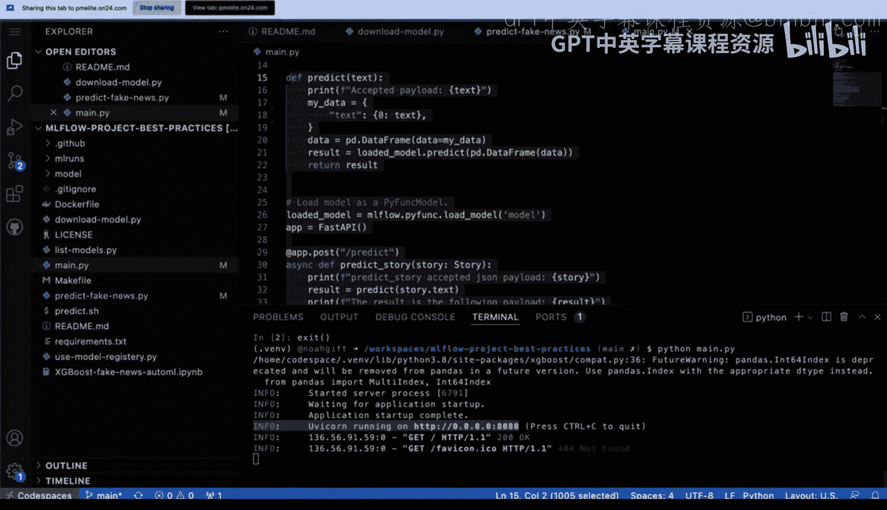

I can do docs。And so what's nice about this is that now I have a web service that has really known again。

 has no interface with Databricks this is at this point we just have a model it's using fast API which is a Python web service and we can just we can basically just play around with this code and so this is really pretty awesome in that all I need to do now is kind of package package the thing up and do an import so if I click on post。

I should be able to try this out this endpoint。And then say whatever it is I need to do。 so。

 you know， aliens are coming。To invade Earth。Some kind of fake news story。

Let's go ahead and see if it predicts that that's fake。

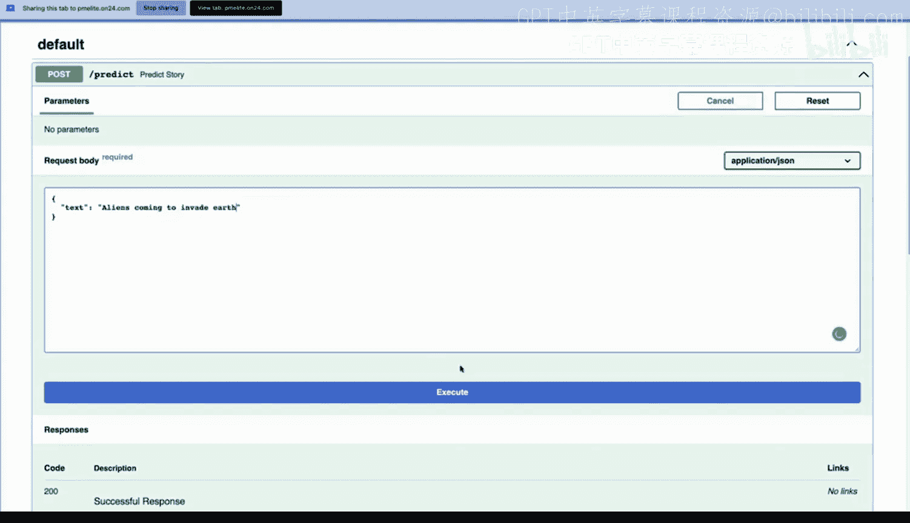

And look it says fakeake news， it returns back one， which I believe would be true。

 it's a fake news story and so we're able to actually get this whole input here back so we're able to use this in point here。

 everything is working correctly and then if I wanted to I could build Camillean tools with this kind of style。

 I could build lots of different things using this kind of a style so。

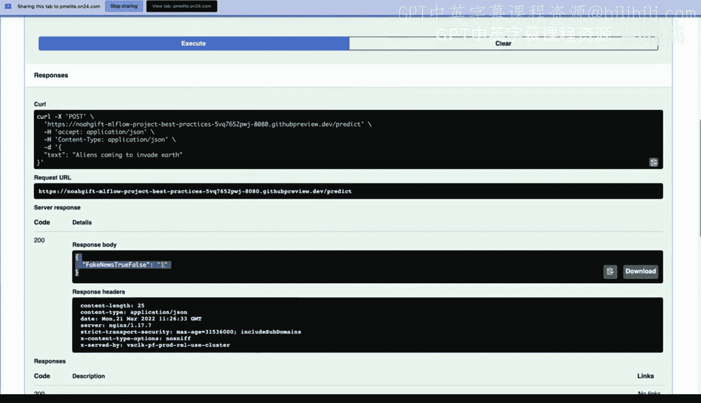

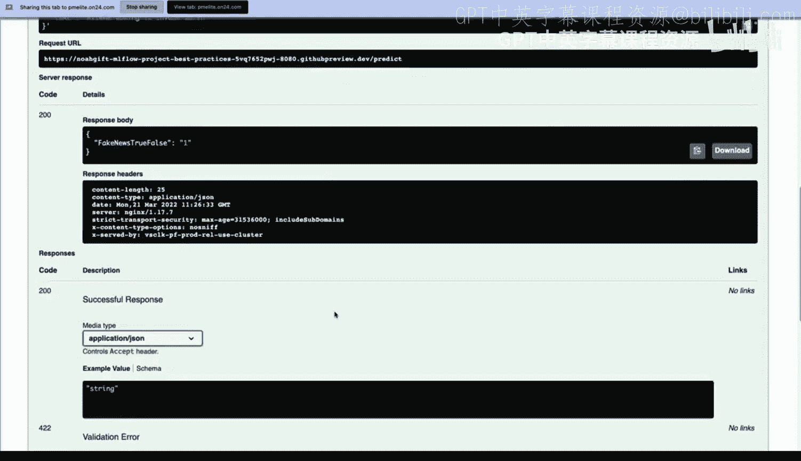

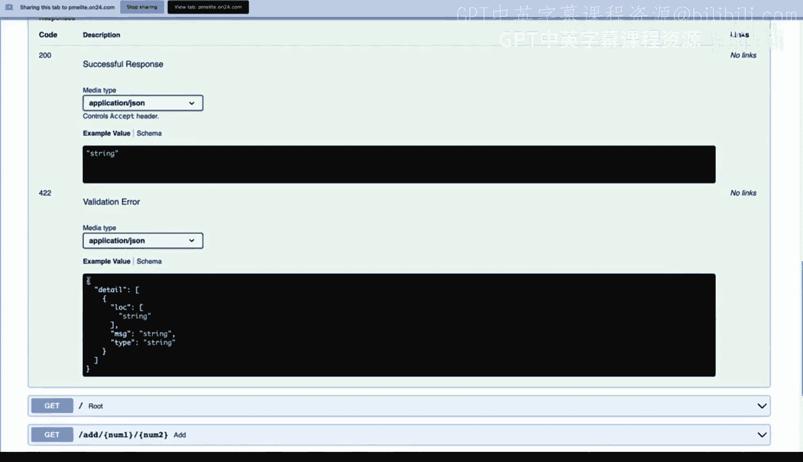

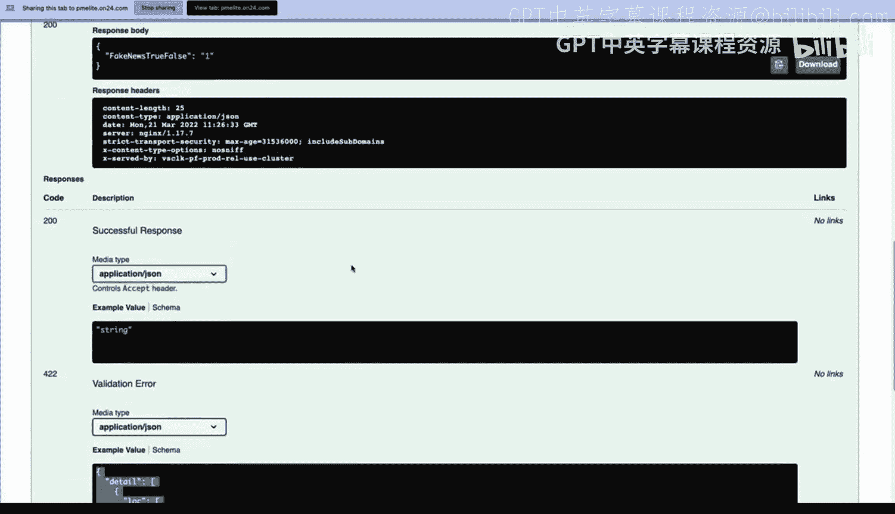

That might be a good thing to try out next is to see if we can also build like a nice little chamullan tool that can also import and play around with this library。

 and that will set us up to then be able to containerize both of these systems and then set up a continuous deliveries。

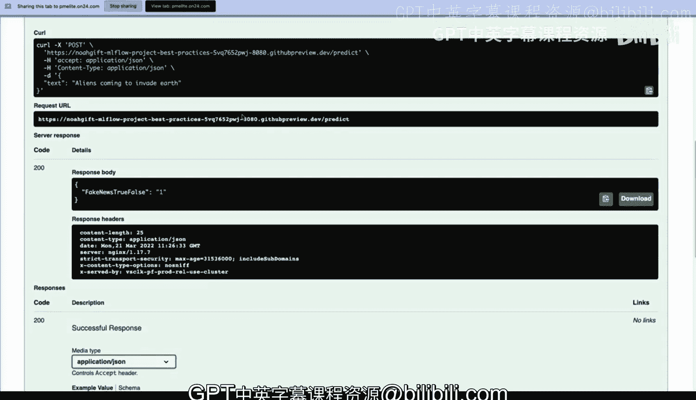