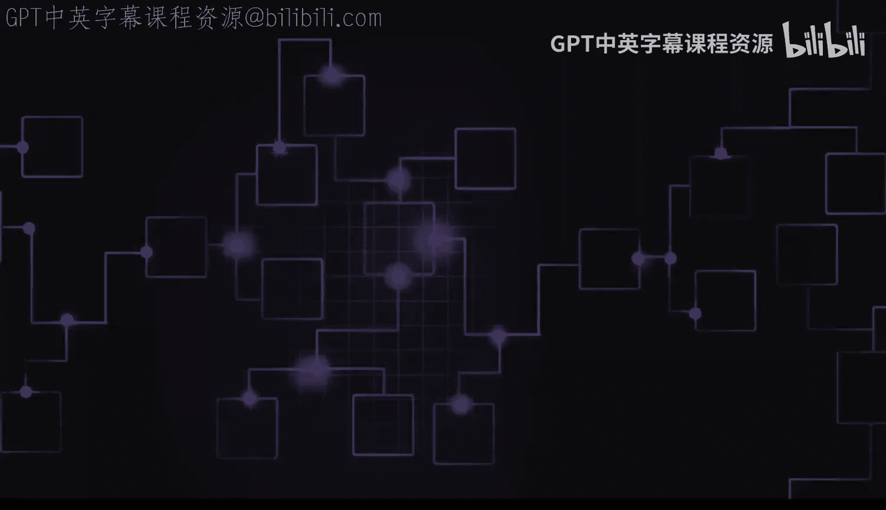
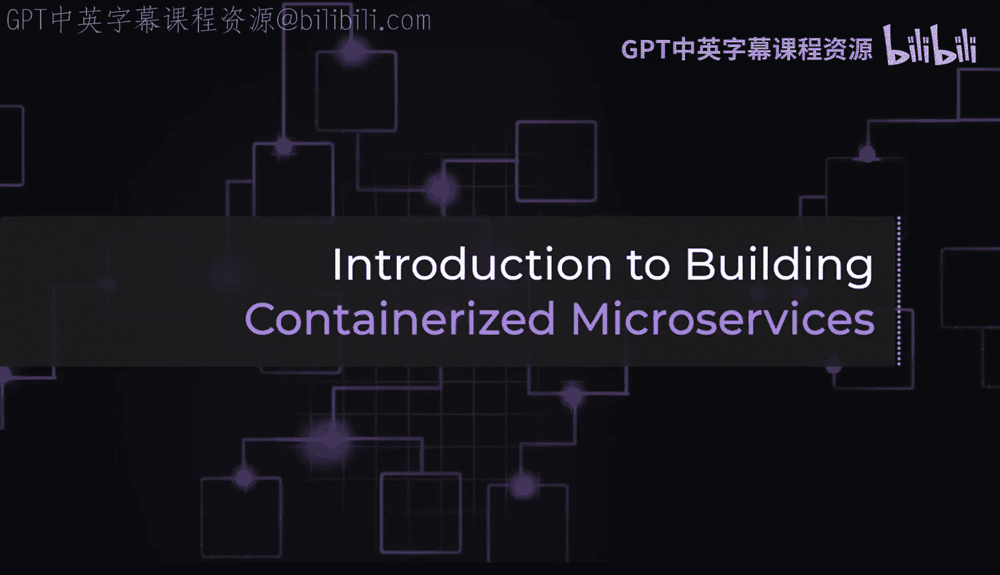

# 杜克大学｜Python、Bash和SQL数据工程基础2-4Python Bash and SQL Essentials for Data Engineering p156 22_03_02_容器化微服务构建导论.zh_en -BV1XS421X7tw_p156-

In this lesson we talk about microservices and containers。

 a match because of the concept of a function that you want to apply to a endpoint。

 but also map up the runtime， really that's the key concept is take this piece of logic。

 put it inside of the runtime as well as the source code when you package those together you're able to make a reproducible product that can deploy to many different environments including serverless environments like AWS Lambda and also you can use many languages like CSharp or Python。

 we're going actually take a look at both C sharpharp and Python and deploy microservices using these technologies let's go and get started。

