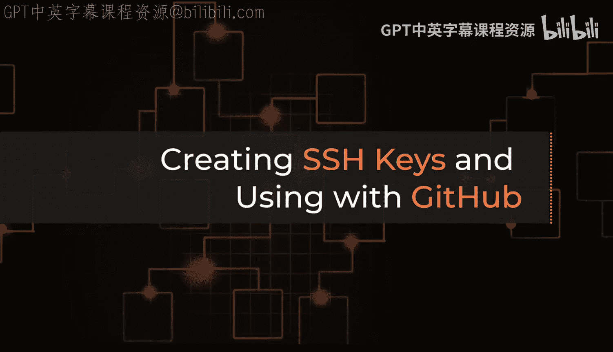
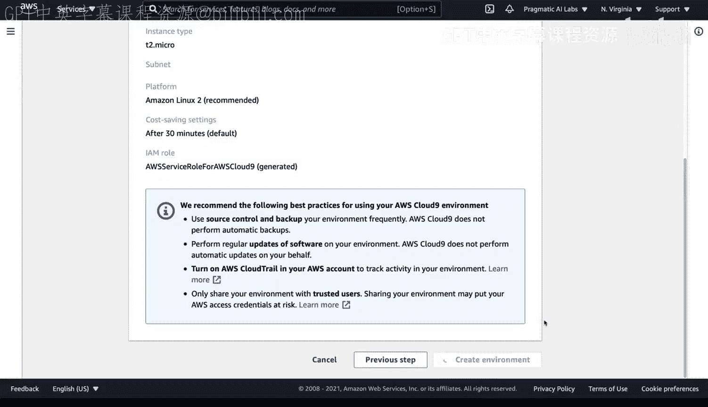
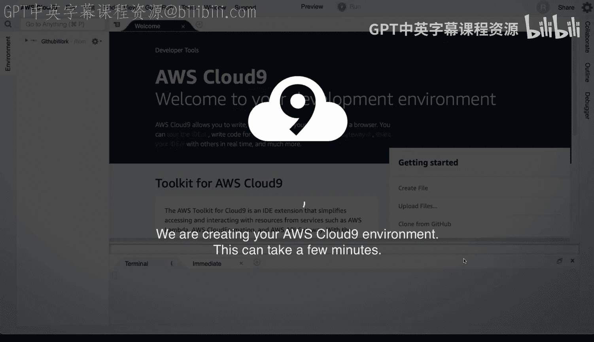
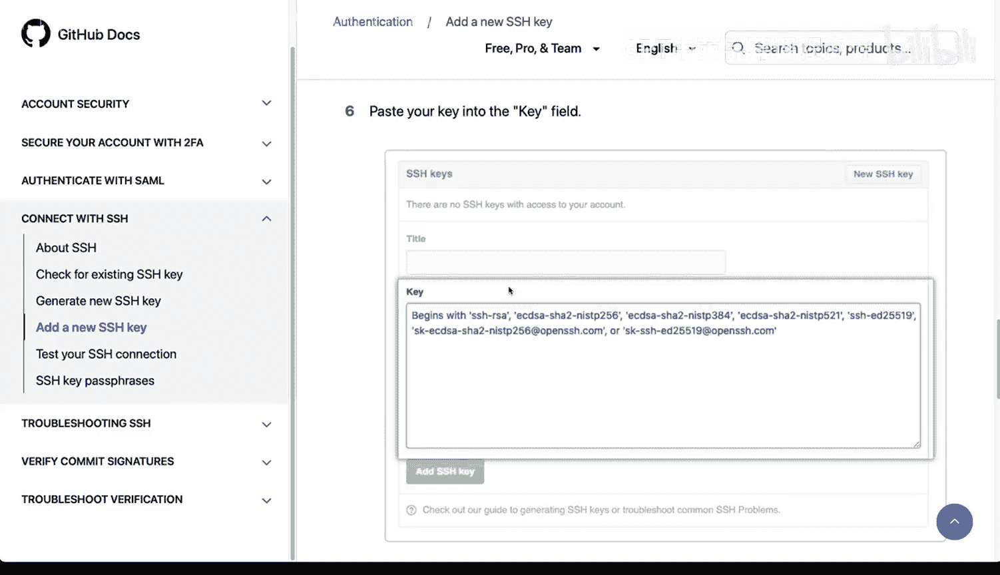
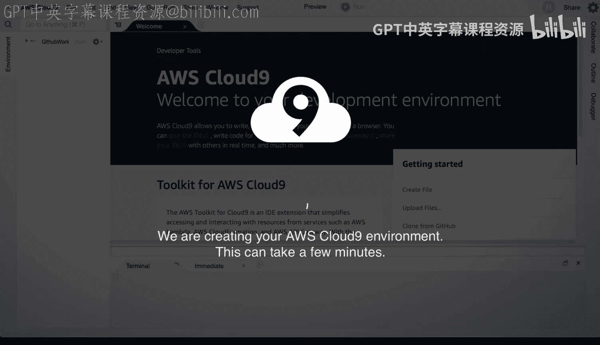
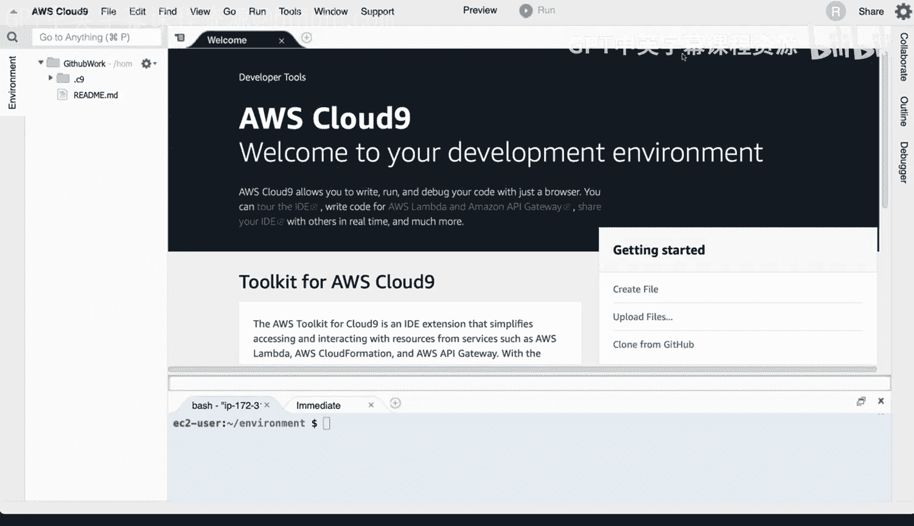
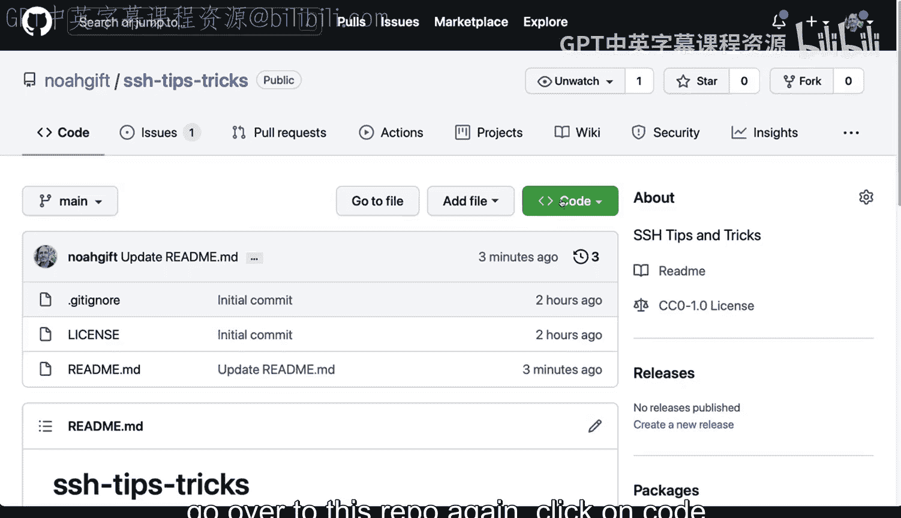
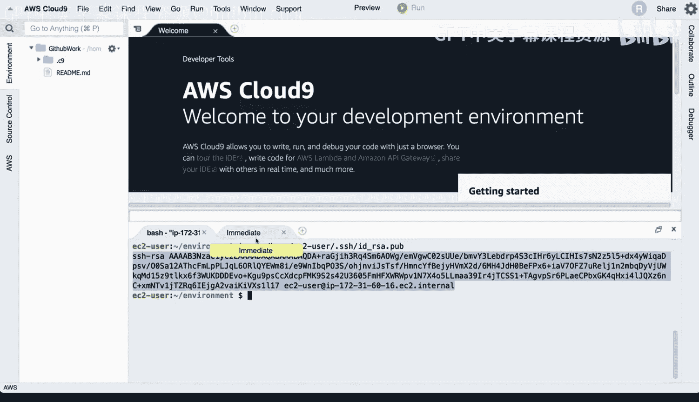
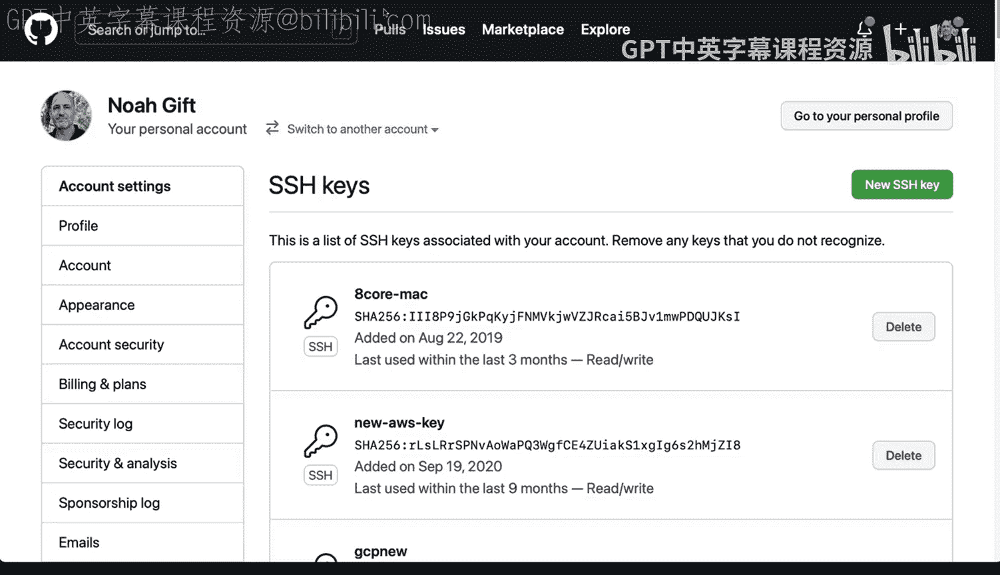
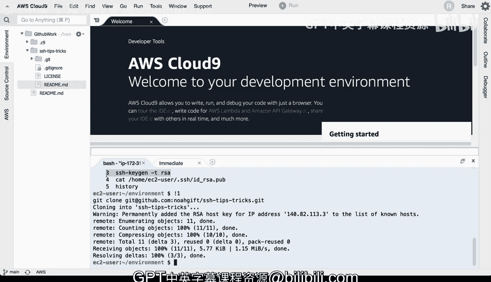

# 杜克大学｜Python、Bash和SQL数据工程基础2-4Python Bash and SQL Essentials for Data Engineering p16 16_01_04_创建SSH密钥并与GitHub配合使用.zh_en -BV1XS421X7tw_p16-

Let's look at this GiHub repository and see how we can connect to it and actually start working on the code。

 This is really a day one problem for people working on a data engineering project if I click on code here notice that it gives me this option of SSH Now this is the best method in my opinion to connect to GiHub because I don't have to use a password and authenticate back and forth and it's encrypted end to end is what most people use when they talk to a GiHub repo so how do we do this Well first we're going to need an environment so I'm going move over to AWS here。

And I'm going to use something called Cloud9 now cloud 9 is a cloud based development environment and it's very similar to other environments like GitHub code spaces or Azure Cloud show and we'll call this GiHub work。

I will edit my。Gitthub repo right this is a pretty common step here。

 and then I can leave everything default here right So this is Amazon Linux2。

 itll it'll time out after 30 minutes and it'll take me just a second and it'll spin up this environment for me。

 So the problem here， even though this is a great environment It's inside the Abu cloud。

 everything's ready to go is that I'm going to need to communicate with Github if I'm going to be reading and writing back to this repository。

 So again， if we go back here I'm going to want to read and write to this repository and do things to it。

 The only way I'm going to be able to do this is by creating SSH keys。

 Now let's look very briefly at the official Github documentation and have some good information here that says how to add a key to your repo in a nutshell。

 basically you're gonna to copy your public key。

And then you're going to add it into the settings。 and then under the settings section there's an icon here where you add it。

 And then that's all I need to do。 So we can do something very similar。 we'll go here。

 wait for this thing to wake up and then we'll create our own SS keys and then add those keys to our Github profile。

 Okay so we're set up here Now the first thing I would do is I would go over to this repo again。

 click on code this would work with any Github repo。 and let's try to check it out。

 Now this won't work and let's actually debug why so I can say get clone And if I type in yes。

 it says could not read from remote repository。 the reason for this is if we go into the dot Sage directory here。

 there's nothing available So we have no concept of SS on this machine。 So what do you do Well。

 you can type in this command SSH。

Hhen。Qiizhen。Dash T RSA。So this command will create both a public and a private key pair for you。

 and you're going to take the public key and you're going to copy it and paste it into GitHub。

Here we go， enter a file to save it， that's right home e2user。ssidsA。

We'll click returnturn again and now notice if I scroll up a little bit here。

 you have access to this repository。Here we go， I can type in cat and cat again is a UniX command that allows us to print out what's happening。

And this is actually publicly available， I could post this on the internet somewhere it wouldn't matter in this case I'm going to give it to GitHub so that they know who I am。

And if I copy this， I can go back to my GitHub account。

And I'm going to go over to the profile over here。And I'm going to go to settings。

I'm going to scroll down to SSH and GPG keys from here。

 I can create a new one and we can call this bash Duke Coursera。SSH， and I'm going to paste this in。

Once I paste this in， it's going to ask me to authenticate。

And now we're good to go so once I've got this set up。

 what's really nice is I can go through and use history。

If you remember this， history is our friend when you're using bash and I don't have to type in that same command again。

 I can just type in shift one， which is exclamation point1。And this will type in the Git clone again。

There we go and now you can see that we've actually got access to everything that's in that repository。

 so really it's a very straightforward process as long as you understand the steps。

 which is you need to have a public key here and you can actually create that using the SSH keyGN T RSA command。

