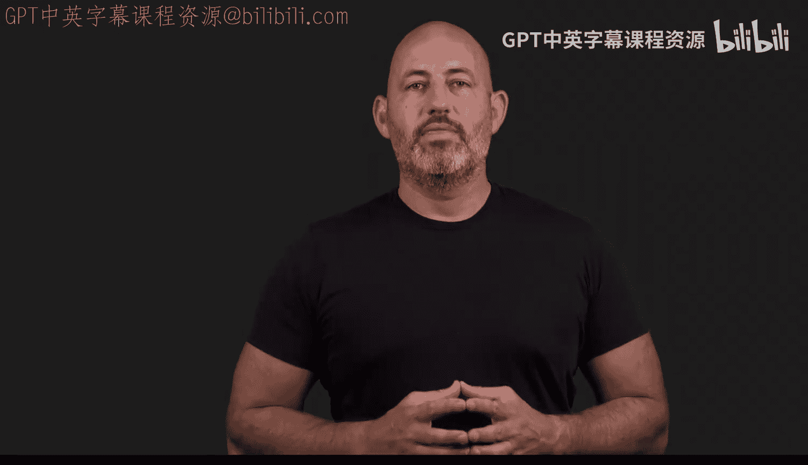
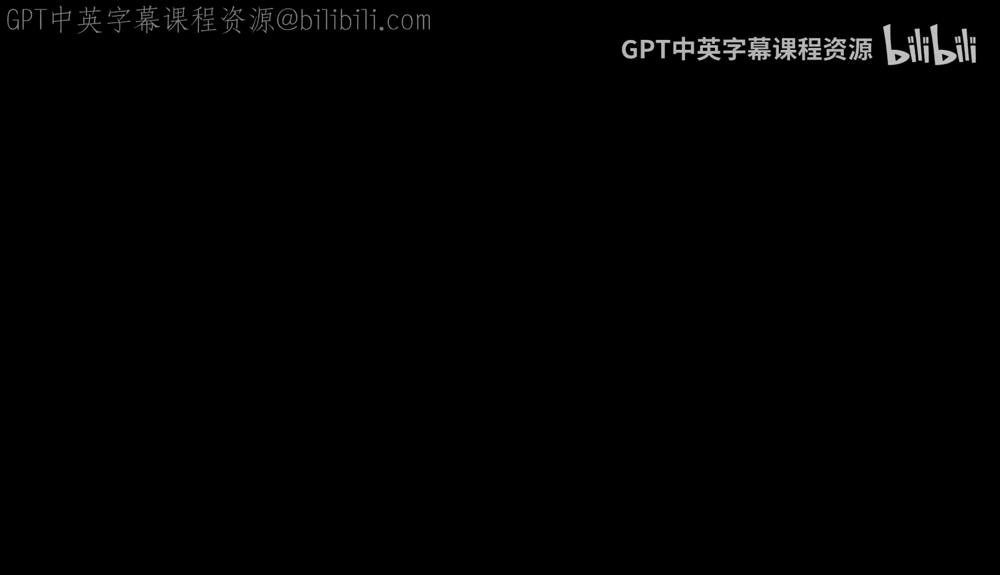

# 杜克大学｜Python、Bash和SQL数据工程基础2-4Python Bash and SQL Essentials for Data Engineering p160 26_04_02_Python打包与命令行工具导论.zh_en -BV1XS421X7tw_p160-

Welcome to click we're going to cover this week's material by diving into a command line tool framework that's very popular called click we'll first get into some of the advanced features of click。

 we'll also dive into testing with click and we'll also use some of the introductory techniques of click that can help you get started with just a function Let's go ahead and get started。

