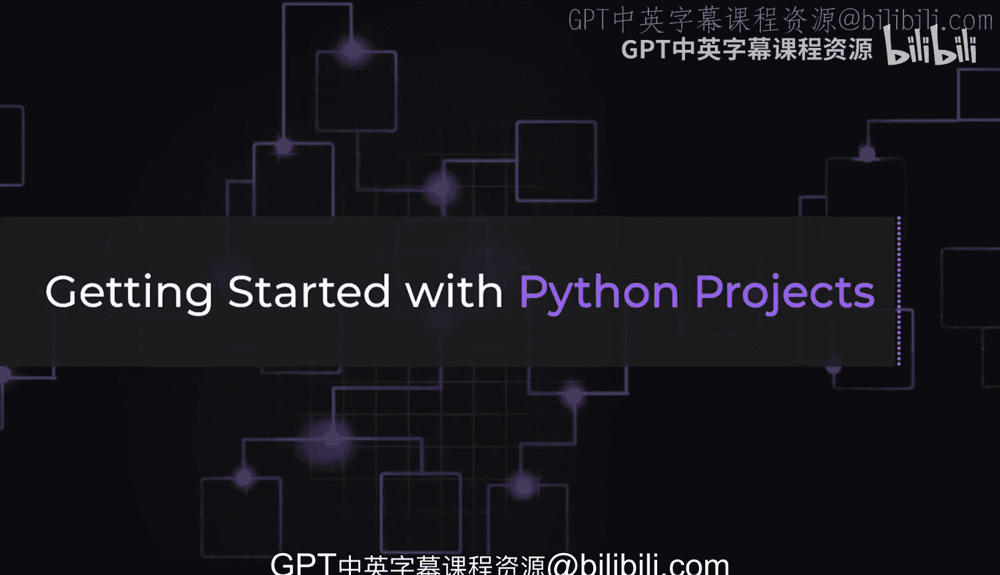
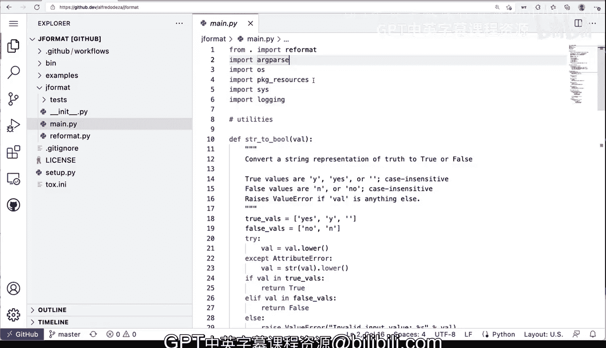

# 杜克大学｜Python、Bash和SQL数据工程基础2-4Python Bash and SQL Essentials for Data Engineering p162 28_04_04_Python项目初始设置.zh_en -BV1XS421X7tw_p162-

A Python project is useful because it gives you structure and structure brings order and why order is important because it sets the foundation for you to grow a project。

 Now it's very easy to get started with a single file in Python specifically because it's a scripting language。

But it can quickly get complicated when you need more files， more supporting files。

 what about a license， what about a readme， what about documentation and tests and other supporting files you want to have utilities or you want to declare dependencies What about packaging Well。

 that's all what a project is about So we're going take a look quick look at a project and walk through some of the components that you might find interesting So here we have a project on Github and it's called J format is a simple very simple Python commandline tool project and it has several directories。

 you can see there's a dot Github that is useful when you want to do some automation in this case that is setting a Yao file that is required by Github to do some automation on pull request This is not something that we're gonna to see right now but we' will see later and it allows you to test on every。

Now you may or may not need that or may or may not want that right from the get go。

 but it's useful to see why that might be there。 It also has a bin directory and inside of there this is optional as well because there are many different ways of doing this in Python this is a script that will allow us to install this particular script when we're packaging and distributing this project Now again。

 this is also optional because you can do it with setup the pie and packaging tools in Python which we will also be seeing later。

Examples is another thing that you might want to include with your project。

 where you might want to have something that some files where you can work with and say hey。

 like I I want to set some basics here some some examples， this is not very well documented。

 but it something that you might also see。Then you will have the Git ignore file。

 which will allow you to work more effectively with Git。

 ignoring certain things in specifically with Python。

 there's a lot of things that you might want to ignore and not get into version control。

A license is always a good idea in this case， we're using the MIT license。

 there's a to that II file that allows you to do some testing。This is useful。

 especially when running on the terminal locally on your computer and you want to run several different Python versions。

And then there's a set of API which allows you to do a little bit of packaging。

 which will also be packaging。 show you how to do packaging later。

 but let's get into J format itself tests is where you might want to put your tests inside a tool sometimes this is outside of the actual Python project at the root level right along with examples and Github workflows and then but in this case it's inside。

 it's up to you where to put it， there's no strict rule， sometimes when you're putting it here。

 it might imply that you're distributing your tests along with your project so that might be something desirable the underscore any is something that is very common。

 especially if you're gonna to make a project， a module。

 something that you're going import or you're gonna execute main D file is for command line tools is where you might want to put your main code like。

YourYour initial function or entry point to your script in this case we go all the way down here in line 42。

 you can see there's a main function that's fairly common and then finally you have a reformat that where it has some utilities sometimes you may find utilities but these initial structure allows you to have some defined order where you can put more things so if you wanted to put more tests you would go to test the test directory if you need more files or supporting files or even submodles here you could certainly do that as well you can see here in the main all the way up up to the top you can see on line one it's importing reformat from the top directory so that's it that's a basic project in Python that sets some structure in some order that we will be certainly using along these lessons。

