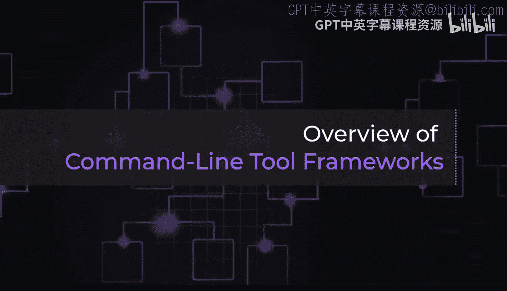
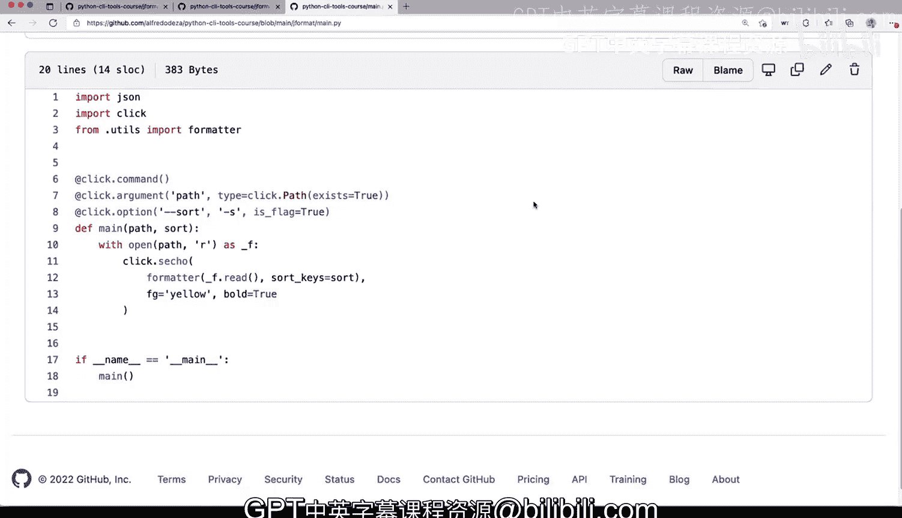

# 杜克大学｜Python、Bash和SQL数据工程基础2-4Python Bash and SQL Essentials for Data Engineering p163 29_04_05_命令行工具框架概览.zh_en -BV1XS421X7tw_p163-

Let's see some of the differences between the options that you have to build command line tools with Python。

 The first thing I want to show you is using Ss， the Cs module。

 So here we have an example of a tool that does some formatting of JN it receives the string and convertge that with theation it like formats it nicely So what it is's using is not using any framework at all its just using Cs and the way it uses it is by it's kind of like a cheat like it's trying to say checking the arguments on the command line。

 So that's done by cis that Rv so if that is equals to one then it gives you like this nice help menu So you can see that this is fairly manual is you're not getting any help menu for free and you have to sort of like do all these extra work here in line 29 it does a ci that exits zero to prevent from the tool from continuing execution。

And then it checks if there are some some flags by checking any arguments。

 So this is fairly complicated。 I mean， if the tool is very simple， then this is totally fine。

 but once you start getting into flags and to add in some more conditionals。

 then these cats gets very， very complex and error prone。

 So that is when you might want to step up Now the next the next one up is the same example。

 but using the arc parts framework。 Now this is an actual framework and arc parts comes with Pythons。

 there's no need to install anything。 arc parts allows you to distribute your tool and no need to install absolutely anything on any system you can just declare that you're gonna import arc parts and I mean you don't need to declare it as a dependency because it already comes with Python in the standard library Now arc parts requires some setup and you do get the help menu for free。

This is how you add some arguments。 And in this case。

 it's adding in a path and a dash dash sort flag。's it's using some constructs here to say that this is a true flag。

 a boolean flag and you can optionally set the help menu。

 and then you parse the arguments and then the arguments is becomes an object that is passed to the main function and then you start getting these attributes on the arcs object when the arguments are parsed to read them from that same object。

 So it involves a little bit more。Knowledge on how that works and and how you're reaching out to these values that get associated to the to the actual object。

 And finally， what we're going to see in this lesson is we are going to be using click。

 And you can see here that's the same the same example tool。 and it's much， much simpler now。

Click does this thing where you can add separates what is an argument and an option and we'll see that next and the only thing you need to do to define a function asline tool is to use these decorator on line 6 and then that's it line 17 ensures that these will get executed when you run it with Python on the terminal so those are the three ways there are plenty more but these are the three basic ways from the most simple to the one that comes with Python which is ourrc parts and to click which is external library and you will have to install it and declare it as a dependency of your tool。

