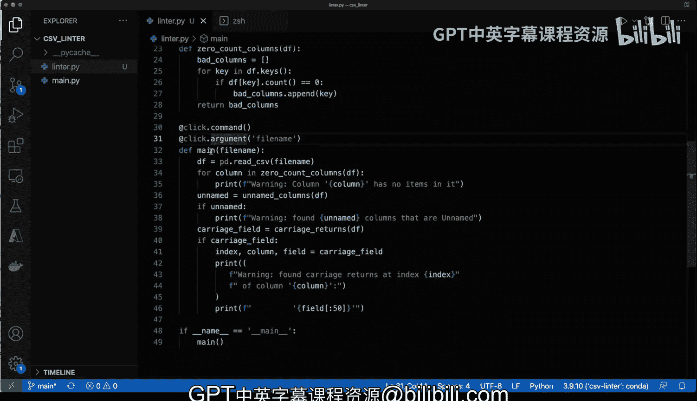

# 杜克大学｜Python、Bash和SQL数据工程基础2-4Python Bash and SQL Essentials for Data Engineering p164 30_04_06_使用Click构建命令行工具.zh_en -BV1XS421X7tw_p164-

Here we have an example of a very simple command line tool called Lter and this L will load a CSb file。

 will use pandas behind the scenes。 and what it will do is it will try to detect some defects。

 So the way we're gonna run it is' going to use Python then L that pi and then we're going to use the examples carriage。

 that CSb file。 So we're gonna to pass that path and it's going to run against that is going to load it and it's going to get some warnings。

's that's effectively it。 So this command line tool accepts a single argument。

 and this is how that looks。 Now the first thing aside from all the code that we have。

 we have some helper functions here。 this are not important right now。

 the most important thing right now is line 47。 What is this if underscore name equals underscore main mean that will allow these。

To make it a command line tool that you can execute on the terminal。 If this wasn't here。

 then main wouldn't run。 the main function wouldn't run。 So we're required to do that。

 Now we're going to use click the command line tool framework to make this better here we're using a trick where we're importing this and passing the last argument on the command line to the main function that's effectively the file name right here on line 31。

 So we're to make sure that we are importing click。

 you can see here it's grayed out because I'm not using it right now and then we're using pandas as well。

 but click is the important one and we are going to do a couple of things So instead of。

Running import this， we're just going to say we want to run main now you can see here that I'm not passing anything and I save that and when I make a modifications to the main function So the first thing in order to make a click command line tool is we need to use a decorator here that's what this is called and we're going to type in click command that makes this function a a part of or a functioning part of a command line tool。

And this is going to accept a single argument。 So we'm going to say click that argument。

 I're going to say file name。And I'm going to save that。 And so these string means， hey。

 I'm going to take a single argument called file name and you're going to pass that into my main function。

 So now let's see what happens when I run these on the terminal。

 So I'm going to go here to my terminal。And I am going to run my tool again。

And we get the same behavior。 However， we are now getting a couple of things。For free。

 if we're doing help。 we are going to get some helpful options here。

 We're gonna to get the usage and we're gonna get the options。

 Now this doesn't look like something to advanced， but it will allow you to do more complex things。

 So say， for example， here we're passing something that that says is's a file name but you wanted to use some flags we're getting a help menu we're those options would appear here。

 and these help menu would start getting populated。

 So you could still build from here and add more flags and options。 likewise。

 we don't pass any arguments。 we're gonna get error reporting for free。

 So here you can see that error missing argument file name。 So right away， giving some two things。

 help menu error reporting and it will allow us to add more options。

 So that's how you get started with click you import it and you decorate with click that command。

And then start passing some arguments which will get injected into the main function right there。

