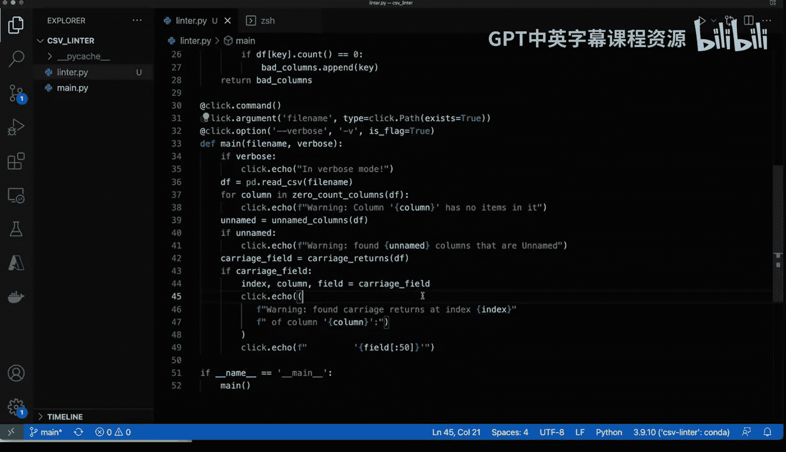

# 杜克大学｜Python、Bash和SQL数据工程基础2-4Python Bash and SQL Essentials for Data Engineering p165 31_04_07_探索高级命令行工具特性.zh_en -BV1XS421X7tw_p165-

Now that we have a click command line tool。 let's start enhancing our tool to be a little bit more friendly。

 So one of the things that you can do here is you can define the type for what you want to pass。

 So click supports saying hey I'm gonna pass a flag that is a path and I want to make sure that when I'm passing that it's make sure that it exists。

 So this gives you more and more thorough error reporting。

 So I've saved these already I'm going go back to my terminal。 So if I say for example。

 Python Li pi and then I pass some path CSB， So something that obviously doesn't exist。

 I'm going to get an error saying hey， this is an invalid valid for final name because the path some slash CSB does not exist。

 this is very useful for anyone using command line tools because it allows you to half and report do a very good error reporting where its。

Tling you exactly what you need and what's receiving why it's not correct and why what it would need instead instead we would need something that effectively exists。

 So that's something useful that doesn't take too much effort and it's sort of like a semi advanced option you can have Another thing that we didn't went into detail is that you can also have some options So we're going to do an option It's not going to do much but we're going to just put it here so that。

We can we can show you how how it works so I'm going to add an option in in click the click framework calls these options and we're going to say for example。

 verbos which is usually something that its done when you want increase the verbosity in the output we can give it a dash view for。

For something that， you know， like Anaalliaius， you can actually use this as analysisalius when I say E flag equals true。

So this is going to to say， well， this is going to be now a boolean。

 Now the one thing that you need to do is right here on main， you now need to accept。Berbose。

 so burbose is going to be past in。 And now we can say， if verbos。We can say， print。In burbose mode。

So we're going to save that and now this is going to do two things it's going to give us extra items on the help menu and we're going to be able to conditionalize our printing for more vervosity or two so we're going to go back to the command line。

And we're going to say Python Li。The pi dash dash help and you can see that now we have extra options and you see these dash B comm dash dash ver because we have alias both。

 so that means that both will do the same work。 So if we do Python Lipi and this time with something that does exist that should still work and then we can pass in a dash dash verse。

And we can see that you will get an inberbose mode， which is what we want。 Now， that's all good。 And。

 and that's great。 But you might want another advanced option that you might want to use is instead of using print statements like I've used here。

 you can use functionality from click called click E So click echo does the same work or or similar work come complies with the sameresponsibilities of printing。

 but it ensures that it will work everywhere。 So if you want to distribute your。😊。

Your tool on Windows systems as well as Linux and OS10。

 Well guess what this is a very good way of ensuring that your tool will work perfectly regardless of where your where it's being executed and additionally it will deal very nicely with with Unicode So if you have anything that is doing we Unicode you won't have to deal with those right here。

 click will take care of those that will not change our output here so if we run Python Li you can see that the output is the same that is just ensuring that your output will remain consistent regardless of the system where it's running。

 So that's it those are a few of the extra more advanced options that you want to use that click the path to ensure that the path exists more options that you can alias and that you can indicate that it's a flag and click that echo to support consistent reporting on the terminal。

