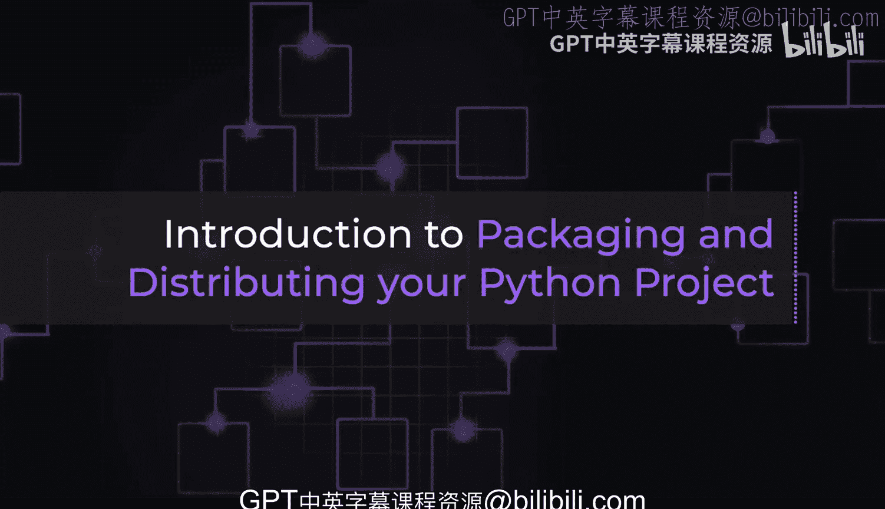

# 杜克大学｜Python、Bash和SQL数据工程基础2-4Python Bash and SQL Essentials for Data Engineering p167 33_04_02_Python项目打包与分发导论.zh_en -BV1XS421X7tw_p167-

There are two situations in which Python packaging might be useful for your projects。

 The first one is to declare dependencies， so we've seen before tools that are installing click。

 which is a command line tool framework so you might want to install that particular library and declare it as an external dependency that your users will need to install it Now that's one reason and the R1 is of course distributing your project。

 So once you're going beyond a single file that is doing some automation or some tasks that that you find useful and you want to distribute that to other systems or other users that might find that useful well it's time for packaging and in this lesson will take advantage of Python set of the tools and other libraries that will help you not only package your project but also register your project on the Python package index for easy distribution for anyone to install an。

Systems。