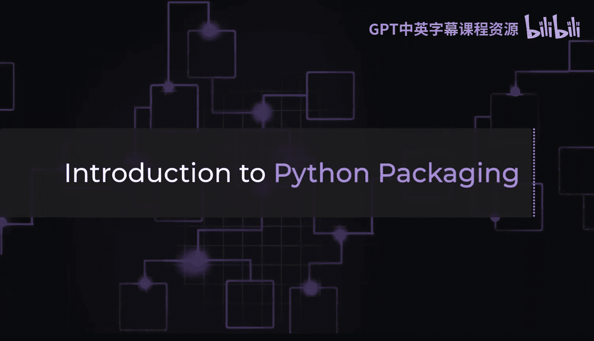
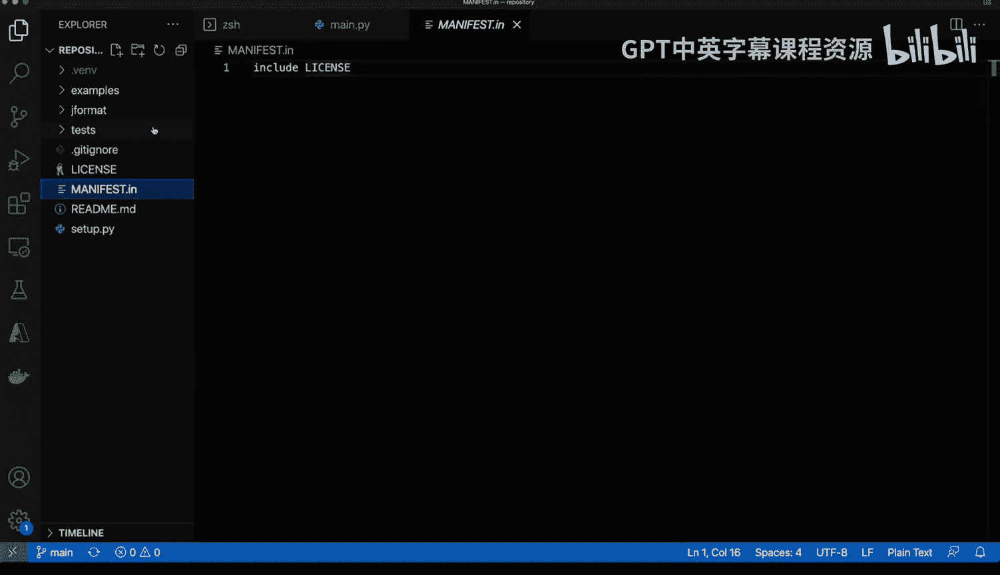

# 杜克大学｜Python、Bash和SQL数据工程基础2-4Python Bash and SQL Essentials for Data Engineering p168 34_04_03_Python打包技术入门.zh_en -BV1XS421X7tw_p168-

So here we have a small project that we've been seeing before and we have a terminal open here。

 but let's take a look at main Pi the editor is complaining that click that is being important here。

 it's not available。 So the first thing we need to do is to install click as a dependency but what we need to do and the first thing that you will have to encounter when you're working with Python projects that you want to deal with packaging Well that is going to be dealing with virtual environments virtual environments allow you。

To isolate the libraries that you will be installing for your project then those from the system and you can easily toss away these virtual environment once you're done。

 So one way to create these is using Python dash Vm And one thing that I like to do is use dot VM which is will create a hidden VM directory。

 I'm using the VM module to create that the ator in this case has detected that yes。

 I have created a virtual environment and I want to activate that you know in some situations。

 the aer will refresh and everything will be activated。

 but it's useful to note that you can also manually activate these virtual environment。

 In this case what we want to do is use source。That VM being activated。

 So this will you'll see here that the prompt has changed and now VM is over there。

 and now we can start installing dependencies。 In this case， we can do something like Python。

 If I do which Python， which is a nice way of verifying that the virtual environment has been activated。

 It will point to this path and not the one the one in the system Python。

 So that's that's the telltale there to identify something aside from being with the activated virtual environment and changing the prompt over here。

 So now what we're going to do is we're going to install we're going to install click and the way you can do this is by using Python dash M P install。

Click main tool。 So there you go。 Pip has been click has been installed by Pip。 So now if I go。

 if I go here， this will have to get reloaded。And， you know， you will have to do reload window。

 And once you reload that， the editor will recognize that click is now installed。

 So the reason why you have to reload is because the editor needs to know what virtual environment is activated。

 You can see all the way down below here that the。The virtual environment activated is this repository。

So now if you open， for example a new terminal and I say this。

 you can see that it will automatically activate that for us。

 so that is a useful feature of Python packaging and DC3 in particular VS code。

When working with Python， but there is more to packaging virtual environments are the first thing I you need to know but let's walk through a few of the files that you will be interacting with the first one is you've realized that I created a dot VM that appears here at the left and that is where the virtual environment all the dependencies and all of the things that you will install for this project will go but we have our project here called J format we'll have a few files we have a license file a read me where you might want to put some。

Documentation， which is fine， but there are some files that are particular to packaging in this case。

 a manifest that I and the manifest that I will allow you to when you're doing packaging to include certain files or exclude certain patterns。

 So for example， if you're adding supporting images and you don't want to distribute those you could add an exclude path here in this case we want to include the license。

 So that's why we're saying include the license here because that would not be normally include as part of a Python project。

 So if I go to set up a pi， this is the other thing that you might be working with。

 we will see next how we're interacting with setup tools but this setup file is a convention the naming of the files。

 a convention in Python so that you can distribute package your tool， your program your library。

 your project and then distribute it and upload it somewhere like the。

Python package index that we will also be seeing later。 So that said， you have a set of a pie。

 a manifest I N and a virtual environment with these three things。

 you will be able to work with packaging。

