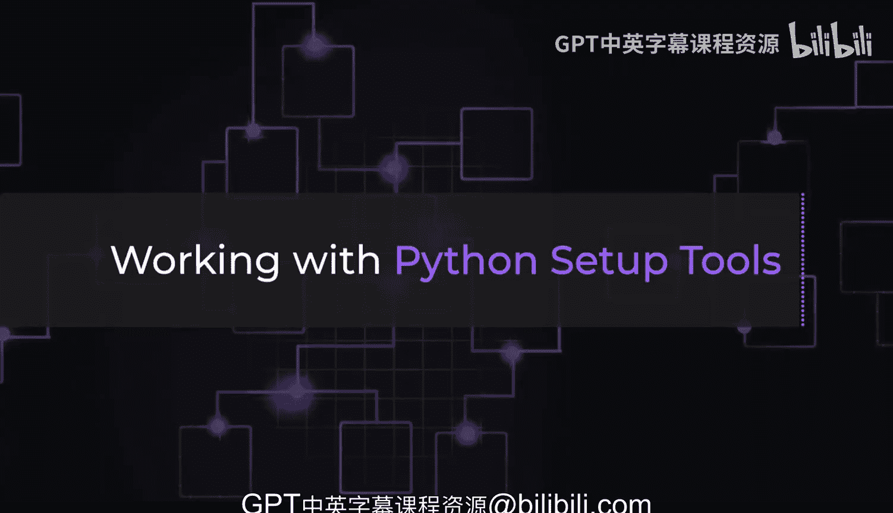
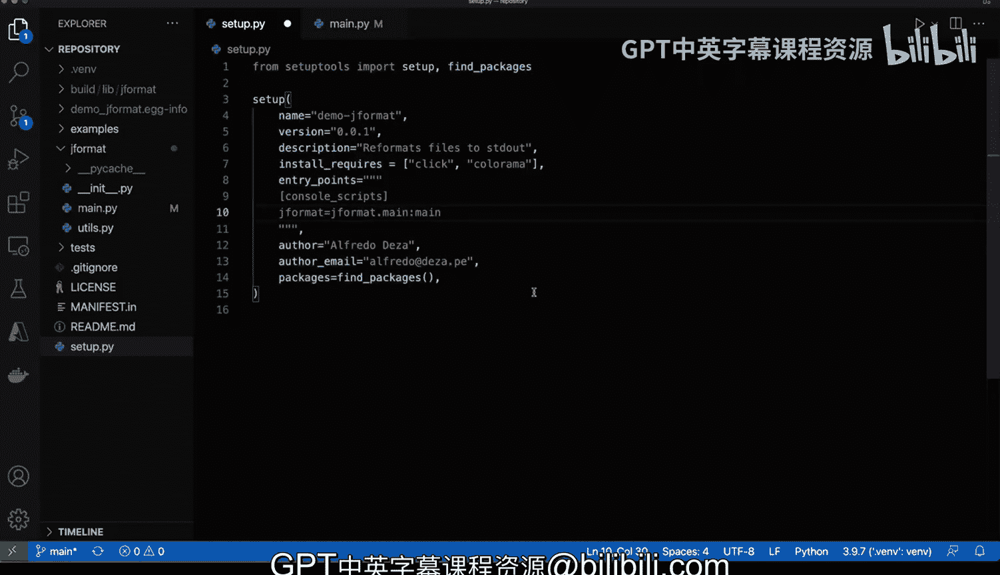

# 杜克大学｜Python、Bash和SQL数据工程基础2-4Python Bash and SQL Essentials for Data Engineering p169 35_04_04_Python Setuptools实战.zh_en -BV1XS421X7tw_p169-

So let's start working with setup tools。 The first thing that you need to in order to work with setup tools is to define everything in your setup up by file here。

 In this case， we have a R J format little command line tool here and we have with a fine a setup function we import that setup function from from here at the very top and then we import also find packages and I'll tell you why in a second So first you call this function with all of these attributes let's just go one by one in line for you define the name this is important because thats that's what users will use to install your package。

 So in this case they would do P install demo J format if it's installed or rather if it's available on a Python package index or some other registry。

 this is a name that they will use next the version。

 which is important to keep track of recent changes and different things that you might be releasing to your tool a short description。

Then some installation requirements in this case we want both click in colororama and you can also optionally define some some version constraints So this you could do something like71。

 that2， for example， if that's a version that you want or it pick the。

The highest version available for a click entry points iss an interesting one and it looks kind of weird。

 but effectively what it does is the find that this console script like a terminal tool called J format we'll use the J format module inside the main Dpi file which uses the main function if we take a look at J format。

 the module and then the main Dpi file and we open that we'll see that we have a main function over here so this is very useful because it allows us to produce command line tool just by defining the console scripts so it is kind of hard to deal with and makes sense of it because it's a text within some Python that looks like an ini configuration file but once you see that J。

For is the name of the script， and that is executing the J format module inside the main file and is with the main function。

 then it becomes clear。 So J formatmat that main and call on the function。

 Then the author author email allows you to register these and authenticate as yourself。 And finally。

 find packages。 It's a helper that will allow allow the the packaging tools to figure out where are these packages。

 Now that we know what each of these parts are for。 It's time to make use of them。 So。

Let's create a quick terminal over here。 Remember， we've already activated automatically our virtual environment。

 And what we're going do is we're going to use。We're going to use a helper for setup tools that will allow us to install these tool locally and so we can play with it。

 And the way we're going to do that is using Python setup up pi。

 So we're going to call our setup by file here that is going to execute this function and we're going to say develop。

Why develop Because once we run that and you can see there's a lot of output over here。

 once we run that it's going to install the J format command line tool in our path。

 in this case our project is called demo dash J format and that's the library name or the project name and it's going to make the J format work right here。

 you can see now there's a demo underscore J format thatig that info that's a link。

So now we do which J format we will have these executable。 So if we do J format dash dash help。

Now we're executing our little main function here。 Now why is this important， why。

 why Python instead of that P developed， which looks kind of weird because we are able to make changes here and immediately well get reported right here So if we say I think we can do help we can do help here and say。

Some help for S。 and we want to try that and we do help。

You can see that now that's reflected right there in option so you can develop here。

 you can develop on your source code and get those reflected right away on your on your terminal using your command line tool So these will allow you to work very well。

 and of course there's many different options and the thing that up set tools does with that little set a Pi file is that it allows you to do all kinds of different packaging things if you do set a Pi dash dash help。

There is an enormous amount of various different options that you can you can use。

 including build and install install will install it in a system and build will create a package。

 so if we do Ps instead of a Pi build， it will create a build directory that will create some of these some of these things that we will need so for example。

 if we go to build。Actually we can use our editor here。

 you can see that there's lots of different things inside build Lib， J format。

 all of our packages and that's effectively what the building does it prepares everything so that you can upload that and distribute so that's all you really need to know for packaging。

 of course to get started at least because of course packaging in Python is super complicated。

 it can be very complex it can be very difficult but this foundation will allow you to build a command tool。

 create an executable and distribute your project which well see next。

