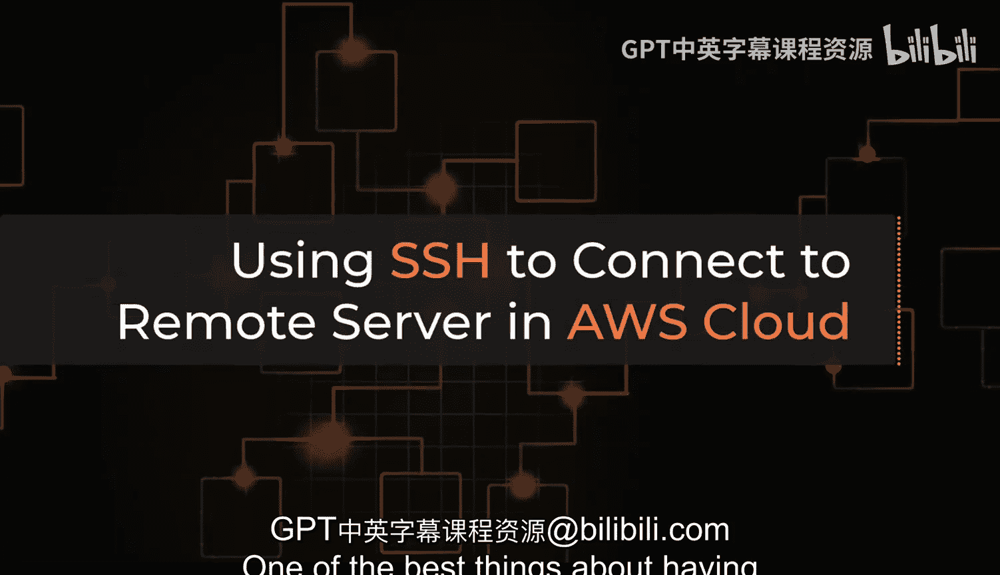
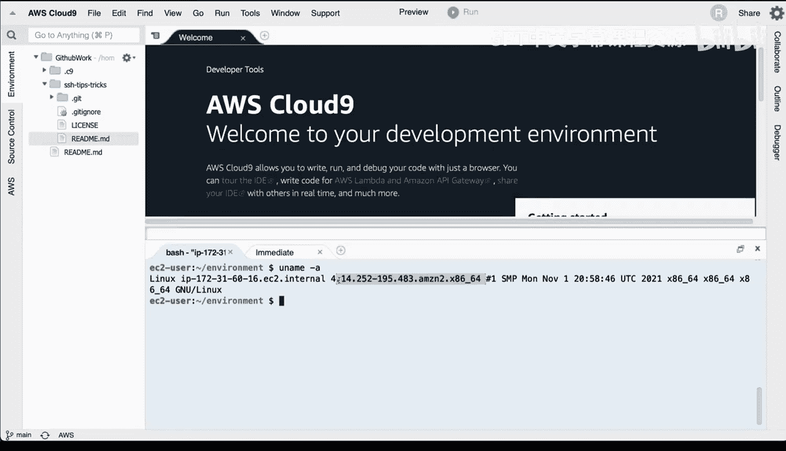
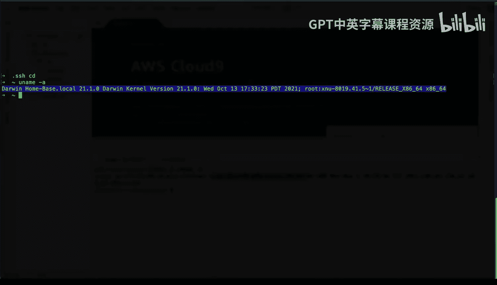
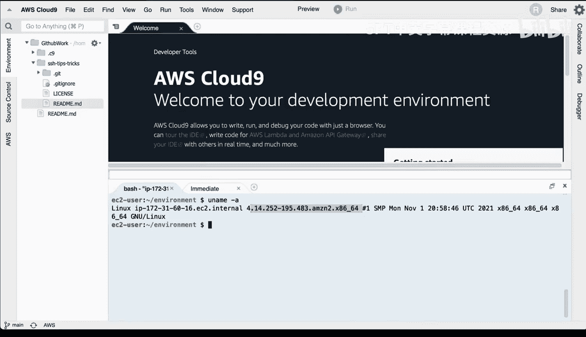
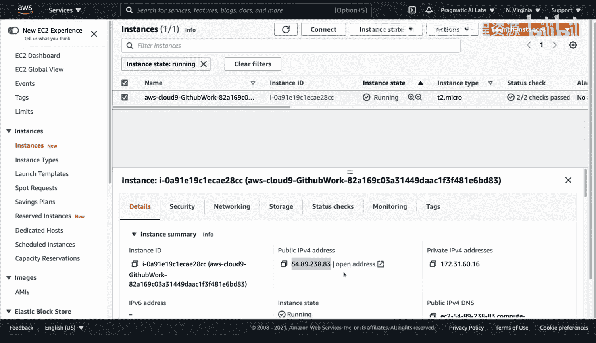
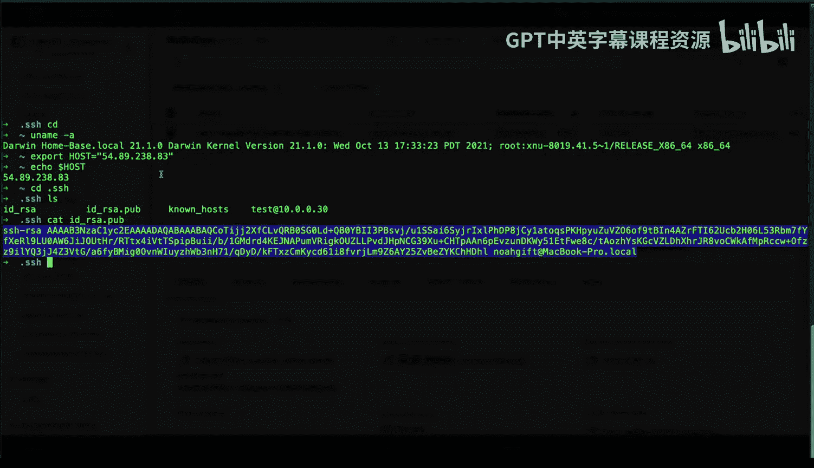
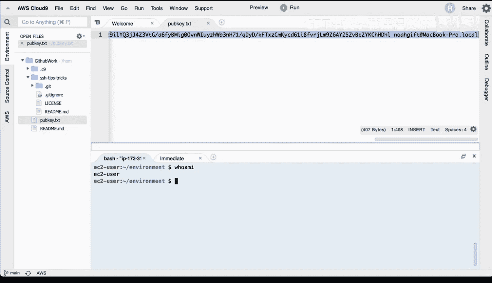
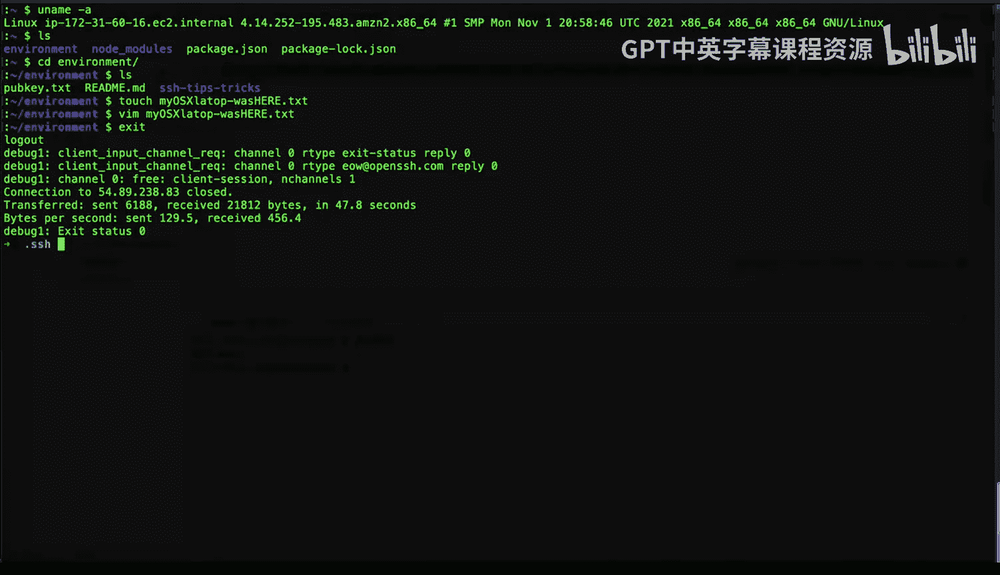
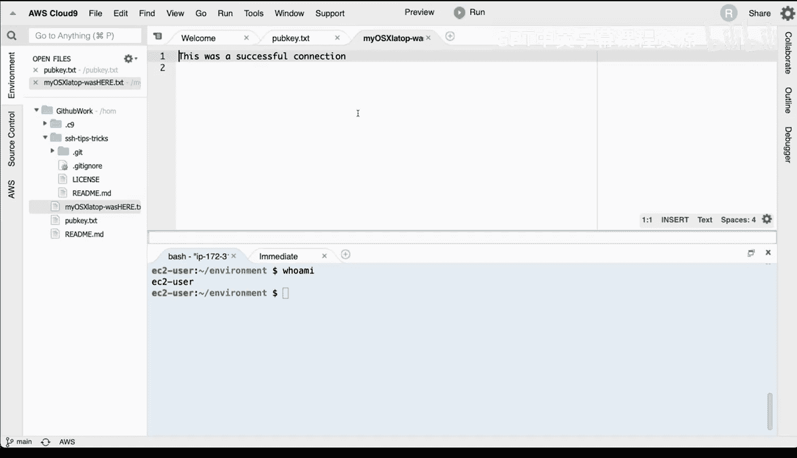
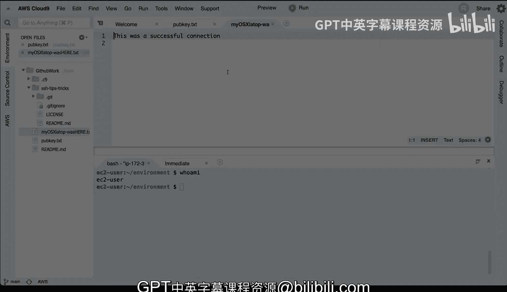

# 杜克大学｜Python、Bash和SQL数据工程基础2-4Python Bash and SQL Essentials for Data Engineering p17 17_01_05_使用SSH连接AWS云远程服务器.zh_en -BV1XS421X7tw_p17-

One of the best things about having a cloud based development environment is that it's all set up with the tools that I need and it's also inside the location where I have fast access to other servers。

And in fact， if I type in， for example， a command like this， you name dash a， you can see， in fact。

 it tells me that it's running Amazon Linux。 So I know I'm on on a traditional machine。 Now。

 if I toggle to， for example， a other location。

Here and I type in you name a。 this is my OS10 desktop。

 You can see that this is a completely different operating system Now。

 how would I get my local desktop to be able to communicate with that remote server and run commands。

 Well we can do this via SSH So if I go back here what I'm gonna need to do is open up a port so that I can connect to this remote server。

 So I'm going go over to AWs here and I'm going to going to go to EC2 and this is a section where I can see all my running servers and look if I scroll down here。

 I can clear filters and I can look for instance states there we go。

 I've got one that is my cloud9 environment and if I click on this。

You can see under the security settings here that I could actually enhance this so that the security groups themselves allow me to communicate with it so how would I do this I would need to go edit inbound rules and notice that this SSH connection here I don't have to add a rule that says SSH and I think an easy way to start with would be anywhere right and I would say 0000 so this says allow my OS10 machine。

To communicate。I add a little note to myself and then I can go ahead and say save changes Now how would I now communicate with this machine？

We're not done because all this does is open up the port I'm going to need to know a couple more things。

 so first if I go back to this machine again， I'm going to need to know what the public IP address is so I can communicate with it so that's the first problem。

Fortunately， I've got that right here， so I'm going to go ahead and copy this IP address。

And once I've copied that IP address， I can go back to my terminal。

And I can actually just put this in and in fact， this is a good idea is I could actually create a variable called hostst。

And just put it inside of here so I don't have to know keep remembering it。 Now。

 if I type in echo dollar sound host here right now， I've got this as a variable。

 the next thing I'm going to need to do is I'm going to need to go into my dot SH directory。

And you see this again has this public file because I've created SSH key pairs before。

 if I just type in cat IDrsa。pub。There we go I've actually got this information set up and I can copy this and go back to this server and actually set up this connection so I can go into here and actually paste that value so let's actually create a file here real quick that says you know pubkey。

 Txt。

And we'll just put this over here so I can get to it when I need to。 There we go。 It lookss good。

And let's look at the documentation for AWS Now notice what it says it is under cloud9。

 how would we actually set this up， it's going to go through and say how to create an SSH environment and make sure that you first have it launched set it up and if we scroll down here we've done all this stuff and we scroll down a little bit more that the big thing that we're going to need to do is we're going to need to copy this into authorized keys section here and so fortunately this is fairly straightforward we can actually go through and actually put that into this directory so let's go through here and type in Vim。

Tilda。ss authorizedize keys just like this， and we can actually put additional keys right down here below。

And this is why having some experience with VI is really helpful。

 and I can actually go through here and just type in set， paste， this allows me to paste。

The SSH key here。And let's just double check we've got everything correct here， this says SSH RSA。

We are missing one S here。Let's just make sure we've got that up。Here we go。Go up here。In fact。

 I can just start over again， that's probably a better way to do this and just copy this whole。

Code here， paste it in perfect。 Now I can go through here and say quit Now。

 now that I've got that set up here， it should be allowing me to connect to this remote host。

 And the only thing I need to know is。knowBaically who am I right so it says EC2 user。

So I can go back to my shell now。 And in theory， we we we we should be able to connect。

 So if I type in echo。

Dollar sign host here excuse me the host I would type in the command SSH dash V。

 this allows me to see the verbose output and then we would type in the host and I can。

Go through here and do this， and then I can type in as well at the very beginning here， the username。

 which would be EC2 hyphen user at。Now， if we get lucky， it'll allow us to connect。 Okay， here we go。

 it gave us this big verbose output。 It says， are you sure you want to connect？We do and here we go。

 this is really amazing if I type in you name。Dash A。Again， we see this is now Amazon Linux。

 but let's double check that we're really on the right server。

 This is one of the powerful things about using SSH。Is if I go into this environment here。

 notice that I could do whatever I want， I could say my OS 10 laptop。Was here， there we go。

And we could even edit some things inside of there。

 and I could just say this was a successful connection。Okay。

 let's go ahead and close this out and in fact I can also exit。

And then once I go in exit， let's go back here and let's see， oh， look at this。

 we can see that that file was actually successful。

 so you can see how using SSH allows you to really open up a whole new world。

 In fact you can shell into machines， you can shell into clusters of machines。

 and this is a very common and advanced technique to talk to cloudbased machines。

