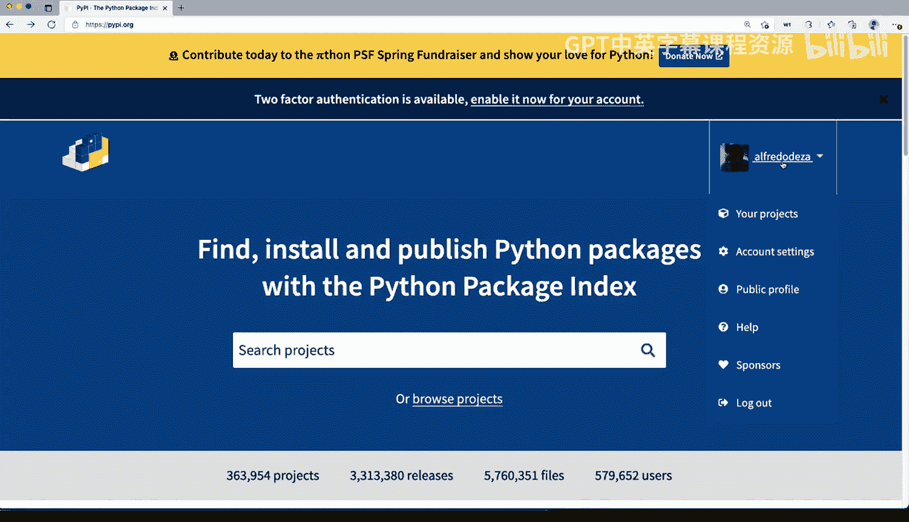
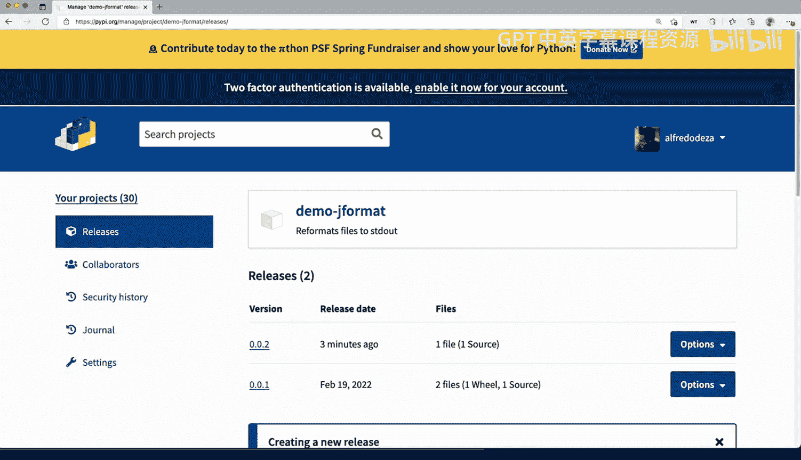
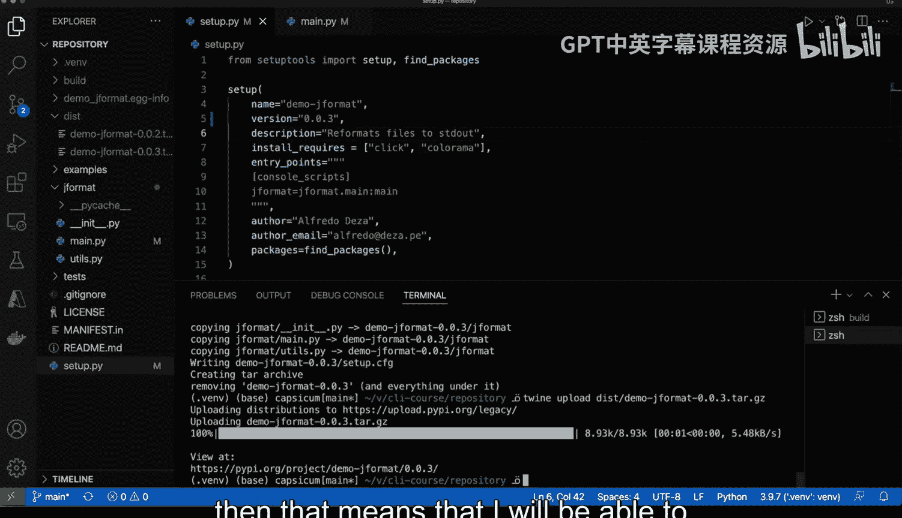
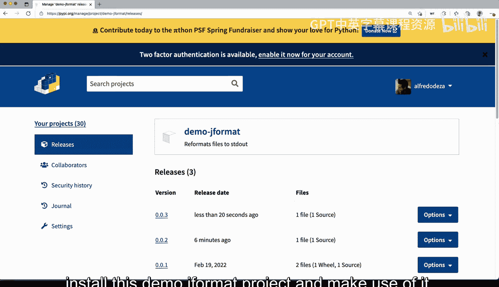
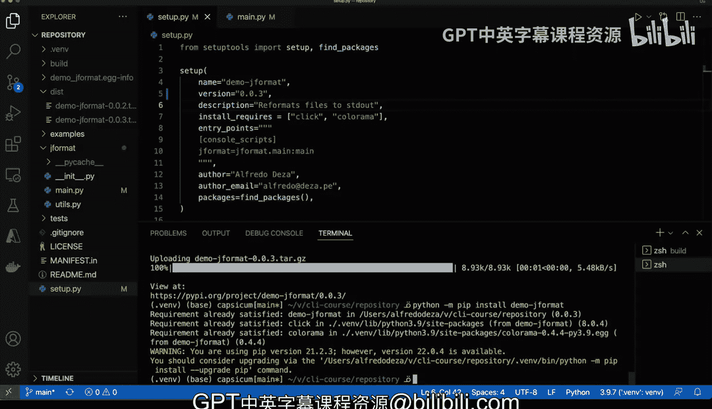

# 杜克大学｜Python、Bash和SQL数据工程基础2-4Python Bash and SQL Essentials for Data Engineering p170 36_04_05_上传至Python注册中心.zh_en -BV1XS421X7tw_p170-

So now you're ready to distribute your project and push it to a registry somewhere ideally it will be something like the Python packageage indexex ppi。

org and you will need to have an account ready for you in this case I've created this Alfredodessa account is my account you will have to follow the prompts if you want to do something like that once you log in you will have your projects available to you in this case you can see that I've been I have several ones and in this case the demoj format project which I've been playing around with has been recently released so if I click manage you can see that there has been a couple of releases and you can definitely have a good control of what's been uploaded over there but how does it look like when trying to upload Well the thing that you need to do and what is recommended right now is that you。

To。Create a source distribution。 You can also do a wheel distribution and upload that。

 we can try we can try creating a source distribution and the way you do that is Python set the pi S this and that will create a demoj format0 that's0 that2 and it will create that inside this disk directory here。

 So we will see here that we have a file。 well， it's a Tgc file。

 that's what S this means it's a source distribution that means that it's a TGc。

 so it's not compiling anything if you need to compile something you might be using wheels wheels Python wheels or some type of compiling system but a source distribution works well and it will work in many different various systems。

 Now once you have that the way the way you upload is first or register that and upload package for distribution is you must use this tool called Te So I'm going to do Python dashm。

Instal twine。 And once twine is installed， it will allow you to have your。Have your package uploaded。

 but it will prompt you for your username and password unless you have a unless you have a home directory Ppi RRC with your credentials。

 Now I have that file， It has my username and my password， but in any case if you don't have that。

 it will prompt you for your credentials， we can which you can input in the terminal。

 So I'm going do L disk and you can see demo J format is there。

 let's see what happens if I try to upload a package that has already the same version。

 So I'm going to lose twine。Upload， and I'm going to do this。And demo J format。

And it is going to complain now， sometimes。The the errors are not very good。

 but in this case it is and it says file already exists。

 so I can't really use the same the same version。 So I need to bump the version right so I'm going to go here to my set of a pie。

 I'm going to change this to to three。0ro that0 that 3。

 and I'm going to have to runy Python set of pi as this again。

And in this case it's going to create demo dash J format 0 that's0 that3。

 and I'm going to be able to do P twine upload SDD or disk rather demo J format the version3 So once I do that will'll use my credentials on Ppi IRC and then that means that I will be able to go to to go back to the Python package index and I'm going to reload these。

And that。 and you can see that version that 0，0 that 0 3， less than 20 seconds ago has been uploaded。

 Now， what does that mean， Well， that anyone anywhere in the world will be able to install this demo J format。

Project and make use of it。 So if I do Python dash M tip， install demo J format。

You will see that it will allow you to install that now in this case we already have it installed so we won't try to go and fetch it。

 but this is pretty useful and is the way how you would not only upload but also verify that it's in the Python package index and then allow others to install your tool from the Python package index。

