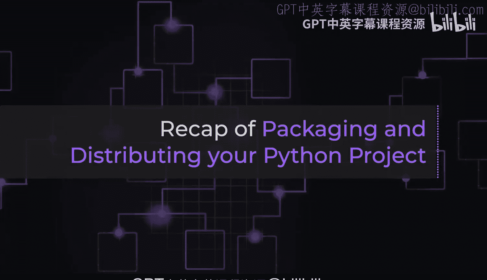

# 杜克大学｜Python、Bash和SQL数据工程基础2-4Python Bash and SQL Essentials for Data Engineering p171 37_04_06_Python项目打包与分发总结.zh_en -BV1XS421X7tw_p171-

So we've covered a lot of different things regarding packaging today and we went from simple walkthrough on important files that you might be seeing when packaging your project from setup tools and functions and the set up a the manifest that I aim to include or exclude certain paths all the way to putting together your project。

 running it， using a virtual environment and using Twine to upload and register your project。

 register a new version so that other users can install it from anywhere in the world while you're making use of these distribution channels for your Python project so now this should allow you to have like a good foundation on how to get any project。

 package it and distribute it。