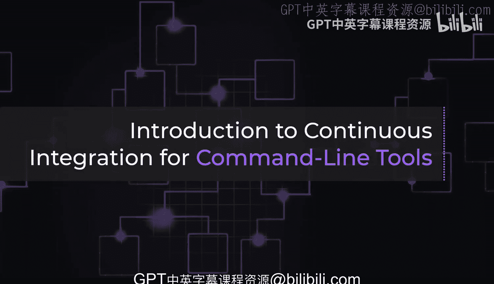

# 杜克大学｜Python、Bash和SQL数据工程基础2-4Python Bash and SQL Essentials for Data Engineering p172 38_04_02_命令行工具持续集成导论.zh_en -BV1XS421X7tw_p172-

Continuous integration for command line tools and any project really is an essential part of creating a robust piece of software in this case will cover several aspects of continuous integration but in the end it will help you to easily maintain your tool or any tool really that you're doing software development in this case in particular command line tools and will enhance the confidence that you feel at the time that you're trying to release and that you're trying to make changes to your application。

